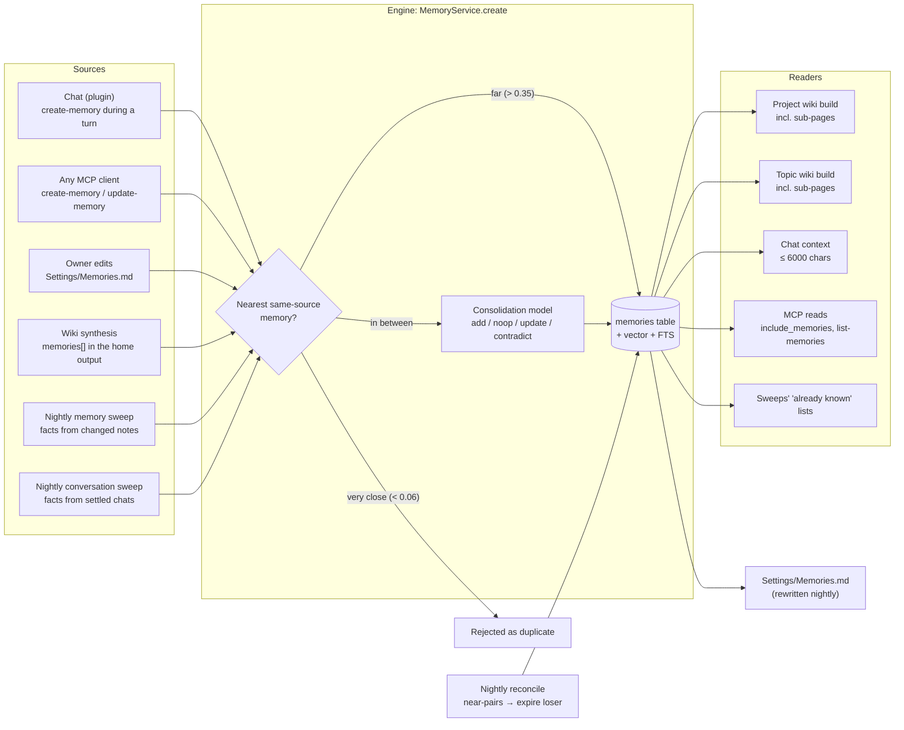

# How memories work

A plain-language map of where memories come from, how the Engine keeps them, and who
reads them, with one real wiki build traced end to end. Written for #289 on
2026-11-01 against `main` at `7835df1b`. Gaps found along the way are filed as #297–#300.
Last checked against `main` at `2b58e3c9` on 2026-11-16.

## The short answer

- **What a wiki build is fed (since #297):** the owner's own memories (newest 50), plus
  up to 40 about its subject. Those are memories scoped to the project or topic node or
  its wiki home, then memories drawn from its evidence notes, then memories naming it
  (title, aliases, linked companies). A project build takes its evidence memories most
  specific first (#551): those from notes filed under the project, the project's own note
  first, then notes filed under the fewest projects, before the rest of the evidence
  memories, newest first. Before #297 every build got the same newest 50, whatever they were
  about; the trace below shows what that did.
- **Where they show up:** `## OWNER MEMORIES` and `## MEMORIES` blocks in the planner,
  adjudicator and home prompts, and in every sub-page prompt (project and topic).
- **Do they change what a page says?** Yes, as context. A memory changing doesn't trigger
  a rebuild or mark the wiki behind (it isn't part of `evidence_hash`, by decision); the next
  build sees it. With `projectHomeProvenanceEnabled` on (default off), each memory line is
  recorded in the home's and sub-pages' provenance.
- **Who else reads them:** the Obsidian chat on every turn, MCP callers that ask for them
  (`include_memories` on `get-node` and `project-evidence`, or `list-memories`), and the
  sweeps, to skip what is already known.

## The flow

## Where memories come from

Every create goes through `MemoryService.create` in the Engine
(`packages/engine/src/memories/service.ts`), which requires evidence (a note, a
conversation, or a curation run) and deduplicates against live memories **from the same
source and scope** (a node-scoped memory is only compared with memories on the same node).

| Path | Triggered by | Model | Caps | Stamped with |
| --- | --- | --- | --- | --- |
| Chat (plugin) | The chat model calls `create-memory` in a turn | Chat model | — | source `chat` (by prompt instruction), evidence `conversation` ref `<id>#<message>` |
| Any MCP client | A `create-memory` / `update-memory` call (claude.ai, Claude Code) | Caller's | — | Whatever the caller sends (claude.ai's are `claude`), except that an OAuth-flow client may not create `curator` or `owner` memories (service tokens and local callers may). It may update, retire and purge them; what it writes is marked `changed_by` with the client (#532) |
| `Settings/Memories.md` | The owner adds a `new:` block or edits one; ingested on a file event or at boot | — | — | source `owner`, evidence = the Memories.md note |
| Wiki synthesis | Any project or topic build, if `memoryWriteEnabled` (default on); the home output may carry `memories[]` | The home model (no extra call) | `memoryWriteCap` 3 per build | source `curator`, scope = the wiki home, evidence `curation-run` |
| Memory sweep | Nightly, after wiki work, if `memorySweepEnabled` | `memorySweepModel` (else `model`) | 50 extraction calls, 10 facts per run, 3 per note | source `curator`, scope `vault`, evidence = the note |
| Extraction run | The Curator's `extract-memories` tool, over notes a caller chooses (#659); shares the sweep's ledger and call | `memorySweepModel` (else `model`) | The run's own dollar limit, which also pays for the Engine's consolidation checks; 3 facts per note unless the run asks for up to 10 | source `curator`, scope `vault`, evidence = the note |
| Conversation sweep | Nightly, if `conversationSweepEnabled` (default off) | `conversationSweepModel` (else `model`) | 5 facts per run, 2 per conversation | source `curator`, scope `vault`, evidence `conversation` (bare id) |

**Consolidation.** This is the path when the Engine has an embedder and a consolidation model
configured. Without an embedder it only rejects exact-text duplicates (with a
`MEMORY_DEDUP_DEGRADED` warning); without a consolidation model, near matches are just added.

When a new memory is close to an existing one of the same source and scope (cosine distance 0.06–0.35),
the Engine asks `memoryConsolidationModel` whether to:
- **add** it;
- **noop**: nothing is written, the existing row comes back;
- **update**: new row, old one expired as superseded. Only for a new memory that says everything
  the old one says, because only the new text is kept;
- **contradict**: new row, old one expired as contradicted. Only when the old one is no longer
  true, not when both can be true at once.

The model sees each memory's source note: its title, its date and up to five projects it is
filed under (#412). It is told that memories from notes under different projects, accounts,
people or products usually state different facts, and to add when unsure. Since #607 a new
memory that repeats an old one and adds a detail counts as an update; add is for when keeping
only the new text would lose something the old one says.

If both memories come from dated notes and the new memory's note is the earlier one, an update
or contradict verdict adds the memory and keeps both. The memory sweep works newest note first,
so during a backfill the "new" memory is usually the older fact. A contradict verdict also keeps
both when the two notes have the same date, because nothing says which one is right. An update
on the same date stands, because it has to cover everything the old memory says. The date is the
note's `date` field, else the last date in its title. An old memory drawn from a chat (the
conversation sweep's) is dated by the day it was written, which is when the chat said it, so an
older note's fact does not replace it either. A new memory from a chat is never held back, so a
correction made in chat still replaces a note's memory. The nightly reconcile applies the same
rule to a contradictory pair: a chat-drawn loser is dated by its write, and a survivor with no
dated note is not held back.

Closer than 0.06 is rejected as a duplicate; further than 0.35 is just added. Any failure
falls back to add. The model's `valid_at` is kept only when it parses as a date, and is
stored as a UTC ISO timestamp.

A memory drawn from a dated note is dated by that note (#706): its `valid_at` is the note's
day, or the model's date when it gives one that is not later than the note's day. A note dated
ahead of today gives today. Chat memories keep the model's date or the time they were written.

A memory added because the call failed is flagged in `memory_consolidation_pending`, and the
caller gets a `MEMORY_CONSOLIDATION_FAILED` warning. The Curator's memory sweep stops if the
warning says the Engine's key has hit its spend limit, and leaves the remaining notes for the
next run. Its summary and the journal show how many memories that run added without merging,
and how many are flagged in all. `replay-memory-consolidation` makes the decision later, for flagged memories or for
every live memory created in a time window:
- It goes in id order, comparing each memory with the older live memories of its source and
  scope, using stored vectors, and applies what create would have done. A repeat is expired as
  `duplicate-of:<id>`; an update or contradiction expires the older memory, unless the note
  dates rule it out as they do in create. That keeps both and counts as `kept_both`.
- It runs in the background (`start`, `status`, `stop`), and one failed call leaves a memory
  flagged. Three failures in a row stop the run, which `after_id` resumes.
- `dry_run` is the default and changes nothing, but its model calls are paid, so dry-run a
  sample with `limit`. It tracks what a live run would expire and the fields it would edit, so
  later memories in the run see them, but the verdicts are still an estimate, because the model
  can answer differently. Spend is recorded on the Engine's account.

The consolidation call is recorded against whoever asked for the memory, through
`create-memory`'s `usage` argument. The Curator passes its run, so the call counts in its
ledger and its daily cap. Chat passes its conversation. A caller that passes nothing leaves
the spend with the Engine. The Curator counts a noop as "already known", not as written.

**Retiring without creating:**
- **Nightly reconcile:** asks a model about near-identical pairs among the newest 1,500 live,
  embedded memories, whatever their source or scope, and expires the loser (`duplicate-of:<id>`
  or `contradicted`). The model sees each memory's source note (its title, its date and the
  projects it is filed under), or `valid_at` without a dated note, and is told that memories
  from different projects, accounts, people or products are usually distinct (#412). A
  contradiction expires nothing unless the survivor's note is later than the loser's, or a
  date is unknown. Otherwise both stay, and the pair is ledgered as `kept_both` until either
  memory changes.
- **Re-verify** (memory and conversation sweeps): expires facts the source no longer
  supports (`evidence-changed`).
- **Node deletion:** expires memories scoped to or evidenced by the deleted note
  (`source-deleted`). The exception is `Settings/Memories.md`, a rendered view of the store:
  memories written or edited there record it as their evidence, but deleting it retires none
  of them.
- **`expire-memory`** calls.

**Cost** (from `usage-report`, read 2026-11-16; every call below went to OpenRouter):

| Purpose | October 2026 | 9–15 November 2026 |
| --- | --- | --- |
| Memory sweep | 124 calls, $0.32 | 145 calls, $0.39 |
| Reconcile | 104 calls, $0.04 | 152 calls, $0.14 |
| Conversation sweep | 1 call, $0.0007 | none |
| Engine consolidation | 142 calls, $0.28 (estimated) | 159 calls, $0.94 |

October's consolidation calls went to the Auto Router (`openrouter/auto`), which recorded no
charge, so their cost is the Engine's estimate from charged calls (#398). Since #298 the
calls are counted against whoever asked for the memory, so most of November's sit under the
Curator. 1–8 November held the one-off memory-backlog run and the consolidation replay: 1,769
memory-sweep calls ($5.65) and 2,586 consolidation calls ($11.19).

Wiki-synthesis memories ride on the home call and cost nothing extra.

## How the Engine keeps them

- **One row per version.** The `memories` table holds:
  - content and category;
  - `source` and scope (`vault`, or `node` + `node_id`);
  - evidence (kind, node, hash, ref);
  - bi-temporal fields (`valid_at` / `invalid_at` for the world, `created_at` /
    `expired_at` for the record);
  - `superseded_by` and `expire_reason`.

  Every content change writes a new row and expires the old one. There is no project
  column; project scoping is node scope.
- **Newest first means newest `valid_at` (#706).** Lists, a project's set, `include_memories`
  and the chat order memories by when each became true, with `created_at` only breaking ties.
  So a fact from a 2021 meeting read today lists with 2021, not ahead of last week's facts.
  `backfill-memory-dates` (preview by default) gives the memories written before this their
  notes' days by the same rule; each change is kept in the memory's history and `undo: true`
  puts the old dates back. Wiki prompts show a midnight-UTC date as that day in any zone.
- **Searchable two ways:** a vector per memory (`memory_embedding_vec`), and FTS over
  content and category. A memory created while the Engine ran without an embedder gets
  its vector at the next start that has one (`MemoryService.backfillVectors`), and a
  reactivated memory without one is embedded as it comes back. `list-memories` searches the
  full text with `query`, or by meaning with `search_mode: "semantic"`, which leaves out
  memories past `max_distance` (default 0.45) and falls back to full text without an
  embedder (#560).
- **A project's memory set:** `list-memories project_of: <node id>` returns the memories
  drawn from the project's own note or from notes linking to it, for each project the node
  is filed under, most specific first: the project's own note, then notes filed under the
  fewest projects, then newest (#413, #414).
- **What a memory is about (#554):** its subjects, links to notes of the vault map's entity
  kinds: its person, company and project kinds, unless `entityTypes` lists the kinds (to
  add a pet, list `[person, company, project, pet]`). `create-memory` and `update-memory` take `subjects`: note titles, aliases,
  `[[links]]` or note ids. A name is matched by the note's vault path, then its title, then
  its aliases. A name no such note answers to is kept as a name and matched once one does;
  a name several notes answer to is ambiguous and links to none of them until the owner
  names one by title or path. A one-word name ("Dana") links to a person's note by its
  title or alias only when the memory's source note is that note or links to it, whenever it
  is matched, so an old memory about another Dana never joins a Dana note made later; a
  path, a note id, and a name the owner types in the memory note are exempt. Companies,
  projects and other kinds match one-word names freely ("Acme"). `list-memories subject_of: <node id>` returns the memories
  about a note (with `include_superseded`, their earlier versions too). Every memory result
  carries `subjects`. A new version, and a memory that replaces another (merge verdicts,
  `expire-memory superseded_by`), carry the old one's subjects; a note merge moves them to
  the kept note. The nightly sweeps give each memory they write its subjects, by full
  name. The vault map's `ownerNote` names your own person note, which is never made a
  subject except by your own edit.
  `backfill-memory-subjects` (no model, preview by default) gives each memory with no
  subjects the entity notes its text names by title or alias (a one-word name only
  through its source note), plus its source note when that is one; `clear: true` takes
  them back out. The Curator's `guess-memory-subjects` then asks a model about the live
  memories still left with none, and about those the free match tagged, for the names it
  missed (preview with a sample first; its own dollar limit; it only adds, and its undo
  takes back what one run wrote).
- **Nothing expires by time.** A memory stays live until something expires it. Expired
  rows stay readable:
  - `get-memory`, and `list-memories` with `include_superseded`;
  - `as_of` time-travels;
  - `get-memory include_lineage` walks the supersede chain;
  - `get-memory include_history` lists in-place changes (`memory_history`): each
    reactivation with the expiry it cleared, and each category, metadata or subjects
    edit with the values it replaced.
  - `list-memories evidence_conversation` finds a conversation's memories in either ref
    format (`evidence_ref` stays an exact match).

  Hard purge is `expire-memory purge:true confirm:true`.
- **No undo** for memory changes. Content history is the chain of superseded rows; the
  rest is `memory_history`. A purge deletes both.
- **`Settings/Memories.md`** is a projection of every memory, live and historical,
  rewritten once nightly by the Curator (or by `refresh-memory-note`). Edits there flow
  back:
  - a content edit versions the memory;
  - a status edit expires or reactivates it;
  - a `new:` block creates an `owner` memory;
  - removing a block does nothing.

## Who reads them

| Reader | What it reads |
| --- | --- |
| **Project wiki build** (`home-evidence.ts`, `wiki-memories.ts`) | `owner`: newest 50 vault-scoped. Then, any source, up to 40 about the project: scoped to the project node or wiki home (20 each), drawn from the build's evidence notes (`list-memories` `evidence_node_ids`; first those filed under the project, with `project_of`, most specific first, so a summary note filed under a dozen projects no longer fills the limit ahead of the project's own meetings (#551), then the rest newest first), matching the project's title, aliases or linked companies as an FTS phrase, or, last, drawn from the semantic gap-fill notes the build also shows. A name matching more than 25 memories (an employer, say) selects nothing. Rendered as `- [category] content` under `## OWNER MEMORIES` and `## MEMORIES`, after caller corrections and before signals and tasks. Seen by the planner, adjudicator, home and sub-pages. A non-owner memory over 1,000 characters is cut and marked; owner memories are never cut. A `memory_limit` omission is recorded when the limits leave memories out. |
| **Topic wiki build** (`topic.ts`) | The same selection, named by the topic's title and linked companies (not its aliases), without the project-set and gap-fill steps (a topic is no project); also reaches topic sub-pages. |
| **Caller-requested page** (`requested-page.ts`) | The project build's selection, with the notes the request's search found standing in for gap-fill (#313). Shown after the request to the planner, adjudicator and home, and appended to the page's own evidence. On a project wiki, dated, sourced and newest first, with the pairs nothing has settled, as a project build shows them (#631). A recoverable request freezes them, the pairs too, so a resumed attempt shows the same ones. On a topic wiki the heading names the topic, and the lines are dated and sourced as a topic build's are. |
| **Home or page refresh** (`refresh-wiki-page`, `home-refresh.ts`) | A home refresh selects as the project build does, and its memory proposals are saved like a full build's (#299). A sub-page rebuild takes the requested-page selection, with the notes its own search found standing in for gap-fill, dated, sourced and newest first as a project build shows them. |
| **Chat context** (`chat-core` `memories-provider.ts`) | `chat`, `curator`, `owner`, `claude`: newest 50 vault-scoped each, plus 20 each scoped to the open note. Then the memories that name the open note as a subject (`subject_of`: up to 30, any source; a person's or a company's, #554) and its project set (`project_of`: up to 30, any source, most specific first; #413, #414). Preferences, corrections and rules first, then those about the note, then the project's, then the rest, newest first within each, cut on whole memories at 6,000 characters. The model can also call `list-memories`. |
| **MCP reads** (`bearing.ts`, `list-memories`) | Only when asked (#560). `get-node` and `project-evidence` with `include_memories`: memories scoped to the node or drawn from it (the chat's four sources), then those naming it as a subject (any source, #554), then its project set (any source). Preferences, corrections and rules first, then the node's own, then those about it, then the project's, newest first, up to 6,000 characters, with `memory_stats`. Each names its source for the caller to open; neither counts toward `evidence_hash`. `list-memories` finds memories by words or by meaning. |
| **Memory sweep** | Newest 100 `curator` + 100 `owner` vault memories as "already known"; the note's earlier facts for re-verify. |
| **Conversation sweep** | An FTS search per conversation, plus earlier facts by conversation ref. |
| **Reconcile** | `list-memory-near-pairs` (pairs among the newest 1,500 live, embedded memories), up to 200 pairs, then `reconcilePairCap`. Each member carries its note's date, title and projects. |
| **Not readers** | `query-nodes`, semantic note search and the org sweep don't read the memories table; `get-node` and `project-evidence` read it only with `include_memories`. |

## One real run, traced

Project names and identifiers are left out here, per [repository safety](repository-safety.md); the counts are real.

**Project A: an on-demand first build on 2026-10-31.** Reconstructed with `list-memories
as_of` at the run's start:

| Read | Returned |
| --- | --- |
| `owner`, vault, newest 50 | 0: there are no owner memories |
| `owner`, scoped to the project's wiki home | 0 |
| `curator`, vault, newest 50 | 50 of 923 live, all extracted in the previous two and a half days |
| `curator`, scoped to the project's wiki home | 0 |

- **Relevance:** of the 50, **2 are about Project A**. Those are also the only Project A
  memories that exist; they made the cut because they were one and two days old. The
  other 48 are about other accounts and product rules, and go into every wiki's prompt.
- **No memory written back:** the build wrote no memory scoped to the home (none exists,
  even counting expired ones).

**Project B: a nightly build the same morning**, for contrast:
- 6 Project B memories existed, all from the two months before.
- The newest 50 at that moment covered only the previous two days, so **none of the six
  reached the build**. It got 50 facts about other accounts instead.

## Gaps filed

- **#297 (fixed):** wiki builds were fed the newest memories, not the project's; node scope
  meant only the home page; chat memories weren't read; sub-pages saw none. Memory changes
  still don't trigger rebuilds, by decision.
- **#298 (fixed):** accounting. Noops were counted as writes. Consolidation spend had no run
  reference, sat outside the Curator budget, and was unpriced in October (priced since the
  model moved to Qwen3.7 Plus on 10-31).
- **#299 (fixed):** prompts promised memory actions the model can't take (react to
  `contradict`, ask for updates by id); ids are no longer shown. Home refresh dropped its
  memory proposals; it now saves them. Owner memories have their own heading.
- **#313 (fixed):** caller-requested pages saw no memories.
- **#346 (fixed):** when the Engine's key ran out mid-backlog, 976 memories were added without
  consolidation and nothing but the Engine's log showed it. Such memories are now flagged, the
  caller is warned, the memory sweep stops on a spent key, and a replay tool repairs them.
- **#300 (fixed):** record gaps. `valid_at` is checked (#311); deleting Memories.md no
  longer retires the memories edited there (#316); reactivations and in-place edits keep
  what they replaced; vectors are backfilled; `evidence_conversation` matches both
  conversation-ref formats (the conversation sweep still re-verifies only its own facts,
  by exact bare id); OAuth-flow clients can't claim the `curator` or `owner` source.
- **#532 (fixed):** a memory keeps its source across updates, so an `owner` or `curator`
  memory rewritten by a chat client still read as its source's own words. Updates, expiries
  and reactivations by an OAuth-flow client are still allowed, and now set `changed_by` on
  the row they write; tool results and Memories.md show it. Such a client can no longer
  write Memories.md as a node, where a `new:` block would have become an `owner` memory.
  The Obsidian chat's model gets the same rules: the plugin marks the calls its model
  makes, and the Engine treats a marked call like a signed-in chat client's.
- **#352 (closed):** consolidation and reconcile merged memories from different projects or
  accounts that read alike. Merge decisions and reconcile now see each memory's source note
  (#412). `list-memories project_of` gives a project's memory set, which the chat reads for
  the open note, and the chat now reads `claude` memories too (#413). The set lists the
  most specific notes first (#414).
- **#551 (fixed):** project builds took their evidence memories newest first, so summary
  notes filed under many projects filled the limit. They now take them most specific first.
- **#560 (fixed):** an MCP caller reading a note got none of the memories about it unless it
  searched `list-memories` with matching words. `include_memories` and semantic search now
  give them.
- **#706 (fixed):** a memory from an old note was dated the day it was written, so a bulk read
  of old notes (the nightly sweep's backlog, a #659 extraction run) pushed recent memories out
  of wikis and chat. Note memories are now dated by their notes, and newest first reads that
  date.

With #297, facts the November memory-backlog run extracted from a project's notes reach that
project's wiki, through the evidence-note selection, instead of crowding every build.
