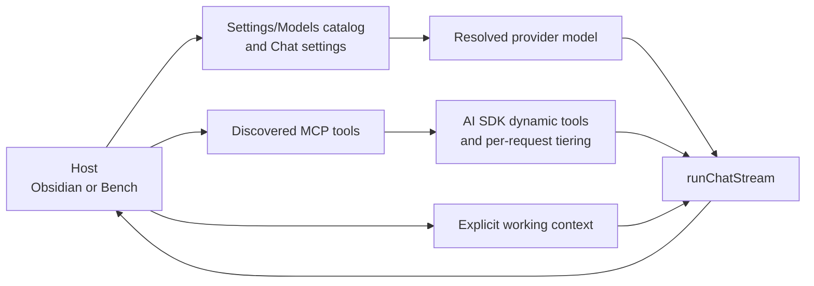

# @vault/chat-core

`@vault/chat-core` is the host-agnostic model loop shared by Vault Engine chat
surfaces and the replay benchmark. It owns provider dispatch, Engine-tool wrapping,
tool tiering, context assembly, visualization and board interpretation, title flows,
usage mapping, and the streaming AI SDK loop.

The package does not render React, open MCP connections, persist conversations, or
know about Obsidian. Hosts inject models, tools, messages, settings, and callbacks.

## Chat flow



`runChatStream()` returns an AI SDK UI-message stream. The host decides whether to
adapt it to HTTP, consume it in process, persist final messages, emit visualization
parts, record usage, or map errors for the UI.

## Minimal composition

```ts
import {
  SYSTEM_PROMPT,
  TIERING_SYSTEM_NOTE,
  composeSystem,
  createToolTiering,
  resolveModel,
  runChatStream,
  wrapEngineTools,
} from '@vault/chat-core';

const model = resolveModel(catalogEntry, providerKeys);
const engineTools = wrapEngineTools(discoveredTools, engineCall);
const tiering = createToolTiering(engineTools);
const requestTools = tiering.forRequest(messages);

const stream = runChatStream({
  model,
  system: composeSystem(
    `${SYSTEM_PROMPT}${TIERING_SYSTEM_NOTE}`,
    assembledContext.text,
    undefined,
  ),
  messages,
  tools: requestTools.tools,
  prepareStep: requestTools.prepareStep,
  maxSteps: chatSettings.maxSteps,
  onComplete: (finalMessages) => persist(finalMessages),
});
```

The example omits host-specific transport, context, usage, and visualization callback
wiring. See the Obsidian plugin's `src/chat/in-process-transport.ts` for the production
composition.

## Provider and model behavior

The model catalog uses four providers (`MODEL_PROVIDERS` in `@vault/settings-registry`):

- Anthropic
- Fireworks
- OpenRouter
- OpenAI

`providerAvailability()` derives what a surface can run from that surface's own keys.
`resolveModel()` takes one catalog entry and those keys, and fails clearly when the
matching provider key is missing. It never silently switches provider or model.

Hosts may inject a custom `fetch`, which the Obsidian plugin uses to route streaming
provider requests through Engine's allowlisted relay.

`runChatStream()` asks Anthropic to cache the conversation on every step. On Claude
5-generation models (`claudeThinksByDefault()`), which think when the request leaves
`thinking` out and hide that thinking by default, it also asks for summarized thinking
so the chat can show it as it streams. Other models get no thinking setting: on older
Claude models it would switch thinking on.

## Tool wrapping and tiering

`wrapEngineTools()` converts MCP discovery results into AI SDK dynamic tools. Each
execution returns the parsed Engine envelope plus `_ms`; transport failures become a
failed envelope so the loop can continue coherently.

`mergeToolSets()` combines surfaces with first-wins precedence. This keeps Engine tools
from being shadowed by a same-named Curator tool.

`createToolTiering()` exposes a compact core set and a `load-vault-tools` meta-tool.
Deferred tools become active in the next agent step and remain active for the rest of
the conversation. Prior successful load results are replayed from message history so
the tier survives another request. Two groups of tools are never exposed to the model,
in either tier: the usage-recording tool, and the five tools that write the conversation
store (`save-`, `delete-`, `archive-`, `link-conversation` and `set-conversation-state`).
The host calls those itself. `list-conversations` and `get-conversation` only read and
stay loadable.

A host also marks every Engine call its model's tools make with `_meta` key
`CHAT_MODEL_META_KEY` (value: the host's name for its chat). The host's service token is
trusted by the Engine; the mark lets the Engine apply its chat-client memory rules to the
model's calls and not to the host's own.

A host wraps two tools at its dispatch seam, where the conversation is visible, before
passing the set to `runChatStream`:

- `stampMemoryEvidence(tools, evidence)` overwrites the provenance on memory writes, so the
  model cannot supply its own.
- `guardWebFetch(tools, allowance)` lets `fetch-url` run only for an address in the host's
  `FetchAllowance` (`createFetchAllowance()`, one per conversation, kept in memory). The host
  fills it from what it witnessed itself: text the user submitted (`noteUserText`) and
  searches run through the guarded tools. Text the model reads can tell it to fetch an
  address that carries vault content, so an address from a note, a fetched page, the model's
  own text or stored conversation history must never fill it: the model can write all of
  those.

## Working context

Context state is shared across hosts and stored opaquely with a conversation. Providers
assemble explicit sections for:

- Active-document identity, without automatically injecting the whole body.
- A selected board and bounded live rows from its cards.
- Pinned nodes with bounded excerpts.
- Relevant durable memories.

`assembleContext()` applies a token budget and returns both the rendered block and a
manifest of included sections. `composeSystem()` adds the current local date, working
context, and transient embedded-surface context to the base prompt.

## Interpretation and generated parts

The package contains bounded structured-output flows for:

- Visualization specs and vocabulary.
- Board composition plans.
- Generic tool-argument interpretation.
- Conversation titles.

Each flow has explicit sanitize/normalize logic because provider JSON schemas are not
assumed to enforce decode-time validity. Hosts emit visualization/card data parts into
the UI-message stream and render them with `@vault/viz-ui`.

Visualization sanitization and query-to-card synthesis keep the first occurrence
of each exact display-field name before applying the eight-field cap. Repeated
names do not consume the cap; spelling and first-occurrence order are preserved.
This matches the fence and persisted board-card parsers in `@vault/viz-ui`.

## Transcript subpath

Consumers that only need plain conversation text should import the dependency-light
subpath:

```ts
import {
  flattenTranscript,
  type FlattenedTranscript,
} from '@vault/chat-core/transcript';

const transcript = flattenTranscript(messages);
```

This entrypoint is importless and does not pull the AI SDK or provider packages into
Curator. It allowlists text parts and drops tool, reasoning, data, and unknown parts by
construction.

## Conversation-inspection subpath

Curator's conversation-capture sweep uses a second dependency-light export to inspect
persisted UI-message parts without importing the provider or streaming stack:

```ts
import {
  conversationCaptureFingerprint,
  inspectConversation,
  type ConversationInspection,
} from '@vault/chat-core/conversation-inspection';

const inspection: ConversationInspection = inspectConversation(messages);
const inputHash = conversationCaptureFingerprint(inspection, linkedDocumentIds);
```

The inspector extracts bounded user/assistant text, successful direct-write receipts,
and normalized research-source URLs. Unsupported content writers, malformed terminal
parts, stale batch results, and excess sources make `coverageReliable` false instead of
silently claiming complete capture coverage. It does not execute tools, fetch sources,
or mutate conversations. `conversationCaptureFingerprint()` deterministically binds the
inspected turns, normalized receipts and sources, and sorted linked-document IDs.

## Public API areas

| Area | Main exports |
| --- | --- |
| Streaming | `runChatStream`, `RunChatInput`, `SYSTEM_PROMPT`, `composeSystem` |
| Tools | `wrapEngineTools`, `parseEnvelope`, `mergeToolSets`, tool-call types |
| Tiering | `createToolTiering`, core/deferred constants and request state |
| Providers | `resolveModel`, `providerAvailability`, provider key/catalog types |
| Context | `assembleContext`, context state/coercion, built-in providers |
| Visualization | spec sanitization, synthesis, interpretation, vocabulary, emitted data parts |
| Boards | board-plan interpreter and schema |
| Titles and usage | title generation flow and Engine usage-event argument mapping |
| Transcript | `flattenTranscript` through the `./transcript` export |
| Conversation inspection | `inspectConversation`, `conversationCaptureFingerprint`, write receipts, source extraction, and diagnostics through `./conversation-inspection` |

## Boundaries

- May depend on `@vault/settings-registry`, AI SDK packages, and model-provider
  adapters, but never on Engine, Curator, or Obsidian.
- Does not own model API keys; hosts supply them.
- Does not persist messages or call Engine connection constructors.
- Does not render components; [`@vault/chat-ui`](../chat-ui/README.md) owns presentation.
- Paid-call reporting remains best-effort host policy and must not fail the model call.

## Package layout

| Path | Responsibility |
| --- | --- |
| `src/run.ts`, `src/compose.ts`, `src/system-prompt.ts` | Streaming loop and system-prompt composition |
| `src/providers.ts` | Catalog-provider resolution and local key availability |
| `src/tools.ts`, `src/tiering.ts` | MCP tool wrapping, precedence, deferred loading, and per-request exposure |
| `src/context/` | Shared context state, providers, budgeting, and assembly |
| `src/*-interpret.ts`, `src/viz-*` | Structured interpretation, sanitization, and emitted visualization data |
| `src/transcript.ts` | Importless allowlisted transcript flattening |
| `src/conversation-inspection.ts` | Dependency-light persisted-message inspection for Curator capture |
| `src/title.ts`, `src/usage.ts` | Conversation-title generation and usage-event mapping |
| `test/` | Provider, tool, tiering, context, interpretation, transcript, and inspection coverage |

## Development

```bash
npm run typecheck -w @vault/chat-core
npm run build -w @vault/chat-core
npm test -w @vault/chat-core
```

Provider, message, tool, context-state, or generated-part changes usually require
Obsidian and Bench tests as well.

## License

MIT
