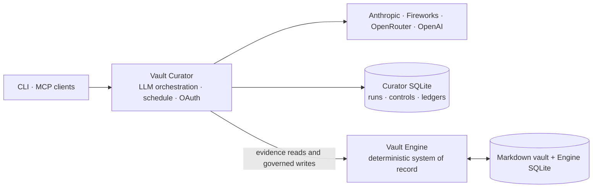

# Vault Curator

Vault Curator is the autonomous AI service for a Vault Engine vault. It turns the
engine's structured evidence into living project and topic wikis, refreshes them on a
schedule or on demand, and can maintain durable memories and vault organization.

Curator is not a standalone vault editor. It runs beside
[Vault Engine](../engine/README.md), reads through Engine MCP tools, and sends every
mutation back through Engine's governed write pipeline.

## What it does

| Capability | What you get |
| --- | --- |
| AI field repair | Capped inference for explicitly opted-in schema fields, with exact reference resolution and governed compare-and-swap writes |
| Project wikis | Multi-page summaries of the projects you ask Curator to keep wikis for, grounded in tasks, notes, meetings, contacts, and recent changes |
| Topic wikis | Wikis about people, technologies, teams, events, or other subjects, grounded in the vault and optionally attributed web research |
| Requested pages | Named sub-pages created immediately or queued for the next full curation |
| Human steering | Per-wiki pause controls and standing corrections that remain active until resolved |
| Durable memory | Facts persisted during synthesis, plus optional extraction and reconciliation sweeps |
| Conversation capture | A conservative, opt-in scheduled backstop for worthwhile assistant-generated chat artifacts |
| Organization | Optional typing of untyped notes and governed moves for misfiled notes |
| Journal and status | A monthly action journal, run history, queue health, token usage, and cost reporting |

## Before you start

You need:

- The Node.js version pinned in the monorepo's `.nvmrc` (currently Node 24).
- A working Vault Engine checkout and running Engine MCP server.
- An Engine service token for Curator.
- At least one model in the Engine's `Settings/Models/` catalog and the matching
  provider API key.
- A project node in the vault if you want to try project curation.

Curator supports Anthropic, Fireworks through its OpenAI-compatible endpoint,
OpenRouter, and OpenAI. Provider selection belongs to each model catalog entry; there is no global
provider switch or silent provider fallback.

## Quick start

Run these commands from the monorepo root.

### 1. Install and build

```bash
npm install
npm run build
```

Use the root build: Curator imports shared workspace libraries by their `dist/` output,
and only the root script builds them first. `npm run build -w vault-curator` alone fails
on a fresh clone.

### 2. Create the local environment file

```bash
cp packages/curator/.env.example packages/curator/.env
```

For a CLI dry run, the minimum useful configuration is:

```dotenv
ENGINE_URL=http://localhost:3334
ENGINE_TOKEN=<engine-service-token>

# Set the key required by the model referenced in Settings/Curator/Models.md.
ANTHROPIC_API_KEY=<key>
# FIREWORKS_API_KEY=<key>
# OPENAI_COMPAT_BASE_URL=https://api.fireworks.ai/inference/v1
# OPENROUTER_API_KEY=<key>
# OPENAI_API_KEY=<key>
```

`ENGINE_URL` should not include `/mcp`; Curator appends it automatically. OAuth settings
are required only for the long-lived Curator MCP server, not for the CLI.

### 3. Start a project wiki

Project wikis exist only for projects you ask Curator to keep one for. Start one from the
CLI (or with the `create-project-wiki` MCP tool):

```bash
npm run curate -w vault-curator -- --create-wiki "Some Project"
```

This registers the project, writes an empty home page with its live task sections (no model
call), then runs the first curation within the daily budget. If the budget is already spent, or
the wiki was already paused (a pause is kept by title, so it outlives a removed wiki), the empty
home stays; build it later with `curate-project-wiki` and `force: true`, which leaves a paused
wiki paused. Scheduled sweeps build it only while `wikiReconciliationMode` is `live` and the
wiki isn't paused. Add `--dry-run` to see what would happen.

You can also ask for one in the project note itself, with no tool or CLI: add `wiki: true` to
its frontmatter.

```yaml
wiki: true
```

The Curator server checks for this field at startup and every 15 minutes, with two Engine reads
(the settings, so a renamed or emptied field counts from the next check, then the notes) and no
model call. For each project note of the vault map's `projectType` that has it and no
registered wiki, it takes the same path as `create-project-wiki`: the wiki is registered (with
`created_by` `wiki-field` in `curator-status`) and its first build is queued within the daily
budget. If Curator refuses (say the title is already a topic wiki), the reason goes in the
Curator journal note, once per note and reason; after a restart a refusal that still stands is
noted once more. An AI caller can set the same field with the Engine's `update-node`.

The field is the vault map's `wikiFlagField` (`wiki` by default), so a vault can name it, or
leave it empty (none) to turn the check off: then nothing is read and nothing is registered,
and `remove-wiki` touches no field.

The field only asks for a wiki. Removing it does nothing, and a registered wiki, paused or not,
is left alone. To stop a project wiki use `remove-wiki`, which also removes `wiki: true` from
the project note so the wiki isn't registered again. `wiki` doesn't need to be declared in your
schema: the Engine keeps an undeclared field on a typed note as is, without a validation issue,
and `vault-doctor` and `describe-schema` only list it as an orphan field, for information.

### 4. Preview a curation

Start with a dry run. It reads evidence and reports whether each wiki would be curated and
why (`would_curate`), without any model calls or vault mutations.

```bash
npm run curate -w vault-curator -- --dry-run --project "Some Project"
```

If the project title is omitted, the dry run covers every active project that has a wiki. To see the content
that would be written, use `--preview`: it runs the paid model calls and asks Engine for a
governed preview, still without committing anything.

```bash
npm run curate -w vault-curator -- --preview --project "Some Project"
```

### 5. Commit a manual curation

After reviewing the preview:

```bash
npm run curate -w vault-curator -- --project "Some Project"
```

Useful CLI controls:

```bash
npm run curate -w vault-curator -- --force
npm run curate -w vault-curator -- --limit 3
npm run curate -w vault-curator -- --experiment bench-a --variant candidate
```

- `--force` bypasses the unchanged-evidence gate.
- `--limit` bounds a multi-project run.
- `--experiment` and `--variant` label spend records for comparisons.

## Run the MCP server

The production entrypoint is a long-lived MCP server on `CURATOR_PORT` (default `3335`).
It provides OAuth-protected tools, owns the daily schedule, and records state in its own
SQLite database.

Add these server-only values to `packages/curator/.env`:

```dotenv
OAUTH_OWNER_PASSWORD=<authorize-page-password>
OAUTH_ISSUER_URL=https://vault-curator.example.com
CURATOR_PORT=3335
```

Then build and start it:

```bash
npm run build -w vault-curator
npm run start:server -w vault-curator
```

Remote callers connect to `https://<issuer>/mcp`. Example systemd units are in
[`systemd/`](systemd/); `./install.sh` at the repository root sets both services up on a
new machine.

## Use Curator through MCP

Curator exposes these tools:

| Tool | Scope | Purpose |
| --- | --- | --- |
| `curator-status` | `curate:read` | Read run history, queue state, wiki controls, topics, spend, and server health. A run's `topology` is large, so ask for one with `topology_run_id`. `project` returns just that wiki, small enough to poll while it rebuilds, with `kind` (`project`, `topic` or null), `root_node_id` and a topic's `source` |
| `create-project-wiki` | `curate:trigger` | Start keeping a wiki for a project: empty home, then its first curation, queued so the call replies at once. `wiki: true` on the project note does the same within 15 minutes |
| `curate-project-wiki` | `curate:trigger` | Preview or curate one project wiki or one topic wiki (by its name), or process all active project wikis. Live runs are queued and the call replies at once; `curator-status` shows the outcome |
| `reconcile-wiki-pages` | `curate:trigger` | Audit or reconcile the page topology for one exact project or registered topic; defaults to dry-run |
| `create-or-update-wiki` | `curate:trigger` | Create or update a standalone topic wiki with vault or `vault+web` evidence. A create, or a change that rebuilds the wiki, is queued so the call replies at once; `curator-status` shows the outcome. `paused: true` on a create builds it once, then keeps it paused |
| `propose-topic-wiki` | `curate:trigger` | Propose a topic wiki from one note: the topic it implies, a brief, a confidence, alternatives and any matching wiki, with ready `create-or-update-wiki` arguments. One paid call on the wiki planning model; creates nothing |
| `remove-wiki` | `curate:trigger` | Stop curating a topic or project wiki without deleting its vault pages. For a project, also removes `wiki: true` from its note |
| `request-wiki-page` | `curate:trigger` | Create a named sub-page immediately or queue it for the next full run |
| `set-wiki-paused` | `curate:trigger` | Pause or resume a wiki's scheduled curation, and show it in the home's `wiki_status`. A paused wiki can still be rebuilt on request |
| `add-wiki-correction` | `curate:trigger` | Add persistent owner guidance for a wiki |
| `resolve-wiki-correction` | `curate:trigger` | Resolve a standing correction by ID |
| `preview-wiki-refresh` | `curate:read` | Free preview of rebuilding one captured page of a project wiki; returns the guard `refresh-wiki-page` needs |
| `fill-fields` | `curate:trigger` | Fill empty fields on a chosen set of notes from each note's own text: preview the count, a sample and the cost, run it under its own dollar limit, follow it, and undo it. See [Filling fields on demand](#filling-fields-on-demand) |
| `type-notes` | `curate:trigger` | Give untyped notes a type each, chosen by a model from the note's own text: preview the count, a sample and the cost, run it under its own dollar limit, follow it, and undo it. See [Typing notes on demand](#typing-notes-on-demand) |
| `guess-memory-subjects` | `curate:trigger` | Have a model name who or what each memory with no subjects is about: preview the count, a sample of up to 100 memories with how each name would resolve and the cost, run it under its own dollar limit, follow it, and undo it. See [Naming who memories are about](#naming-who-memories-are-about) |
| `extract-memories` | `curate:trigger` | Read a chosen set of notes for durable facts, as the nightly memory sweep does with changed notes: preview the count, the facts a sample of notes would give and both shares of the cost (the model's and the Engine's checks), run it under its own dollar limit, follow it, and undo it. See [Memories from chosen notes](#memories-from-chosen-notes) |
| `build-dossier` | `curate:trigger` | Build or rebuild a person's or a company's dossier, a captured wiki page named "<Name> Dossier" written from the memories about them and the notes that link to them, each line dated and sourced. `dry_run` (the default) is free; a live build is one call from the daily cap (two when the subject has rules on what may be said: the second checks the lines), queued so the call replies at once. See [Dossiers](#dossiers) |
| `remove-dossier` | `curate:trigger` | Remove a dossier: delete its page through the Engine (one undo operation, returned with the call that brings it back) and forget its record. Takes the note or the page; `dry_run` (the default) says which page would go. Refuses a page that is not a dossier, and one being built. See [Dossiers](#dossiers) |
| `refresh-wiki-page` | `curate:trigger` | Rebuild that one page, given the preview's guard, a request UUID, and `confirm_paid: true`. One paid model call; a sub-page with rules on what to say also gets a check of them after each draft, and one more draft if the first breaks a rule, so at most four |
| `wiki-refresh-status` | `curate:read` | Follow a page rebuild by its request UUID |
| `curator-cost-report` | `curate:read` | Report recorded Curator spending by sweep, run, stage, model, and outcome |

Use the topic title with `create-or-update-wiki` and `remove-wiki`, not the generated
`<topic> Wiki` home-page title. `curator-status` lists the exact registered topic titles.

To rebuild a topic wiki on request, call `curate-project-wiki` with its name and
`force: true`, as for a project. It runs the topic's full curation, with web research for a
`vault+web` topic, queued behind the reply; `curator-status` with `project` follows it.
Without `force` a paused topic wiki is skipped; with it, the wiki is rebuilt and stays paused,
so sweeps still skip it. `dry_run` is the free check, and the daily budget applies. A topic
wiki can only be rebuilt whole: its pages keep no build records, so `refresh-wiki-page` is
for project wikis. From one of its pages, `get-node` gives `relationships.outgoing.wiki_for`,
the wiki's root note, whose title is the wiki's name.
Removing a topic wiki clears its Curator registration and controls but deliberately leaves
its Markdown pages in place.

To make a topic wiki from a note without naming the topic, call `propose-topic-wiki` with
the note's `node_id`. It makes one call on the wiki planning model, recorded under the
spend purpose `topic-inference` and admitted by the daily budget; `dry_run` makes none. It
refuses a wiki page, a topic wiki's own note and a note with too little text before any
call. The caller shows the topic and brief to the user to accept or edit, then sends `next.create` to
`create-or-update-wiki`: a `vault+web` wiki with the note in `source_node_ids` and
`paused: true`, so it builds once and then changes only on request. When the topic matches
a registered topic wiki, `next.add_source` adds the note to that wiki's sources instead,
through `add_source_node_ids`: it adds to the sources the wiki has when the call runs, so
two additions confirmed one after the other both stay.
`next.create` is left out when a registered wiki has the same name, compared loosely, or
when the topic is the note's own title, since the wiki needs a topic note of its own. A
create with `paused` is refused (`WIKI_EXISTS`) when the topic already has a wiki, so it
never updates one by accident. Both calls queue the build and reply at once with `outcome:
"queued"`; `curator-status` with `project` set to the topic follows it. Vault Engine for
Obsidian's "Create topic wiki from this note" command runs the same chain.

A project wiki follows its project note, not its title. When a project is renamed, Curator moves
the wiki's registration and its title-keyed state (pause flag, corrections, page requests,
evidence manifest, deferred creates) to the new title. This happens at the next sweep or
curation of that project, or as soon as a title-based tool names the project by its new title.

The server serializes all of its work through one `CurationQueue`, so its scheduled and
on-demand curations never overlap. The queue is in-process: a CLI run has its own and can
overlap the server's work.

## Configuration

Configuration is split by purpose.

### Bootstrap and secrets: `.env`

| Variable | Required | Purpose |
| --- | --- | --- |
| `ENGINE_URL` | Yes | Engine MCP endpoint, without `/mcp` |
| `ENGINE_TOKEN` | Yes | Long-lived Engine bearer token |
| `ANTHROPIC_API_KEY` | Per model | Calls models whose catalog provider is `anthropic` |
| `FIREWORKS_API_KEY` | Per model | Calls models whose catalog provider is `fireworks` (the Engine reads the same variable) |
| `OPENAI_COMPAT_API_KEY` | No | Original name for the Fireworks key; still read, and wins over `FIREWORKS_API_KEY` when both are set |
| `OPENAI_COMPAT_BASE_URL` | No | Fireworks endpoint override; defaults to Fireworks serverless |
| `OPENROUTER_API_KEY` | Per model | Calls models whose catalog provider is `openrouter` |
| `OPENAI_API_KEY` | Per model | Calls models whose catalog provider is `openai` |
| `OAUTH_OWNER_PASSWORD` | Server only | Gates the OAuth authorization form |
| `OAUTH_ISSUER_URL` | Server only | Public Curator issuer URL |
| `CURATOR_PORT` | No | MCP server port; defaults to `3335` |
| `CURATOR_DB_PATH` | No | Curator SQLite path; defaults to `.state/curator.db` under the package working directory |
| `CURATOR_EXPERIMENT`, `CURATOR_VARIANT` | No | Default labels for usage and evaluation records |
| `CURATOR_MEMORY_SWEEP_SINCE` | No | One-run ISO watermark override for a deliberate memory backfill; unset it once the backfill has drained, because while set every run rescans every node changed since that date |
| `CURATOR_CONVERSATION_SWEEP_SINCE` | No | One-run ISO watermark override for a deliberate conversation backfill |

The larger `CURATOR_*` block in `.env.example` contains first-boot seed values for older
environment-based settings. After the Engine creates the notes in `Settings/Curator/`, edit
those instead. Curator warns when obsolete seed variables remain set, naming the note each
one belongs in.

### Behavior: `Settings/Curator/`

Behavioral settings live in the vault and are validated by `@vault/settings-registry`.
Curator fetches a fresh settings snapshot at the start of every sweep and before every
on-demand tool call. The Engine shows them in one note per area, like the tabs of a
settings screen (#746; the key lists are `SETTINGS_GROUPS` in
`packages/settings-registry/src/notes.ts`):

- `General` — sweep time, timezone, the daily and on-demand spending limits, the journal.
- `Models` — each job's model, output-token cap and reasoning (a job left empty uses
  `model`).
- `Wikis` — scheduled wiki mutation mode, evidence reads, semantic gap-fill, page caps,
  staleness, topic wiki web search and limits, dossiers. (Which project statuses count as
  active is `projectActiveStatuses` in `Settings/Vault.md`.)
- `Memories` — memory writing, memory collection, conversation collection, re-checking and
  reconciliation.
- `Conversation capture` — notes written from finished chats.
- `Organization` — typing and filing, the link sweep, the AI field-repair cap.
- `Prompts` — prompt overrides, each with its built-in prompt folded under it.

Organization typing always excludes the Engine's configured `VAULT_SETTINGS_DIR` before
reading note bodies or calling a model. `orgTypeExcludePaths` adds other vault-relative
path prefixes to that system exclusion; `orgTypePaths` remains the inclusion scope.

### Wiki output and reasoning controls

These next-use settings apply to project/topic wikis, requested pages and home refreshes.
Evaluation home calls use the resolved home settings for each model being evaluated.

| Setting | Default | Meaning |
| --- | --- | --- |
| `wikiPlanningMaxTokens` | `24000` | Per-call ceiling for planning, repairs and scope adjudication |
| `wikiPageMaxTokens` | `32000` | Per-call ceiling for page synthesis |
| `wikiHomeMaxTokens` | `16000` | Per-call ceiling for home synthesis |
| `wikiPlanningReasoningEffort` | `inherit` | Planning/adjudication effort |
| `wikiPageReasoningEffort` | `inherit` | Page effort |
| `wikiHomeReasoningEffort` | `inherit` | Home effort |
| `wikiPlanningReasoningBudget` | `0` | Most reasoning tokens per planning call; `0` sets none |
| `wikiPageReasoningBudget` | `0` | Most reasoning tokens per page call; `0` sets none |
| `wikiHomeReasoningBudget` | `0` | Most reasoning tokens per home call; `0` sets none |
| `wikiPlanningModel` | `null` | Planning, repair and scope-adjudication model |
| `wikiPageModel` | `null` | Sub-page writing model |
| `wikiHomeModel` | `null` | Home writing model |

Stage models are `Settings/Models/` catalog references (`[[Model Note Title]]`); `null`
uses `model`. Each catalog entry pins its own provider, so stages can mix providers, for
example a strong OpenRouter planning model with a cheap Fireworks page model. A dangling
reference warns and falls back to `model`. Each stage is priced with its own model in run
records.

Zero caps inherit `homeMaxTokens`. Reasoning choices are `inherit` (the selected client's
effective configuration), `provider-default` (omit the effort parameter), `none` (thinking
off), `low`, `medium` and `high`. Native Anthropic currently supports only `inherit` and `provider-default`;
explicit effort settings fail before dispatch. OpenAI-compatible routes pass the selected
effort to the provider; model support must be verified before activation. These controls
do not change retries, source selection or memory/journal/web-assessment calls.
Ceilings are per attempt, not a total sweep budget; provider reasoning can consume output
tokens. Smaller ceilings can truncate responses, which still fail closed.

A reasoning budget limits how much of a stage's ceiling reasoning may use, so it can't
spend the whole allowance and leave nothing for the answer (#429). Effort levels don't do
that on every model: Qwen 3.7 Plus on OpenRouter reasons the same at `low` and `high`, and
honors only `none` (#355). A budget is sent as `reasoning: { max_tokens }`, which OpenRouter
maps onto the model's own thinking budget. Rules, each checked before any paid call:

- **OpenRouter models only.** A budget on a Fireworks, OpenAI or Anthropic stage model is
  refused (`WIKI_OUTPUT_REASONING_UNSUPPORTED`), never dropped.
- **It replaces the effort.** OpenRouter takes an effort or a token budget, not both, so a
  budgeted stage sends no `reasoning_effort`. Leave that stage's effort at `inherit` or
  `provider-default`; a budget beside `none`, `low`, `medium` or `high` is refused.
- **It must be below the stage's ceiling** (after a `0` ceiling inherits `homeMaxTokens`),
  so the answer has room.

Budgets ship off. Too small a budget cuts reasoning short and can hurt answers (a 500-token
probe got the wrong answer), so run `npm run eval:wiki` at a budget before turning it on;
the eval uses the same stage settings. For scale, Qwen page calls since 10-28 averaged
about 4,155 reasoning tokens and home calls about 4,266. A budget, once set, is part of
the stage's output policy: it is frozen into requested-page checkpoints, shown on wiki-call
usage rows as `reasoning_budget`, and changing it gives a held wiki one retry. Leaving
every budget at `0` changes none of these. These settings cover only the wiki stages. The
journal lede has a fixed budget of its own on OpenRouter: 1,000 reasoning tokens under its
4,000-token cap, and no effort (#431). On other providers it asks for `low` where an effort
is already sent. The memory, conversation and org sweeps still use `reasoningEffort`.

The default ceilings come from the September 27 sweep analysis: each exceeds the largest
successful output observed for its stage (19k planning, 27k page, 13k home, mostly
reasoning) while stopping the 100,000-token runaway calls that failed. Reasoning stays
`inherit` by default because native Anthropic rejects explicit effort; on OpenAI-compatible
reasoning models, `low`/`medium` keep most of the ceiling for the answer.

Usage rows retain the requested model and existing run/source attribution. Wiki calls add
`metadata.wiki_call` (version 1): stage, optional target, logical attempt, effective cap,
provider, effort, `returned`/`failed` outcome, closed failure reason and `usage_known`.
Bounded diagnostics include adapter attempts, known SDK attempts (otherwise null), up to
two response identities/models/finish reasons, content shape/byte count, and reported
reasoning tokens. Reasoning is already part of output usage and is never added again.
Metadata is capped at 4 KiB and excludes provider response, source and reasoning text.
Only an unambiguous single physical response gets a top-level request ID; retry aggregates
retain their response IDs inside diagnostics. Missing/invalid usage produces a redacted
application diagnostic, without a fabricated paid ledger row. Known retry subtotals remain
recorded but are labeled incomplete when another attempt's usage is unknown.

`returned` means the adapter returned structured data, not that a wiki was published. Join
the existing run outcome to distinguish Markdown rejection, capture failure and publication
failure. Compare stage totals, call/repair counts, truncations, completed outputs and unknown
usage coverage across comparable sweeps; use provider-reported dollars when available and
keep estimates labeled. Real savings and content quality need a paid evaluation and later
production sweep; local tests cannot establish them.

New requested-page checkpoints freeze the complete stage policy. Resumed requests keep
that policy even after settings change; legacy checkpoints retain their original cap and
configuration. Setting the new controls back to `0`/`inherit` affects new work only.
Optional diagnostics are dropped if needed to preserve existing checkpoint byte limits.
There is no SQL migration, but older binaries reject the additive strict JSON fields:
inventory and finish/recover active new-format requests through supported flows before
binary rollback. Never strip checkpoint fields or delete active executions to downgrade.

### Spend guardrails

| Setting | Default | Meaning |
| --- | --- | --- |
| `dailyBudgetCents` | `100` | Hard daily cap on all Curator model spend, per local day in `tz`; `null` removes it |
| `wikiFailureHoldDays` | `7` | How long a paid scheduled failure holds an unchanged wiki with unchanged wiki model, token cap and reasoning settings; `0` disables |
| `wikiTaskOnlyRefreshDays` | `7` | How long a project narrative may lag task-only changes; `0` refreshes it on every task change |

Before every model call, Curator checks that today's spend plus the call's worst case fits
the cap. The worst case is one attempt's bounded input plus its full output allowance. When
the adapter retries malformed output, the retry is checked the same way just before it is
sent; if it does not fit, the call ends there and only the first attempt is charged. Today's spend starts from the Engine usage ledger
(provider charges where reported, otherwise rate-table estimates), so restarts keep counting.
A failed call that reported no usage counts at its worst case, since a timeout or dropped
connection may still have been billed. The usage ledger never records such a charge, so Curator
keeps it in its own DB (`budget_charges`) and adds it back when it loads the day after a
restart. A call the provider answered with an HTTP error
counts as free. Models without pricing are refused while a cap is set; add `pricing` to their
`Settings/Models/` note. A refused wiki is reported as `skipped_budget`, keeps any spend
already made, and is retried by the next sweep. Once the budget is spent, sweeps start no
paid wiki work, but unchanged and task-only project wikis still refresh their live task
sections, which needs no model calls. `curator-status` reports `daily_budget` with the cap, spend and remaining
allowance.

A run's `cost_usd` in `curator-status` is an estimate of that wiki run from the model catalog's rates, then the
static table; `aggregate.unpriced_runs` counts runs that used tokens but have no rate, which `aggregate.cost_usd`
leaves out. For what was charged, across every Curator stage, use the Engine's `usage-report`.

**Provider key limits (#342).** A provider API key can have its own spend limit, set in the
provider's dashboard. OpenRouter keys can have a daily, weekly or monthly limit, reset at
midnight UTC. Curator treats that limit as a second budget:

- **Remaining allowance.** For OpenRouter, Curator reads what remains of the key's limit with
  `GET /api/v1/key`, using the same key that makes the calls. It caches the reading for five
  minutes. A call is admitted only if its worst case fits both the cap and what remains of the
  key's limit. If the reading fails, calls go ahead, and the provider still enforces its own limit.
- **Refusals.** A refusal for a spent key limit or an empty account counts as a budget refusal,
  not a failure:
  - It is recognized from the provider's wording or error code (OpenRouter's "Key limit
    exceeded", HTTP 402, OpenAI's `insufficient_quota`, Anthropic's "credit balance is too low").
    Fail-closed calls drop the provider's text, but the adapter first records a yes/no
    spend-limit flag and the error code in the call's diagnostics.
  - A bare 403 counts only when a fresh reading shows nothing left, since a 403 can also mean
    moderation.
  - Later calls to that provider are refused before they are sent, until the limit resets or a
    reading shows money left again (for example, after you raise the limit). When the provider
    gives no reset time, the stop lasts at most an hour.
- **Wikis.** The refused wiki is `skipped_budget`, so no failure hold follows. While the wiki
  models' provider is stopped, sweeps start no paid wiki work.
- **Sweep stages.** The memory, conversation, org and reconcile stages stop at the first budget
  refusal of either kind. They report one line, and the items they did not reach are deferred,
  not counted as errors.

`curator-status` reports `provider_key_limits` with each wiki provider's limit, what remains,
when it resets and any stop.

Because the check uses each stage's full output allowance, a high ceiling on an expensive
model admits few calls near the end of the day. With a strong planning or home model, lower
its `wiki*MaxTokens` to what it needs, for example 8,000 when reasoning is off.

A scheduled run that fails after paid calls stores its evidence hash. Later scheduled sweeps
skip that wiki as `skipped_failure_hold` until its evidence changes, someone forces it, or
`wikiFailureHoldDays` pass. Changing a wiki stage's model, token cap, reasoning effort or
reasoning budget gets it one retry, and a failure on the new settings holds it again. A failure that was only a dropped provider connection
(`reason=provider_transport_failed`) holds nothing, so the next sweep retries it. Manual and
on-demand runs are never held. Plain dry runs make no
model calls at all (see the quick start).

A project wiki run that fails partway keeps what it already paid for. The completed planning
result and each finished sub-page are checkpointed in the curator DB (`wiki_stage_checkpoints`),
and the next run on the same inputs resumes at the first missing stage. Topic wikis are not
checkpointed: a topic run records its evidence selections as each stage runs, which reuse would
skip. "Same inputs" covers the
evidence, the existing wiki, the planning and page models, limits and prompts, and whether
provenance capture is on. Any change starts over. With provenance capture, a finished page's
staged derivation is left for that next run instead of being failed. The page is reused only
while that derivation is still staged and its lease runs past the reuse margin; otherwise it
is generated again. Nothing reaches the vault until a run writes the whole wiki. A
successful write, a failed write, `remove-wiki`, or 24 hours clears the checkpoint. Runs that
reuse stages say so in their detail (`reused checkpointed planning and N page(s)`).

Engine's `project-evidence` reports which part of a project's evidence changed (status,
tasks, notes, meetings or contacts) alongside `evidence_hash`. Curator remembers the parts
behind each written narrative. When only tasks changed, it re-renders the home's live task
sections without a model call (`refreshed_live`) and refreshes the narrative once it is
`wikiTaskOnlyRefreshDays` old; any other change refreshes it at once, and runs record what
changed. Unchanged wikis also get their live sections re-rendered each run, so Overdue and
Upcoming stay current; Engine skips the write when nothing changed. Generated wiki pages and
the settings folder are never semantic evidence, and wiki pages enter planning and home
prompts without their Log or live sections.

### Evidence-based early refresh for topic wikis

Early refresh is an opt-in admission check for scheduled `vault+web` topic wikis only.
Cadence remains the primary gate: project wikis, vault-only topics, manual runs, and forced
runs keep their existing behavior. The feature is disabled by default and has no environment
variable shortcut; configure all four controls in `Settings/Curator/` (the switch and cap in `Wikis`, the model and token cap in `Models`):

| Setting | Default | Purpose |
| --- | ---: | --- |
| `topicEarlyRefreshEnabled` | `false` | Check committed vault and web evidence before cadence is due |
| `topicEarlyRefreshAssessmentModel` | `null` | Optional web-materiality model override; `null` uses the main Curator model |
| `topicEarlyRefreshAssessmentMaxTokens` | `2000` | Maximum output tokens for one web-materiality assessment |
| `topicEarlyRefreshAssessmentCap` | `5` | Maximum novel web-materiality assessment calls shared by one scheduled sweep |

Vault admission uses durable source membership keyed by stable Engine node ID. **Explicit**
sources are caller-managed through `create-or-update-wiki` and are capped at 20 unique IDs;
**observed** sources are the first 50 non-explicit vault nodes actually supplied to the last
successful live synthesis. A new semantic-search neighborhood alone never triggers early
refresh. Fingerprints cover the exact synthesis-visible title, types, and included body
projection, without storing source bodies.

Monthly Curator journals are excluded from implicit topic evidence and observed-source
refresh triggers, so Curator's own activity cannot cause journal-driven wiki refreshes.
Existing observed journal references are ignored immediately and replaced through the normal
successful live baseline commit; previews and failures do not rewrite them. A journal deliberately
selected in `source_node_ids` remains an explicit source. The exclusion recognizes the writer's
canonical `Curator Journal — YYYY-MM` title; it does not exclude ordinary notes about journals.

For `source_node_ids`, omission preserves the current explicit list, `[]` clears it, and a
non-empty array replaces it after deduplication. Use stable IDs already returned by vault tools.
Changing the list forces immediate curation because it changes input evidence; these anchors are
independent of requested output pages and their pinning. Invalid, unresolved, over-cap,
self-referential, and managed-wiki-page IDs are rejected. If the forced curation fails, the new
membership remains pending and retryable until a successful live refresh commits its baseline.

Web admission keeps two different records. The **committed baseline** is the canonical bounded
search snapshot used by the last successful live refresh. The **last-probe cache** is the most
recent novel snapshot and sanitized verdict; it suppresses a duplicate assessment but never
rebases the committed comparison. A preflight performs search only—page fetching begins only
after admission. Unchanged committed probes need no model call, and cached probes reuse their
closed verdict. Novel changed probes are assessed against the committed baseline under usage
purpose `topic-refresh-assessment`; the per-sweep assessment cap is consumed only by a real novel
model call. Unknown, malformed, unavailable, capped, or failed assessments cannot authorize an
early refresh, so the topic falls back to its normal cadence eligibility.

Committed source and web baselines advance only after successful live reconciliation. Preview,
skipped, failed, partial-state, and mode-off paths do not advance them. In
`wikiReconciliationMode: dry-run`, Curator still exercises admission and may perform bounded
search, but makes no assessment or synthesis calls and writes neither the wiki nor refresh
state; an admitted topic is reported as `would_curate`. `wikiReconciliationMode: off` performs no early-
refresh source reads, web probes, or assessments.

`curator-status` exposes a bounded `early_refresh` object for each topic. Check `enabled`,
`vault_baseline_ready`, `web_baseline_ready`, and `pending_source_change` before rollout. It also
reports bounded `explicit_sources`, `observed_source_count`, `source_committed_at`,
`web_committed_at`, `last_probe_at`, and the closed `last_probe_verdict`; it never exposes source
bodies, stored snippets, body hashes, or raw model output. Migration 14 adds this Curator-owned
state. Enabling early refresh does not mass-refresh legacy topics with no baseline: a successful
normal-cadence, manual, or source-triggered live refresh establishes the required baselines.

Use this approved rollout sequence:

1. Deploy with `topicEarlyRefreshEnabled: false`.
2. Confirm migration 14 and `curator-status` baseline readiness.
3. Keep `wikiReconciliationMode` `off` or `dry-run` under the existing canary procedure.
4. Let a normal cadence refresh or deliberate manual refresh establish committed baselines.
5. Enable `topicEarlyRefreshEnabled` while reconciliation remains in `dry-run`.
6. Review trigger reasons, probe volume, assessment usage, and false-positive/false-negative examples.
7. Run the separately approved paid real-model canary.
8. Enable live scheduled reconciliation only through a separate post-review operational approval.

Disabling `topicEarlyRefreshEnabled` immediately restores cadence-only admission without deleting
baselines; re-enabling resumes from the last committed state. Changing this repository does not
activate the feature, change a real vault setting, run the paid canary, or authorize rollout.

### Topic evidence request limits

Topic planning/home requests default to 204800 UTF-8 bytes, pages to 98304,
and source excerpts to 24576 bytes per source. The next-use Curator settings
are `topicRequestMaxBytes`, `topicPageRequestMaxBytes`, and
`topicSourceExcerptMaxBytes`. These bound serialized provider parameters,
including schema, escaping and protected context; they are not token or dollar
budgets. Per-source limits cannot exceed either request limit. Existing
`bodyCharCap` remains a read-projection upper bound.

### Conversation capture sweep

Conversation capture is a separate scheduled backstop for durable **assistant-generated**
chat material. It is deliberately independent of the personal-memory sweep: captured
content remains available to normal search and wiki curation, but well-formed generated
capture blocks are excluded only from personal-memory extraction.

The notes it creates are of the vault map's `journalType` (`note` by default), the kind of
Curator's own notes; with `journalType` none capture is off. It never writes in the settings
folder Engine reports (`settingsDir`, `Settings/` by default).

Use the following staged rollout in `Settings/Curator/Conversation capture.md`:

1. Leave `conversationCaptureMode: off` for deployment.
2. Set it to `preview`; the first preview considers only the configured rolling lookback (7 days by default).
3. Inspect exact destinations and bodies in the all-project preview terminal output.
4. Adjust Markdown settings or the `curatorConversationCapturePlannerPrompt`,
   `curatorConversationCaptureCoveragePrompt`, and
   `curatorConversationCaptureComposerPrompt` prompt settings if needed.
5. Set the mode to `live`; writes occur automatically after the configured quiet period (6 hours by default).

For a safe manual inspection of the all-project sweep, use:

```bash
npm run curate -w vault-curator -- --preview
```

`--preview` runs the paid capture calls and forces effective capture preview even when the
mode is `live`; `off` remains off. A plain `--dry-run` makes no model calls, so it skips
capture, field guessing, and the memory, organization, and reconciliation sweeps. Preview is recomputed from current conversation evidence on
each run—it is not a review queue—and it neither writes the vault nor advances the
capture ledger or watermark. Do not use `--project` for this purpose: conversation
capture runs first in the scheduled/all-project sweep and never runs from `curateOne`
or a single-project curation.

All conversation-capture controls and all three prompt overrides are Markdown settings in
`Settings/Curator/` (`Conversation capture`, with the models and token caps in `Models` and
the prompts in `Prompts`); there are no environment-variable shortcuts. The approved
defaults are a 6-hour settle period, a 7-day first-run lookback, a 500-character visible
assistant-prose floor, and per-run caps of 10 evaluations, 3 artifacts per conversation,
and 5 destination writes. An archived conversation is still eligible when it is settled
and inside the lookback/watermark window. Older archives stay untouched unless you
deliberately widen the initial-lookback setting for a bounded run.

Capture routing is intentionally narrow:

- A conversation bound to eligible linked nodes can only append a provenance-marked block
  to one of those exact nodes. It never replaces, deletes, field-mutates, or creates a
  fallback node when no link fits.
- An unbound conversation creates one or more granular standalone `note` nodes; it never
  searches for or adopts a similar existing node.
- A malformed or unsupported possible content-writer record defers the conversation rather
  than risking a duplicate. Successful writes are recovered from paired provenance markers,
  and a partial multi-destination failure retries only missing capture IDs.

When a linked conversation has no fitting destination, that decision is suppressed only while both
the conversation input and the planner-visible linked-destination evidence remain unchanged. The
evidence is bounded to the planner excerpt, so edits beyond that excerpt do not reopen evaluation.
Changes to destination protection state can reopen evaluation or redirect the candidate. Existing
legacy no-fitting rows may receive one bounded reconsideration after upgrade; they are not
backfilled. `conversationCaptureMode` remains the only rollout and write-safety control.

Capture synthesis has three explicit model stages: the planner selects and routes durable
assistant-origin artifacts, a per-artifact coverage adjudicator compares each planned artifact
with eligible same-conversation write receipts and prior Curator capture blocks, and the composer
writes only retained artifacts. When no eligible coverage evidence exists, the host marks planned
artifacts uncovered and skips the coverage model entirely. When evidence exists, one coverage
failure defers the whole conversation before composition or writes; successful artifacts are not
partially committed around a failed adjudication.

Coverage routing is configured only in `Settings/Curator/Models.md`:

- `conversationCaptureCoverageModel` is nullable. When blank it falls back first to
  `conversationCaptureModel`, then to the main Curator model.
- `conversationCaptureCoverageMaxTokens` bounds each per-artifact adjudication and defaults to
  `2000`.
- `curatorConversationCaptureCoveragePrompt` is the operator prompt override; blank selects the
  built-in prompt while the immutable coverage protocol remains appended.

Before enabling the feature, back up both the vault and the Curator state database. Normal
startup applies the Curator-owned transactional migration for the capture state, processing
ledger, and recovery records. To stop future scanning, model calls, and automatic writes,
set `conversationCaptureMode` back to `off`; this intentionally does not remove or rewrite
previously captured blocks or notes. Use the normal Engine-governed recovery/backup process
if an operational rollback requires restoring earlier vault or Curator state.

After switching to `live`, monitor the capture summary and journal for committed-destination
action evidence and count summaries, write volume, coverage suppression, protected or unreliable
deferrals, errors, and marker-recovery events. Exact proposal bodies appear only in the
all-project preview terminal output; they are not stored in the persistent journal. This
preserves the intended rollout: **off → preview → inspect → live**, with the first live run
applying its own rolling lookback rather than inheriting a preview watermark.

Do not add standing behavioral configuration to `.env`; add it to the Curator settings
domain instead.

### Models: `Settings/Models/`

Curator model settings are references such as `[[Claude Sonnet 4.6]]`. Each referenced
model note supplies its provider and raw model ID. The home/page model can differ from the
memory, conversation, organization, reconciliation, and journal models.

Accepted wiki page synthesis on OpenAI-compatible APIs (including OpenRouter) omits
API `response_format`: schema mode has produced flattened or heading-only Markdown.
The page prompt requests a versioned `VAULT_PAGE_V1` envelope containing a one-line
optional log note and raw Markdown. Curator parses exact framing into the existing
page object, then validates its schema and Markdown before any wiki writes. This avoids
requiring the model to escape a long narrative as a JSON string. Invalid framing,
refusals, truncation, and filtered output fail closed with redacted errors and known
usage retained. Page calls make one attempt, with SDK retries disabled. In a wiki run,
a page whose output was malformed (invalid framing, non-text or empty content, or a
body that fails validation) gets one more call before the run fails; the retry is
admitted by the daily budget like any call, and both attempts are billed. Truncation,
refusals, filtering, provider errors and budget refusals are not retried. Prepared
provenance captures use adapter version `openai-compat-page-markdown-v1` and contain
the exact dispatched request; byte budgets measure that same payload.
Home overview and other structured calls retain their default schema mode, and native
Anthropic tool calls are unchanged.

Field repair is deliberately stricter than the other model overrides. `fieldGuessModel`
defaults exactly to `[[GPT-OSS 120B]]`; the seeded catalog entry points to Fireworks raw
model `accounts/fireworks/models/gpt-oss-120b`. You may select any enabled catalog model,
and Curator derives its provider from that model note. Resolution is strict: a dangling,
deleted, or disabled reference skips the phase with an explicit error instead of falling
back to the home model or another provider.

`fieldGuessCap` defaults to `25` admitted call slots and accepts `0` as the immediate
kill switch. A slot is consumed immediately before provider dispatch and is never
refunded, even when missing credentials or another pre-network failure means no request
was made. Each slot permits at most one provider HTTP attempt because field repair
disables its malformed-output retry and per-request SDK transport retries on both the
OpenAI-compatible and Anthropic adapters.
Response-shape failures use bounded metadata-only diagnostics with closed reason codes
and an allowlisted finish reason—never raw output or dynamic model or tool identifiers.
Billed failed completions are still recorded under `field-guess`. Other Curator
structured calls retain their shared retry behavior; if a legacy application retry fails
in transport after an earlier billed response, that earlier usage remains recorded
without attributing usage to the failed transport attempt.

`fieldGuessMaxTokens` defaults to `2000` with a minimum of `1`. The matching
`CURATOR_FIELD_GUESS_MODEL`, `CURATOR_FIELD_GUESS_CAP`, and
`CURATOR_FIELD_GUESS_MAX_TOKENS` variables are first-boot seeds only;
The notes in `Settings/Curator/` are authoritative after seeding.

Enabled catalog aliases may share a raw model ID only when they name the same provider.
A raw ID assigned to different providers rejects the runtime settings snapshot before
route registration, a model call, or usage attribution. Curator repeats this check while
registering the home model, strict field-repair model, and nullable sweep overrides,
including hardcoded home-model fallback routes.

Curator needs only the keys for providers reached by a particular run. A missing key fails
that model call clearly. It never silently switches to another model or provider.

## Scheduled operation

The daily sweep runs in a single queue and performs these phases in order:

1. Run the opt-in conversation capture sweep.
2. Repair eligible, explicitly opted-in schema fields.
3. Curate the project wikis Curator was asked to keep, for projects with an active status.
4. Refresh registered topic wikis whose cadence is due.
5. Apply the configured project-staleness policy: a project whose wiki has not been
   rebuilt in `staleProjectDays` gets the `staleProjectStatus` status (`backlog` by
   default). An empty `staleProjectStatus` turns this off.
6. Run the opt-in memory and conversation-memory sweeps.
7. Run the opt-in organization sweep.
8. Reconcile near-duplicate or contradictory memories (`reconcileEnabled`, on by default).
   A pair the Engine marks `subjects_apart` (two memories about different things of one
   kind) is never sent to the model or merged; it is recorded as kept apart (#718).
9. Run the opt-in link sweep, when it is on the daily schedule (below).
10. Refresh the canonical memory projection.
11. Append the Curator journal entry.

Phases 3 to 5 run only when `wikiReconciliationMode` is `live`. Its default is `off` (see
[Scheduled wiki mutation safety](#scheduled-wiki-mutation-safety)), so with default
settings the scheduled sweep builds and refreshes no wiki; wikis are then built on request.

Conversation capture runs first, and field repair remains before project discovery so an
inferred project status can activate that project in the same sweep. Wiki work is
all-required-success. Capture, field repair, and later maintenance and observability phases
are best-effort: they warn, but do not fail an otherwise successful curation.

### Link sweep

The link sweep (#332, `linkSweepEnabled`, off by default) reads the notes created since its last
run, then older notes it has never read (`linkSweepBacklog`, below), and finds the plain-text mentions of people, companies and projects that could become
`[[links]]`. It makes no model calls. `linkSweepMode` decides what it does with them:

- **`report`** (the default): each note's proposed links go to the Curator Journal, and no note
  changes.
- **`apply`**: it also writes a narrow set of them, and lists the rest as before:
  - a person (the person kind) named by two or more words, in any letter case;
  - a company (the company kind) named by its title or one of its aliases exactly as written,
    letter case included, so a lowercase phrase that spells a company's name is only listed;
  - only where one note has that title (letter case aside), and never around a line break or a
    name holding link syntax, to a title that ends like a file name (`Northwind.ai`, which a
    link could take for a file), or for a mention right after `[`, `!` or `\` or right before
    `]`, where the link would nest, embed or be escaped.

  A link is `[[Title]]`, or `[[Title|text as written]]`. Each note is one Engine write
  (`update-node` `set_body`), made only while the note is as it was read, in the database and on
  disk, so an edit saved in between wins and the note is read again next run. Each linked note's
  journal line names its `undo-operations` id, and the run's summary line lists every id of the run,
  so one `undo-operations` call with all of them undoes the whole run. The Engine keeps undo for
  24 hours. Apply mode also
  reads again, after the new notes and within the cap, the notes report-only runs read
  (`reported`), so the links reviewed during the trial are written too. A note whose read or write
  failed waits behind all of these, so it can't hold the cap.

  Adding links changes a note's content hash but not what it says. The memory sweep and the org
  sweep's typing remember each note by the hash they last read and read it again (a paid call) when
  it moves, so after each write the sweep moves their record to the new hash, where it held the
  very hash the link sweep read. A note edited since they read it keeps its record and is read
  again. Field guessing still sees the change: for it a new link is new evidence. Wikis do not
  (#332): they compare notes by text, with each link read as the words it shows (see "Links are no
  change to a wiki" below), and a sub-page's record of its notes made before that holds content
  hashes, which the sweep moves forward as it moves the ledgers.

- **What it looks for:** the titles and aliases of notes of `linkSweepTargetTypes`, by default
  the project, person and company kinds in `Settings/Vault.md`. A one-word name must match its
  capitalization; a longer name matches in any case. Names under 3 characters, and names more
  than one note answers to, are skipped.
- **Kept out to avoid wrong links:** a person (a note of the person kind) matches only by a name
  of two or more words, since a first name alone often meant someone else; a person's first name
  still makes a note of the same name ambiguous. A mention followed by another capitalized word is
  part of a longer name ("Acme Cloud") and is skipped. A name found in at least 5% of the vault's
  notes and in at least 200 of them (the owner's own company, a platform most notes mention) is
  too common to link: one Engine count per name a run meets, of the notes that hold it as whole
  words (`full_text_words`, #687; counted as a substring, a short name was also found inside every
  longer word holding it), and the run's journal summary lists the names it skipped.
- **What it leaves alone:** code, existing links and embeds, URLs, comments, tags, headings and
  table rows; the note's own name; any target the note already links to. Only the first mention
  of each target counts.
- **Which notes:** notes created since the last run (a first run looks back a day), leaving out
  wiki pages, the settings folder and the suite's own notes. A note edited within
  `linkSweepQuietMinutes` (30), or past `linkSweepNoteCap` (50) for the run, waits for a later
  run. Each note is reported once.
- **Older notes** (`linkSweepBacklog: fewest-links`, the default; #697): in whatever room the
  cap leaves after the new notes, the notes held over and the rereads, the sweep reads notes it has
  never read, the same kinds of note as above, after any note whose earlier read failed. Those with the fewest links go first: the notes
  that link to it and the notes it links to, added together, as the Engine counts them (body links
  and fields alike), so a note that nothing links to and that links to nothing comes first. Among
  notes with the same count, the newest goes first. A note it leaves for the cap or the quiet
  window is not queued: the walk finds it again. The summary line says how many older notes it
  read and how many are still to read. `off` reads new notes only. On the `timer` schedule each
  run takes its own share of the cap, so the walk goes faster.
- **Names that get a note later** (#699): a note is read once, so a person or company named in it
  before they had a note of their own would stay unlinked. Each run compares the names it can link
  (a person's name of two or more words, a company's title or an alias, with one note answering to
  it) with those it has seen. For each new one, from a new note, a new alias or a rename, it finds
  the notes that hold the name as whole words and were read before, and reads them again right
  after the new notes, so they get the link. The first run only records the names, so the vault is
  not read again all at once. A name too common to link is recorded and not looked for, and a
  project is never looked for, since apply mode does not link projects. At most 50 new names are
  looked for a run (the rest the next). A queued note left for the cap stays in line; one still
  being edited moves to the notes held over, so it can't hold up the rest. The summary line says how many names it looked for and how many notes it read again.
- **When:** `linkSweepSchedule: daily` runs it in the daily sweep, and its lines go in that
  night's journal entry. `timer` runs it every 30 minutes instead; a run that finds something
  writes its own short journal entry, with no model call, and a run that finds nothing writes
  nothing.

The scheduler recomputes from local wall-clock time after every run, so `sweepAt` and `tz`
remain correct across daylight-saving transitions. On startup, the server runs a catch-up
sweep when the previous scheduled run was missed.

### AI field-repair safety

`ai_guessable` is opt-in at the Engine global-field level and defaults to `false`. A
schema may override it only when `overrides_allowed.ai_guessable` permits. Optional
absence is never a candidate. Missing, null, blank, or empty-list values are offered as
empty only when the field is effectively required; an explicit optional null is offered
only when ordinary validation rejects null. A present invalid optional value remains
repairable, while valid optional empty values are respected.

Engine candidate pages contain no body or current values. Curator checks the paid-call
cap first, then fetches one admitted node with `include_embeds:false`, checks its version
and content hash, and compares fresh bounded evidence against terminal history.
Unchanged terminal candidates still require this read but spend no model call. After
the cap is reached, unread candidates are counted as deferred without body access,
including candidates whose terminal evidence could not be checked. Prompt context is limited to node identity, types, current
fields, bounded relationship summaries, offered constraints, and a bounded body. It does
not include web results, embeds, attachments, or linked-node bodies. The body hard ceiling
is 100,000 characters. Initial aggregate caps are 4,000 characters for node types,
12,000 for current fields, and 12,000 for relationships; excess entries are omitted with
deterministic structural markers. Both real serialized provider request shapes are capped
at 109,000 characters, including JSON escaping and OpenAI's repeated schema. If necessary,
Curator deterministically reduces optional node evidence while retaining every offered
identity, every exact applicable enum/per-type/reference constraint, and the node ID;
legal constraint strings are never truncated, and prompts that already fit are byte-for-byte
unchanged. Node content and
field descriptions are treated as untrusted data. An irreducibly oversized configured
model or reasoning value is reported as configuration error rather than node-state overflow.

Every offered field is retained in one call. Its canonical mandatory record is newline-
delimited JSON containing the field identity, `set`/`abstain` actions, and exact applicable
global/per-type enum values and reference target. Engine prevents this complete projection
from exceeding one shared 20,000-character section ceiling. Curator therefore never partitions
a node into extra calls, preserving call-cap, usage-ledger, and single-CAS semantics.

Only offered fields can reach the patch. Advisory output is sanitized locally for scalar
or list shape and constraints. References must match exactly one existing title, refetch
to a canonical title, and satisfy the target type. Terminal abstention, value, and
reference outcomes suppress only their exact node, field, content, definition, model,
classifier, and versioned prompt-evidence fingerprint; provider, stale-node, and mutation failures retry on a future
sweep.

A preview (`--preview`) still spends the configured model calls and asks Engine for a governed preview,
but writes no attempt rows or per-field journal actions. It does persist the one required
count-only `field-guess-sweep` summary, marked as a dry run. A live run submits at most one
combined, guarded compare-and-swap patch per admitted node. Engine atomically rechecks the
offered definitions, AI eligibility, and accepted reference identities; abstained fields
do not receive defaults, and there is no per-field fallback after a combined failure.

### Filling fields on demand

The nightly field repair above fills only what the owner marked: fields that are
`ai_guessable` and required, 25 notes a night. `fill-fields` (#644) does the same work
per note over a set the caller chooses, which is what a newly typed pile of notes needs.
A model reads one note and writes the named fields it clearly gives; the rest it leaves
empty.

| Action | What it does |
| --- | --- |
| `preview` (default) | Counts the notes in scope, with each field's count; tries the model on the newest few (`sample`, default 5, 0 for the count alone) as a dry run; returns what it would write, the sample's cost, and an estimated cost and duration for the whole set. It also returns the `start` call at a suggested limit |
| `start` | Starts the run with `limit_usd`, the most it may spend. Replies at once with a `run_id`; the run goes on in the background |
| `status` | One run by `run_id`, or the recent field-filling runs. `curator-status` shows the on-demand run in progress, or the latest, as `on_demand_run`, with its `job` |
| `undo` | Puts back everything one run wrote. A dry run by default |

- **Scope.** `fields` names the fields; `query` selects the notes with `query-nodes`
  filters, without joins (`types`, `path_prefix`, `node_ids`, a field filter). The Engine
  checks the filters with `query-nodes`' own schema, so a malformed one is refused. A note
  is in scope when a named field holds no value.
- **A value already there is not touched.** A valid one never. One that fails its
  field's type (a date field holding "TBD", a status not on its list) is someone's text,
  and is left as it is unless the request says `replace_invalid: true`; the model then
  replaces it where the note gives a value. The preview counts such values per field
  either way (`fields.<name>.invalid`), and with `replace_invalid` a sample note shows the
  value now there under `replaces`. The Engine's write guard holds the rule too: a write
  that would replace a value is refused for a run that did not ask to.
- **Typed text counts as a value.** The usual way a field comes to hold a wrong value is
  someone typing it: "TBD" in a date property. The Engine stores nothing for that and
  leaves the text in the note's file, so its database says the field is empty. A run
  reads the file as well and treats such text as a value that fails its type.
- **Undo puts replaced text back.** After a run with `replace_invalid`, undo restores
  each replaced value as it was, typed text the Engine had refused included: the Engine's
  undo record keeps the lines only the note's file held (Engine #656).
- **The fields are named in the request, and that is the consent.** They need no
  `ai_guessable` mark and need not be required, for this run only. The nightly sweep's
  rule is unchanged.
- **Its own limit.** A run is paid from `limit_usd`, stated in the request, and not
  from the daily cap: that night's wikis and sweeps still have their budget. The limit
  covers the run's whole life and does not start again at midnight. The spend
  is recorded in the ledger under the purpose `field-fill-run`, and the daily tally
  leaves that purpose out (it reads the day's spend once, grouped by purpose, so the two
  come from the same moment). A call is refused before it is sent when its worst case no
  longer fits the limit, so a run stops a little under its limit. The provider's own
  key limits still apply. The model must have a price.
- **A day's ceiling the owner sets.** A run's limit is a number its caller states, and
  the caller is usually a model. So all on-demand runs in a day share one ceiling,
  `runDailyBudgetCents` in `Settings/Curator/General.md` (500, five dollars, by default; `0`
  turns on-demand runs off; `null` removes the ceiling). A run whose limit does not fit
  what is left is refused, the preview says what is left and suggests no more than
  that, and what counts against the day is what each run started that day has spent.
  It is a setting, as the daily cap is: an assistant with access to settings could
  change it, but that is a separate step that shows in the settings note.
- **The preview's sample is the exception**: its few calls are paid from the daily cap,
  under the purpose `field-guess`, so nothing is spent apart from the cap without a
  stated limit.
- **One run at a time**, typing runs included (`type-notes`, below), a batch of 20 notes
  per turn in the curation queue, so a wiki build queued behind a run waits for one batch.
  A start while another job's run is going returns that run, with its `job`.
- **Stopping and continuing.** A run that reached its limit is `stopped`; one the
  Curator shut down or restarted under is `interrupted`. Start it again with the same
  fields and query: filled notes are no longer in scope, and a note the model was
  already asked about is skipped while it is unchanged (the same attempt ledger the
  nightly sweep keeps). A note the run wrote some fields on is asked once more about the
  rest, because its text changed.
- **Unsure notes** get nothing new written about them. They stay in the Engine's
  `cleanup-report` (no date, no people, and so on), and the run's counts say how many
  were left.
- **Undo.** The run keeps the Engine undo operation of every note it wrote, and `undo`
  hands them to `undo-operations` in one call. Notes edited since are left as they are
  and listed. The Engine keeps undo records for a limited time (24 hours by default), so
  a write older than that is counted as no longer undoable.
- **Running it again after an undo** fills the same notes again. The attempt ledger
  stops a field being asked again only where the model declined it ("the note does not
  say") and the note is unchanged; a field the run set, and the undo emptied, is asked
  again.
- **The journal** gets one summary line for the run, and no line per field.
- **CLI.** `npm run curate -- --fill-fields date,people --types meeting` counts the notes
  in scope and calls no model (so does `--dry-run`, as everywhere in the CLI); `--preview`
  adds the paid sample and the estimate; `--limit-usd 2` runs it; `--replace-invalid`
  also replaces values that fail their type; `--undo-fill <run id>`
  undoes it (`--dry-run` first). Ctrl-C ends a run after the note in hand.
- **A run belongs to the process that started it**, the server or a CLI, and beats every
  15 seconds while it lives. A run whose process is gone (a restart, a second Ctrl-C) is
  marked `interrupted` the next time runs are started, listed or undone, and at server
  start: at once when the process ran on this machine, otherwise after two minutes of
  silence. Until then it would block the next run and refuse an undo.
- **The model** is `fieldGuessModel`, with `fieldGuessMaxTokens`. `fieldGuessCap` is the
  nightly sweep's cap and does not limit a run.

### Typing notes on demand

The nightly organization sweep types 25 untyped notes a night. `type-notes` (#644) makes
the same call per note over a set the caller chooses: a folder of mixed notes on a vault
that has just been given its types. A model reads one note and picks one type from a
closed list, or none when no type clearly fits.

It has the same four actions as `fill-fields` (`preview`, `start`, `status`, `undo`), and
everything above about a run's own limit, the day's ceiling, one run at a time, stopping
and continuing, the owning process, undo and the journal holds for it too: the two jobs
run on one shared runner (`src/on-demand/`). What is its own:

- **Scope.** `query` selects notes with `query-nodes` filters (`path_prefix`, `node_ids`,
  `path_dir`, title and date filters; not `types` or `fields`, which the job sets). Only
  the notes among them with no type are in scope. A note that has a type is never given
  another. Omit `query` for every untyped note.
- **The sample** is spread evenly through the scope, not its newest few: notes that
  sit together in a listing are often alike, and a sample of look-alikes would not show
  whether the model tells the kinds in the set apart.
- **The types on offer.** Every type with a schema, or the ones named in `types`. Fewer
  types make a surer choice. A type that does not exist is refused: create it first.
- **What the model sees.** Each offered type's name, display name, folder and field names
  (up to 15), then the note's title, path and text. The nightly sweep's prompt has no
  field names and is unchanged; a run adds them because it is pointed at whole folders,
  on types that may be minutes old and alike in name. Types have no description of their
  own to send.
- **It types and nothing else.** No note is moved, and no field is filled beyond the
  defaults the type sets. When the nightly sweep is on and re-files typed notes
  (`orgMovePaths`), the preview says so in `moves_note`.
- **The owner's rules on typing hold.** A type in `orgTypeExclude` is never offered, and
  naming one in `types` is refused. A note under `orgTypeExcludePaths`, which always
  includes the settings folder, is never typed; the preview counts the notes left out
  for it in `scope_note`. A note is checked again where it is when its turn comes, so one
  moved into such a folder after the run listed it is not read to the model. `orgTypePaths` and `orgTypeCap` are the nightly sweep's scope
  and cap and do not bound a run.
- **Unsure notes** stay untyped and stay in the Engine's `cleanup-report`. Their "no type
  fits" answer is kept per note with the note as the model was shown it (a hash of its
  title, path and text) and its version, the rest of the call (a hash of the prompt, with
  each offered type's name, display name, folder and fields, and of the settings that
  shape the call: `bodyCharCap`, `orgSweepMaxTokens`, `reasoningEffort`) and the model
  (`type_run_verdicts`). So a run started again does not pay to ask the same question,
  and a new type, a narrower offer, a type whose fields or folder changed, a raised text
  cap, or a note that was edited, renamed or moved is asked. This is apart from the nightly sweep's
  ledger, which is keyed by content alone: a run asks about a note the nightly sweep gave
  up on, and the nightly sweep may ask once about a note a run left untyped.
- **Answered notes are out of scope.** A note still at the version it was asked at is
  left out as the scope is listed: the preview counts such notes as `already_asked`,
  apart from `notes`, and a start with nothing left to ask is refused with that count
  instead of starting an empty run.
- **How many notes a run takes on.** The newest 50,000 that are left to ask. Notes kept
  out of typing and answered notes do not count toward that, so they cannot fill a later
  run's scope and hide the notes behind them. A scope with more than 500,000 untyped
  notes is refused (`SCOPE_TOO_LARGE`): narrow it by folder, or type one `survey-nodes`
  group at a time.
- **A write is guarded by the note's version.** The type is added only if the note is
  as it was when it was read with no type. A note typed or edited meanwhile is counted
  as `changed` and left alone.
- **A type the Engine refuses** (validation) is counted as `refused`, and a sample note
  shows the reason.
- **Undo** takes back every type the run gave, with the field defaults that came with it.
  A note typed by a run that was then undone is asked about again by the next run. The
  note is untyped again, but its file is not byte for byte what it was: a note that had
  no frontmatter keeps an empty `types:` block, because the Engine writes frontmatter on
  every note it has written.
- **Its spend** is recorded under the purpose `type-notes-run`, left out of the daily
  tally like `field-fill-run`. The preview's sample is paid from the daily cap under
  `org-sweep`.
- **CLI.** `npm run curate -- --type-notes --path Inbox/` counts the untyped notes in
  scope and calls no model; `--types meeting,person` narrows the offer; `--preview` adds
  the paid sample and the estimate; `--limit-usd 2` runs it; `--undo-types <run id>`
  undoes it (`--dry-run` first).
- **The model** is `orgSweepModel`, or `model` when that is not set, with
  `orgSweepMaxTokens`.
- **Not checked with a real model.** The run was exercised end to end on a scratch
  vault (180 notes, the real Engine and Curator) with a stand-in for the model. Read a
  preview's sample before the first real run.

### Naming who memories are about

A memory's subjects are the people, companies and projects it is about, and what put it in
a note's set (`list-memories subject_of`). The nightly sweeps write them as they write a
memory (#554). For older memories the owner chose (2026-11-20) "free match, then model":
the Engine's `backfill-memory-subjects` gives a memory the notes its text names in full,
with no model, and `guess-memory-subjects` asks a model about the live memories that
still have none: a first name, a company named in one word, someone with no note yet.

It has the same four actions as `type-notes` (`preview`, `start`, `status`, `undo`) and
runs on the same runner: its own limit, the day's ceiling, one run at a time (whatever the
job), stopping and continuing, and the journal all hold. What is its own:

- **Scope.** Every live memory with no subjects, and every one whose only subjects the
  free match gave (owner, 2026-11-20: "Dana Whitfield is the Acme account lead" got Dana
  Whitfield from the free match and not Acme, and a company's set would miss such memories).
  There is nothing else to choose. The Engine lists them (`memory-subject-pass` `list`,
  service-only) in id order, each with the subjects it has. For a tagged memory the model
  names only what is missing, and the Engine adds a name only where the memory has no
  subject of that name or note: nothing is ever taken away, and once the model has added
  to a memory it leaves the scope.
- **What the model sees.** The vault owner's name first (the vault map's `ownerNote`),
  then 20 memories to a call, each with the title of the note it was drawn from and the
  people, companies and projects that note is or links to (up to 40, the owner left out),
  so "Dana" in a memory can be written "Dana Whitfield". It answers with a list of names
  per memory id. Those names only spell out a name the memory gives in part: a name whose
  first word (after "the", "a" or "an") is not a word of the memory's text is left out,
  and the preview shows what was left out (`dropped`). On the owner's vault the model
  had copied a meeting's attendees onto memories that never mention them.
- **The names are resolved by the Engine** (`memory-subject-pass` `write`) as it resolves
  any caller's: linked to the note that alone answers to the name, kept as a name when no
  note does yet (matched once one does), ambiguous when several do, a one-word person's
  name linked only through the memory's source note, and the owner never, nor the owner's
  first name alone. They are marked `set_by: "model"`, and written only to a memory that
  is still live and still has no subjects; one that changed meanwhile is counted as
  `changed`.
- **Sample first** (the owner's ask): the preview tries the model on up to 100 memories
  (20 by default) spread through the set, writes nothing (the Engine resolves the names
  as a dry run), and shows each memory with the names it would get and how each would
  resolve, with counts. The estimate is per memory, since a call covers 20. The sample's
  calls go out side by side, so a 100-memory sample takes about as long as one call (a
  minute on a reasoning model) and stays inside the time an MCP client waits.
- **No one named.** A memory the model names no one in (or only the owner) keeps no
  subjects, and the answer is kept (`subject_run_verdicts`, Curator DB migration 38) with
  a hash of the memory as it was shown (its text, its source note's title and names) and
  of the call (the prompt, the owner's name, the call's token room, `reasoningEffort`),
  and the model. A run started again leaves those memories out until what they would be
  shown changes; the preview counts them as `already_asked`. A memory the model's answer
  left out, or answered with no list of names, is asked again.
- **Undo** takes back out the subjects each of the run's writes gave, named by memory
  and the time of the write (`memory-subject-pass` `clear`). Subjects set any other way
  stay, and so do a later run's on the same memory; a memory whose subjects from this run
  were removed since counts as `no_longer_undoable`. It is not the
  Engine's undo of note operations, which memories are not part of, so it has no time
  limit.
- **Its spend** is recorded under the purpose `memory-subjects-run`, left out of the
  daily tally like the other runs. The preview's sample is paid from the daily cap under
  `memory-sweep`.
- **The model** is `memorySweepModel`, or `model` when that is not set, with
  `memorySweepMaxTokens` but never less than 8,000 tokens: that setting sizes one note's
  extraction, and a reasoning model answering for 20 memories needed more (2 of the
  first 7 calls on the owner's vault were cut off at 4,000). A call is billed for what it
  uses.
- **No CLI.** It is run through the tool.
- **Checked** with a stand-in for the model only, before its first preview on the real
  vault.

### Memories from chosen notes

The nightly memory sweep reads the notes that changed, at most 50 a night, and keeps at
most 25 facts (`memorySweepExtractionCap`, `memorySweepCap`): sized for a vault that is
caught up. A newly organized vault of a few thousand notes would take months, and the only
way round it was raising those caps by hand. `extract-memories` (#659) reads a set of
notes the caller chooses, with the sweep's model and instructions.

It has the same four actions as `type-notes` (`preview`, `start`, `status`, `undo`) and
runs on the same runner: its own limit, the day's ceiling, one run at a time (whatever the
job), stopping and continuing, and the journal all hold. What is its own (owner's
decisions, 2026-11-20):

- **Scope.** query-nodes filters (`types`, `path_prefix`, `node_ids` and the rest; no
  search, no joins), newest first. When the owner has named the kinds or folders the
  memory sweep reads (`memorySweepTypes`, `memorySweepPaths`), a run reads only those
  notes too. When both are empty, as on a new install, where the installer turns the
  nightly sweep off, the query alone decides. Wiki pages, notes in the settings folder and
  the Curator's journal are never read: memories drawn from a wiki page would be the
  Curator's own writing read back as fact. The preview counts what each of these leaves
  out (`outside_allowlist`, `never_read`).
- **The sweep's ledger is shared.** A note the sweep or a run has read at its current text
  (`memory_sweep_ledger`) is not in scope (`already_read`), and a note a run reads is not
  read again at night until it changes. The Engine's `query-nodes` returns each note's
  `content_hash` when asked (`select`), so this is known from the listing.
- **The same call per note** (`extractNoteFacts`, shared with the sweep): the sweep's
  prompt, its ALREADY KNOWN block, the owner's name, the note's date, and the note's
  earlier facts to re-check. Facts its text no longer supports are retired, as at night.
  `facts_per_note` defaults to `memorySweepNoteCap` (3) and goes up to 10. There is no cap
  on facts per run: the limit is the brake.
- **One limit pays for both shares.** Each memory a run writes is checked by the Engine's
  consolidation model against the memories already there, on the Engine's key. The run
  names itself on every `create-memory` (its ref, the source `memory-extraction-run` and
  the purpose `memory-consolidation-run`), so the Engine records each check under that
  purpose, which the daily cap's tally leaves out like the runs' own purposes. The Engine
  reports each check's cost and the run charges it to its own limit (`chargeRun`). A check
  is paid only once it is made, so before writing a note's memories the run makes sure what
  is left of its limit covers twice the recent average check for each (or the dearest check
  it has paid for, when that is more); when it does not, nothing of the note is written, the
  note stays unread and the run stops (Codex, #705). With no recent checks to go on, the
  first note's checks set the figure. The preview estimates the Engine's share as one
  check a fact at the average cost of its checks over the last 30 days, live checks and
  runs' own together, names the provider, and suggests a limit from both shares together.
  It is an estimate, not a ceiling: a check against many close memories (a busy project)
  costs more than the average, by about a third on the first production run (#707).
- **Minutes.** The preview's `estimated_minutes` is the sample's model time per note for
  every note, plus about 20 seconds for each expected fact: the Engine writes a run's
  memories one at a time, each with its check, and the sample times only the model's
  calls. The first two production runs took 14 and 26 seconds a memory (#707).
- **`types` means all of them.** query-nodes reads several kinds in `types` as a note
  having every one, so `types: ["meeting", "note"]` usually matches nothing. Give one kind,
  or leave `types` out to take every kind the sweep reads; when such a query matches
  nothing, `scope_note` says why (#707).
- **The Engine's key running out** stops the run, as it stops the sweep: the rest would be
  added unchecked. Memories already added that way wait for `replay-memory-consolidation`.
- **Undo** (newest memory first, by id, then the facts it retired): a memory the run wrote is retired if it is still live,
  the memories it replaced come back if each is still retired in its favour, and the note
  it came from is no longer marked read (if the ledger still holds the text the run read),
  so a later run reads it again. An earlier fact the run retired comes back if it is still
  retired for that reason. A memory changed since in any way (retired and brought back,
  edited in place, given subjects) is left alone and counted as a conflict: the run records
  each memory's `updated_at` as it left it and compares (Codex, #705). The run's own changes
  are not changes since: a memory it wrote and then replaced, or added a later fact's
  subjects to, is unwound with the rest. A note that gave no
  memory stays read. The run records `memory:<id>` (with `:replaced:<ids>`) and
  `retired:<id>`, each with `@<updated_at>`, as its operation ids.
- **Its spend** is recorded under `memory-extraction-run`, left out of the daily tally
  like the other runs. The preview's sample (5 notes by default, at most 10, sent side by
  side) is paid from the daily cap under `memory-sweep`.
- **The model** is `memorySweepModel`, or `model` when that is not set.
- **No CLI.** It is run through the tool.

### Dossiers

A dossier (#554) is one page about one person or company, built on request from what the
vault knows about them, with the page's inputs recorded like any captured wiki page.
`build-dossier` takes the note as `node_id` or `title`. The owner's decisions (2026-11-20):

- **What it reads.** The memories about the note (`list-memories subject_of`, live only): its
  rules (up to 20) and preferences (up to 20) first, then the 60 newest, with the total, so
  the page says when the limits left some out ("74 of 1,214 memories"). The owner's own
  standing memories, as every wiki build reads them. The note itself (fields and body, cut
  at 12,000 characters), and from `project-evidence` the meetings, notes and tasks that link
  to it and the people and companies around it. The 8 newest past meetings and notes that
  link to it are read in full too (`dossierBodyReads` in Settings/Curator/Wikis.md, 0 for none), each cut at 4,000 characters (#720; owner, 2026-11-21),
  so a fact said only in a meeting can reach the page, cited to it; the rest are shown by
  title. A wiki page among them is passed over for the next. The dry run's `reads.read_in_full`
  counts them, and its size and estimate include them.
- **Live facts, dated and sourced.** The model writes one fact a line, in the sections of the
  note's kind (built in: a person gets Who, Relationships, Preferences, History, Open items; a
  company What it is, People, Relationships, Preferences & terms, History, Open items; any other
  kind What it is, Relationships, History, Open items), each citing the memories
  and notes it rests on. Code writes each line as
  `- text · since 2026-03-04 · [[Kickoff call]] <!-- memory:812 -->`: the day the newest cited
  memory became true (a History line shows the bare day, newest first), and where each came
  from ("from a chat" for a chat memory). A line that cites nothing the build showed is left
  out and counted. Open items are what is still open as of the build: the prompt sends an item
  whose day has passed (a deadline gone by, a meeting held) to History unless a newer source
  says it is still open (owner, 2026-11-21). No privacy filter.
- **Past facts in History** (#717; owner, 2026-11-21: "yes, 10 newest", contradictions only).
  A dossier also reads the 10 newest memories about the note that a newer memory contradicted
  (`list-memories subject_of` with `expire_reasons`), each with the memory that replaced it.
  An update is no past fact: the newer memory says everything the older did, and a hand edit
  records the same reason; nor is a duplicate or a deletion. A contradiction is either a change
  ("works at Northwind", then "works at Contoso") or a correction ("an internal colleague", then
  "an external consultant": never true), and the memories' dates can't tell them apart, since
  most older memories are dated by when they were recorded. So the model sees each past fact
  over what replaced it, and writes it in History only when the newer memory says the fact
  changed (owner, 2026-11-21). Code writes such a line in History only, as
  `- Worked at Northwind · 2026-01-10 to 2026-03-04 · [[Intro call]] <!-- memory:401 -->`, with
  a start only when the memory has a real date (from its note or a verdict), else
  `until 2026-03-04`; its end is the Engine's `invalid_at`, or else the day its replacement became
  true. A line citing one anywhere else is left out, and so is a past fact whose replacement
  can't be read. Both memories are recorded as the page's inputs, and a newly contradicted memory
  puts the page behind. The dry run counts them (`reads.memories.past`).
- **Sections per kind** (#716; owner, 2026-11-21: a Curator setting). `dossierSections` in
  `Settings/Curator/Wikis.md` gives a kind its own list: a `kind:` line, then one
  `- Name: what goes in it` line per section, in page order, at most 12. A note's own kind is
  looked for first, then `person` or `company` for the vault map's person and company kinds,
  then `other`, the setting's list before the built-in one at each step, so a setting that
  lists only `vendor:` changes vendors' dossiers alone. Blank uses the built-in lists, which the
  settings note shows. "Last contact" and "Rules on what to say" are code's and can't be named.
  A section named History is sorted by day. A line the setting can't use is skipped and said
  in the dry run's `sections.setting_issues`; the dry run also says which list a build takes
  and from where. For example:

  ```yaml
  dossierSections: |
    vendor:
    - Offering: what they sell, and what we buy from them.
    - Terms: prices, contracts and payment terms agreed with them.
    - History: what happened with them, one event per line, newest first.
  ```
- **Days for lines from notes.** A line citing no memory shows a cited meeting's day, or else
  the day the model read in a cited note (`day`, YYYY-MM-DD), kept only when code finds it
  there: a note with that day in its title, or a note shown in full (the subject's own, or
  one of the 8 bodies), where the day must be in the entry the fact came from (one list item with what is indented deeper, blank lines
  included, or one paragraph): the entry that best matches the line's words, a word counting for less the more
  entries hold it. A day elsewhere in the note is a real date on another fact, so it is
  dropped (owner, 2026-11-21: "same entry only"), as is a day after the build. A line with no
  confirmed day shows none, and the run's detail counts them ("12 without a day"). The first
  real build (2026-11-21) left 27 of 41 lines undated, nearly all from the person's own note.
- **Last contact** is worked out in code: the newest past meeting the person attended (named
  among its attendees), or, for a company, that someone the vault places at it (their note's
  company field, read in full, not from the page's capped contact list) attended. A meeting
  that only links to the note is no contact. When the page's meetings show none attended and
  were cut off at their limit, the newest 100 linked meetings are read for it; with none there
  either, the line says how many were read. The rules are
  listed under "Rules on what to say" as on project pages.
- **The page** is a wiki home whose root is the person's or company's note, written through
  `wiki-reconcile` with only At a glance (the dossier) and Log. A new page is named
  "<Name> Dossier" (the Engine's `home.title_suffix`); a rebuild finds the page by its root
  and keeps its title and path. The Engine adds its live sections to it as to any home (the
  note's tasks and related notes). It is not registered as a wiki: the sweeps that keep
  project wikis leave it alone.
- **Behind, and rebuilt when asked** (#714; owner, 2026-11-21). Each build is recorded. Every
  30 minutes the Curator checks each dossier against now, with Engine reads only: it is behind
  when a note or memory it read has changed or is gone (a note that only gained links is
  unchanged), when the memories a build would show now differ (a new memory about the
  subject), or when the subject's memory count moved. The page's `wiki_status` then says
  `behind`, and `current` again once rebuilt. A dossier is rebuilt only when someone asks,
  unless its person's or company's note says `dossier: on-change` (set it by hand, or pass
  `rebuild: "on-change"` to a live `build-dossier`; `"manual"` removes it). Then the nightly
  sweep rebuilds it when it is behind, after the memory phases, at most 5 a night, oldest
  build first, each through the same checks as a live build and from the daily cap; a refusal
  by the cap leaves the rest for another night. A new meeting it never read is not a change
  on its own; the memories drawn from it are. A dossier built before this is recorded at its
  next build.
- **Refused:** a project (its dossier is its project wiki), a wiki page, a note of a kind
  that is not one of the vault map's entity kinds (`entityTypes`, else the person and
  company kinds), the vault owner's own note (`ownerNote`), and a note that already has a
  wiki.
- **Cost.** `dry_run` (the default) makes no model call: it returns what would be read and
  left out, the page it would create or rebuild, the model (`wikiHomeModel`, else `model`)
  and provider, the request's size, the Engine's own dry run of the capture, an estimate of
  the calls and their worst case, and what is left of today's cap. The estimate takes the
  average answer of the last 30 days' dossier calls on the same model, reasoning included, and
  says so; with none, it takes 11,000 tokens. (Real builds on a reasoning model answered in
  10,829 and 16,827 tokens; a first fixed guess of 2,500 put the estimate at a third of the
  cost.) `dry_run: false` checks
  the same again, refuses when the worst case does not fit the cap (in the budget's words),
  then queues the build and replies with `status: "queued"`. `curator-status` with `project`
  set to the page title follows it (`in_progress`, then the run's outcome). The call is
  paid from the daily cap and recorded under the spend purpose `entity-dossier`.
- **The rule check** (#721; owner, 2026-11-21: "drop the breaking lines"). When the subject
  has rules on what may be said, a second call on the same model reads the rules and the
  lines as the page will write them (their days and sources included, and the "Last
  contact" line), numbered, and names any line that breaks one. A breaking "Last contact"
  leaves that section out. Code leaves those
  lines out and the Log counts them ("2 left out for breaking a rule on what to say"); the
  rest of the page is written, and the rules are still listed under their heading. A check
  whose answer can't be read lets every line stand, and the Log says the rules were not
  checked. A check call that fails writes nothing, as a failed page call does. The dry run
  counts two calls, estimates the check from the last 30 days' checks on the model (else
  4,000 tokens), and holds both calls' worst case against the cap; the check is recorded as
  `entity-dossier-rules`, so the page's own estimate is not averaged with it.
- **A build cut off by a restart** (#722): a build that never sent its call is started again
  after the restart, through the same checks (a nightly rebuild only if its note still asks for
  it and it is behind); one whose call was out may have been paid, so it is reported (a run
  error and a journal line: nothing was written, build it again) and never run again unasked;
  one cut off while its page was being written is checked with the Engine and reported as
  written, not written, or unknown.
- **Removing one:** `remove-dossier` takes the person's or company's note, or the page, and
  (with `dry_run: false`; the dry run is the default) deletes the page as one undo operation,
  returning the `undo-operations` call that brings it back. It refuses a page that is not a
  dossier (a project or topic wiki: `remove-wiki` deregisters those) and a dossier with a build
  queued or running. The note's `dossier` field is left as it is (#723).
- **From Obsidian** (#715): **Build dossier for this note**, on a person or company note, shows the
  dry run (what it reads, the page, the cost and today's budget), builds on confirm, follows the
  build with `curator-status` under the page title and opens the page once written. The build runs
  in the lane under its page title, as wiki builds do, so `curator-status`'s `queue.current` names it.
- **Not built yet:** a CLI.
- **Golden evals:** `npm run eval:dossier` runs four fictional cases on the configured home
  model (a dated timeline with a passed deadline, a company with a fact said only in a meeting,
  a subject with a rule, an employer a newer memory replaced beside a corrected fact), paid from the daily cap, and checks the pages as code writes them.
  `--dry-run` lists them for free.

### Scheduled wiki mutation safety

`wikiReconciliationMode` controls scheduled project and topic wiki work:

| Mode | Behavior |
| --- | --- |
| `off` | Skip scheduled wiki work while allowing non-wiki maintenance phases |
| `dry-run` | Report which scheduled wikis would be curated, with no model calls or writes |
| `live` | Allow scheduled wiki mutations |

The safe default is `off`. Change the value in `Settings/Curator/Wikis.md` only after reviewing
manual and scheduled dry-run output. The setting does not override explicit on-demand tool
arguments. It is also separate from `reconcileEnabled`, which controls memory-pair
reconciliation.

## How curation stays safe

- **Engine-governed writes:** Curator never edits vault Markdown or Engine SQLite directly.
- **Bounded spend:** A hard daily cap refuses calls whose worst case would exceed it, paid
  failures are not retried on unchanged evidence, and dry runs make no model calls.
- **Evidence idempotency:** Unchanged Engine evidence skips synthesis before the paid model
  call unless `force` is set.
- **Retryable partial failures:** The evidence hash and curation timestamp are stamped only
  after every required page write succeeds.
- **Stable identity:** Wiki reconciliation uses exact root identity and refuses ambiguous
  or root-title-colliding plans.
- **No page deletion during normal retirement:** Themed pages become dormant or retired and
  keep their history.
- **Scoped access:** The MCP server separates read-only status access from mutation tools.
- **Bounded automation:** Optional sweeps have enable switches, allowlists, and per-run caps.

## What a wiki contains

A wiki has a home overview plus sub-pages. The project home is a stand-up-style view with
an overview, current state, focus, open threads, and an appended dated log. Engine-owned
task lists remain deterministic appendices; Curator interprets them instead of duplicating
them as narrative facts.

Curator may propose evidence-backed sub-pages. Each has a kind, and each kind has a template
(`src/page-templates.ts`) that the page writer follows on creation and every refresh:

| Kind | Sections |
| --- | --- |
| `workstream` | Current state · Next steps · Blockers · History |
| `decision-log` | Decisions · Open questions · Superseded |
| `risk-register` | Current risks · Mitigations · Resolved |
| `timeline` | Upcoming · Recent · Earlier |
| `stakeholder-map` | People · Organizations · Relationships |
| `spotlight` | Overview · Why it matters · Details |
| `freeform` | Organized by what the evidence covers |

A section with nothing supported is left out rather than padded. Automatic creation is
capped: `archetypeTotalCap` active sub-pages per wiki (default 6), `archetypeKindCap` of one
kind (default 2), and `wikiPageCreatesPerRun` new pages per curation (default 3). The planner
sees these limits; extra proposals are dropped in plan order and reported as warnings, with no
extra model call. When the per-run cap dropped proposals, the next curation of that project or
topic wiki plans again even if evidence is unchanged, so a first build finishes over a few runs. Existing pages
can be refreshed without consuming the caps. Requested pages
are exempt and are pinned against automatic retirement.

The planner must give every existing page an action. When its only fault is leaving some
pages out, the run keeps those pages unchanged, with no repair call, and names them in the run
warnings ("planner gave no action for N page(s), kept unchanged"). Pages with no valid scope
to keep, and plans with any other fault, still go through up to two repair calls; a repair
call names the pages still missing an action.

Generated pages with recognizable collapsed Markdown tables are rejected, including
tables without outer pipes. Valid tables and literal examples remain allowed; Curator
does not silently repair malformed output.

Topic wikis use the same page-writing machinery but gather evidence through hybrid vault
search. A `vault+web` topic also uses Engine-provided web search and page fetching, preserves
source attribution, and refreshes on its configured cadence.

### The wiki's status on its home page

A wiki's home page carries `wiki_status`, so the page itself says whether the wiki is kept
up, in Obsidian's property panel, to an AI caller reading it with `get-node`, and to a Bases or
Dataview query:

| Value | Meaning |
| --- | --- |
| `current` | Built from the notes as they are now |
| `behind` | A project wiki whose notes changed since its last build; the next sweep rebuilds it |
| `paused` | Paused; nothing changed since its last build |
| `paused-behind` | Paused, and its notes changed since its last build: a refresh would change it |
| `building` | A build is under way |
| `failed` | The last build started and did not finish |

`wiki_curated_at` beside it is the last build. Sub-pages carry no status.

The Curator writes `paused` and `paused-behind` when `set-wiki-paused` pauses a wiki (resuming
makes it `current` or `behind`), `building` once a build has passed its "nothing changed"
check, so a sweep that skips a wiki writes nothing, and `failed` when that build doesn't
finish. A build's own home write stamps `current`, or `paused` for a paused wiki's build. The
Engine moves `current` to `behind`, and `paused` to `paused-behind`, a few seconds after a
change makes a project wiki's evidence differ from its last build, by the same comparison as
the Curator's build gate. It also writes `behind` or `paused-behind` straight away when a
build, a resume or the startup stamp would write `current` or `paused` over notes that have
already moved on. It stays there until the next build, even if the change is undone.
Topic wikis never read `behind`: their evidence comes from search, which only the Curator runs.
At startup, and every 15 minutes after, the Curator gives every registered wiki's home the
status the pause table calls for, writing only where one is wrong. That stamps homes written
before this field existed, and puts right a `building` left by a stopped process or brought back
by an undo. These status writes never make a build, a page request or a page refresh fail as out of date.

### Links are no change to a wiki

A wiki compares the notes it was built from by their text, with each `[[link]]` read as the words
it shows (`withoutWikiLinks` in `@vault/contract`), never by the file's content hash. So adding or
removing a link around words already in a note, by the link sweep, by hand or by an AI caller,
does not put a wiki behind, rebuild it, send the note to a sub-page's next rewrite as changed, or
show a page as behind on the note in the provenance inspector. A link that changes the words shown
(`Acme` becoming `[[Acme Inc]]`) is a change, and so is a rename. An embed is a change too.

- **Project wikis:** the Engine keys its evidence hash on each note's text hash (`text_hash` in
  `get-node`'s `metadata`), over every note filed under the project rather than the newest 50 the
  evidence lists, since a link added to an older note would make it the newest file and push
  another out of that list. Meetings on one date are told apart by when the Engine first saw
  them, not by their last save, for the same reason.
- **Sub-pages:** a page records each note's text hash; a record made before this holds the
  content hash, and either still matching means unchanged.
- **Topic wikis:** sources are hashed with links read as their words, before `bodyCharCap` cuts
  them, so a link moves neither the cut nor the count of characters cut. A source matches its
  record read either way, so a record made before this needs no rebuild.
- **The switch:** the Engine's status check gives a home stamped by the earlier formula, whose
  notes are unchanged by it, the current stamp instead of marking it behind; a topic wiki's
  earlier stamp is compared as it was made. A note linked before the switch was deployed still
  counts as changed once.

The build fingerprints (`wiki_evidence_hash`, `wiki_topology_hash`, `wiki_reconcile_key`)
are kept in the Engine's database and left out of the page's frontmatter. The line goes from a
home written before that the next time the Engine writes it.

## Architecture



Curator is both an MCP client of Engine and an MCP server for external callers. Its two
entrypoints share the same core:

- `src/run.ts` provides one-off CLI runs, dry-run inspection, and benchmark labeling.
- `src/server.ts` provides the long-lived OAuth MCP service and daily scheduler.

The package keeps two hard boundaries:

1. Open-ended narrative synthesis belongs in Curator; Engine remains deterministic.
2. Curator mutates vault state only through typed Engine MCP methods in `src/engine.ts`.

## State, observability, and spend

Curator owns `.state/curator.db`, separate from Engine's database. It stores OAuth data,
run history, topic registrations, page requests, pause and correction state, sweep ledgers,
field-repair attempts, and journal events. Non-OAuth schema changes use versioned
transactional migrations.

Field repair records append-only per-field outcomes in `field_guess_attempts`. Exact
terminal fingerprints suppress duplicate work. Missing, ambiguous, or wrong-type
reference targets are terminal `rejected_reference` outcomes, while exact-title or
canonical lookup failures are retryable `reference_error` outcomes.

Migration 15 adds nullable `evidence_hash` and `evidence_version` columns and updates
the terminal lookup index. Existing rows remain intact with unknown evidence; they
cannot suppress a new attempt. This can cause one fresh reconsideration of previously
terminal candidates, subject to the usual call cap. Only the SHA-256 digest and version
are stored, not prompt bodies. See [field-guess evidence fingerprints](docs/field-guess-evidence.md)
for the canonical projection and admission tradeoff.

Every full field-repair phase writes one count-only `field-guess-sweep` journal summary,
including zero-change and operational-skip outcomes. Scheduled and catch-up runs emit only
closed, count-based operational lines; warnings and summaries exclude action values,
exception text, raw model output, secrets, and dynamic provider or model IDs. The
`fieldGuessCap: 0` kill switch is intentionally quiet; CLI reporting remains interactive.

Every curation records its trigger, outcome, duration, token usage, and cost. Each paid call
is also reported to Engine's spend ledger with a purpose and run reference. Usage reporting
is observer-only and cannot fail the model call it records. Attribution and persistence
failures use fixed, stage-only warnings without exception text or dynamic model, provider,
or request values.

Failed requested-page runs retain known usage from completed stages and billed failing
calls. Their run rows remain failures. Totals include only reported usage, so an unknown
transport failure can leave a partial total; it does not erase earlier known usage.
Requested recovery retains logical execution totals, while each run row and status
aggregate counts only newly dispatched known usage in that invocation. Reusing saved
results or retrying committed fulfillment bookkeeping adds no model spend.

The monthly `Curator Journal — YYYY-MM` note summarizes Curator actions. It lives in the
wiki folder (`wikiDir` in `Settings/Vault.md`, default `Wikis/`), as a note of the vault map's
`journalType` (`note` by default); with `journalType` none the journal is off, as with
`journalEnabled: false`. Topic wikis' topic notes are of the map's `topicType` (`topic` by
default) and go to `Topics/`, or to the folder named by `topicDir` in `Settings/Vault.md`. With
`topicType` none a new topic wiki is refused (`TOPIC_WIKIS_OFF`, also from `propose-topic-wiki`,
before any model call); a topic wiki that already exists keeps its note and keeps working.
Journal events are marked complete only after the vault append succeeds, so a failed append
can be retried on the next run.

Other names Curator reads from the vault map: a memory's note date (`dateField`, else the
last date in the note's title), and gap-fill's search, which leaves out pages of the
`wikiType` and reads each candidate's status from `projectStatusField` for a project note
and `taskStatusField` for anything else.

### Sweep cost breakdown

`curator-cost-report` (`curate:read`) reports recorded Curator spending without
calling a model or changing vault state. With no arguments it covers the last
24 hours. Pass UTC `since`/`until`, or an exact `sweep_ref` from a previous report
to inspect one sweep. An explicit sweep reference has no implicit date bounds.

Groups include sweep, project/source, run, purpose, stage, page target, provider,
requested model, reported model and call outcome. The report joins exact run IDs
to existing wiki journal summaries for a separate `wiki_run_outcome`. A returned
model call is not proof of publication; a written wiki is not a prose-quality
certification. Missing/conflicting summaries stay `unknown`; dry-runs cannot
be counted as published. Other phases have costs but no wiki publication outcome.

`provider_reported_usd` contains account charges returned inline by OpenRouter.
`estimated_usd` uses Engine's existing rate tables when no complete inline charge
is available. `unpriced_events` are unknown, never free. `cost_usd` is the known
subtotal (actual plus estimated), not a complete provider bill. Reasoning tokens
are part of output tokens, not an additional charge. `reasoning_known_events`
and `incomplete_usage_events` expose coverage. A ledger event represents one
logical call and can include two application attempts; `observed_responses`
counts retained responses. Historical backfill events may represent whole runs;
event counts must not be treated as physical provider-call counts. Mixed retry
models retain their per-response diagnostics but have no single reported-model
group label. The OpenAI and Anthropic SDKs retry transient errors on their own;
the Curator's clients count every HTTP request they send (`countingFetch` in
`src/llm/sdk-attempts.ts`), so a call is complete when each application attempt
made exactly one request. A call the SDK quietly retried stays incomplete even
when its returned charge is known, because the provider may have billed the
retried request too. Memory consolidation the Engine runs behind `create-memory`
is filed under the Curator's service but recorded by the Engine from the
response it holds, so it never counts as incomplete.

Capture is automatic for newly executed sweeps, including non-wiki phases that
use the existing reporter. Async sweep attribution does not change queue policy
or label interleaved on-demand work as scheduled. Existing rows retain their
original data; older sweep IDs, costs and resolved models cannot be inferred.
No billing API polling or historical repair runs automatically. Calls with
neither usable usage nor an actual charge, lost provider replies, and failed ledger
writes may be absent. This is a report of recorded calls, not an account audit.

The report returns at most `limit` groups (default/max 1000). `totals` cover the
entire filter; `by_wiki_outcome` covers returned groups only. When `truncated` is
true, narrow the date range/sweep before interpreting those outcome subtotals.
The underlying Engine `usage-report` also supports group pagination with `offset`.

Engine automatically exports `.vault-engine/reports/usage-curator-sweeps.csv`
through its existing boot/debounced/shutdown reporting. It contains the same
cost classifications and call breakdown, without the Curator-local publication
join. Raw usage exports retain response IDs/attempt diagnostics for inspection.

Deploy the corresponding Engine contract extension before Curator; older Engine
versions cannot provide the new report dimensions or accept inline dollar costs.
No schema migration, new setting, provider request parameter, model routing change,
paid evaluation or wiki publication is introduced. Ledger inserts are best-effort
and are never replayed after an ambiguous transport response.

## Evaluation

Use the evaluation harness before changing production models, enabling the opt-in
extraction and organization sweeps, or rolling out AI field repair:

```bash
npm run eval -w vault-curator -- snapshot
npm run eval -w vault-curator -- run --profiles baseline --models "<ref>,<ref>" --judge
npm run eval:extraction -w vault-curator -- --model "<ref>"
npm run eval:typing -w vault-curator -- --model "<ref>"
npm run eval:capture -w vault-curator -- --offline
npm run eval:capture -w vault-curator -- --offline --fixture partially-captured-answer
npm run eval:capture -w vault-curator -- --live
npm run eval:capture -w vault-curator -- --live --fixture partially-captured-answer
npm run eval:field-guess-live -w vault-curator
```

To compare models for the memory, reconcile and typing jobs in one table, run
`npm run eval:models -- --models "<ref>,<ref>" --runs 3` from the repository root
(`docs/model-prompts.md`, "Comparing models for a job"). `eval:extraction` and
`eval:conversation` take `--judge-model "<ref>"` to keep one judge across models.

The default snapshot command uses the active projects in the connected vault. To maintain
a curated local corpus, copy `packages/curator/eval/corpus.example.json` to
`packages/curator/eval/corpus.json`, replace the example titles with projects available in
that vault, and pass `--corpus eval/corpus.json`. The local mapping is ignored so real
project names are not committed.

Evaluation reports are written under `packages/curator/.eval/runs/<tag>/`. Evaluation spend
uses a separate `eval:<tag>` experiment label in the Engine ledger.

### Golden wiki cases

Page and home writers follow a short list of evidence rules (`src/prompts/writing-rules.ts`),
appended in code so prompt overrides keep them. They come from failures seen in real wikis:
stale "no recent activity" claims, proposed meetings reported as confirmed, report dates used
as event dates, closed tasks described as delivered, superseded scope kept as current,
restated task counts, stale task text, old wiki prose treated as evidence, resolved risks left
open, unescaped dollar amounts, and a page rewrite that dropped sections its new notes didn't
mention.

`npm run eval:wiki -w vault-curator` runs one synthetic case per failure
(`src/eval/wiki-golden-cases.ts`) through the real page or home writer, with the configured
stage models and prompts and under the daily budget, then checks the output with fixed
patterns. Run it before changing prompts or models; it reports pass/fail and cost but does
not block anything. Add `--dry-run` to list the cases without model calls, or `--case <id>`
to run selected cases. `--show-output` prints what the model wrote for each case after its
verdict, so a failure can be read and not only counted (#632). The patterns are validated
offline against good and bad answers in `test/eval/wiki-golden.test.ts`.

A word pattern can't tell "no time confirmed" from "the time is confirmed", so a "must not say"
check that has a `judge` rule (every one in the home cases) is not failed by its pattern alone
(#604). When the pattern flags an answer, one judge call (`src/eval/wiki-judge.ts`) reads the
case's evidence, the rule and the whole answer, and rules whether a sentence states the
forbidden thing as the current state; the report shows its reason and the sentence it quotes.
The flag stands when the judge breaks the rule or gives no ruling. The judge runs on the page
model unless `--judge-model <ref>` names another (it warns when that is the home model, which
wrote the answers); `--no-judge` turns it off. `--check-judge` runs the judge over labelled
answers instead (`src/eval/wiki-judge-calibration.ts`: real home outputs from 2026-11-16 that the
patterns flag, both correct ones and real misses, and misses written to slip past widened
patterns) and reports how often it agrees; run it after changing the judge, its model or a rule.
On 2026-11-16 Qwen 3.7 Plus agreed on 25 of 25, twice.

`eval:capture` uses the conversation-capture corpus through the same inspection, planner,
per-artifact coverage-adjudication, composer, and sanitization seams without querying live
conversation candidates, invoking Engine mutation tools, or writing Curator capture-completion
state. `--offline` is a credential-free deterministic check and prints a newly created OS
temporary report directory containing `capture-eval.json` and `capture-eval.md`. Add exactly
`--fixture <exact-id>` to either mode to evaluate one fixture; omitted selection runs the full
corpus. The default (or `--live`) run is still read-only, but it requires a reachable Engine plus
valid `ENGINE_URL` and `ENGINE_TOKEN` so it can resolve one current settings/model-catalog
snapshot, as well as credentials for every configured provider route it calls. It never seeds or
changes settings. Before release, inspect the sanitized coverage decisions and exact proof IDs,
the composed Markdown, and the reported precision, routing, grounding, and unsupported-URL safety
metrics. Temporary report output is diagnostic and must not be committed.

### Field-repair live gate

`npm run eval:field-guess-live -w vault-curator` is the exact field-repair release gate.
It uses the production prompt and tool, sanitizer, exact reference resolver, and
OpenAI-compatible adapter against Fireworks raw model
`accounts/fireworks/models/gpt-oss-120b` with a 2,000-token output cap. Like the
scheduled phase, every fixture uses redacted, fail-closed output handling and per-request
OpenAI SDK `{ maxRetries: 0 }`, so one fixture permits at most one provider HTTP attempt.

The six deterministic cases cover a clear enum, an existing typed reference, ambiguous
abstention, a multi-field result, list and scalar shapes, and injected node instructions.
The production prompt treats an offered `eligibility: invalid` field as a repair target:
its invalid stored value is not authoritative or conflicting evidence, while other valid
node evidence may support a replacement. It also gives exact scalar and JSON-array
value-string encoding examples.

The fake Engine contains only fixture reference targets, and every mutation method throws.
The gate cannot write a vault, Engine database, or Markdown file and does not read web,
attachment, embed, or linked-body context. It exits nonzero with bounded, secret-free
diagnostics if a clear result fails to sanitize or resolve, ambiguity does not abstain,
injection changes the expected value, or an unknown or dangling value reaches a patch.
Expectation failures report value-free expected and received field-name sets plus at most
six sanitized per-field outcomes with closed reason and error codes. Additional fields are
counted; raw model text, request or node content, provider or model identifiers,
credentials, and accepted or rejected values are never included.

The gate requires `OPENAI_COMPAT_API_KEY`. If it is absent, the release report must record
the exact command as the sole unrun gate. Do not substitute another credential, provider,
endpoint, or model, and never print credential values.

### Field-repair rollout

1. Deploy the additive Engine and Curator migrations; every field remains disabled by
   default.
2. Confirm the one-time explicit-null presence backfill completes without warnings.
3. Confirm the enabled `[[GPT-OSS 120B]]` model note resolves to Fireworks and its
   credential is present.
4. Mark selected fields—initially `status` and `context`—`ai_guessable: true`.
5. Enable `overrides_allowed.ai_guessable` and schema overrides only where needed.
6. Run a full CLI preview (`--preview`) and inspect proposed values, abstentions, exact references,
   spend, and deferrals.
7. Let the nightly live run apply values, then confirm newly activated projects enter wiki
   curation in that same run.
8. Temporarily raise `fieldGuessCap` to drain the backlog, then restore its default of
   `25`.

Set `fieldGuessCap: 0` in `Settings/Curator/Organization.md` for an immediate kill switch without
changing field or schema definitions.

## Engine read adapters

Curator mirrors selected Engine read contracts without importing Engine source. The
wrappers preserve warnings and structured domain failures, reconnect once only for a
transport failure, and never retry a completed `{ ok: false }` tool response or a request
that timed out (the Engine may still finish it). `create-memory` gets a five-minute timeout,
since its consolidation model call can outlast the MCP SDK's 60-second default.

### Related-node summaries

The internal Engine MCP client exposes `engine.summarizeNodes(request)`, returning
`{ data: SummaryData, warnings: Issue[] }`. It preserves completeness warnings and
structured `EngineError` details, with the existing one-reconnect behavior for
transport failures and no retry for completed tool failures. Wire types live in
`src/summary-types.ts` and are checked against Engine by root
`npm run typecheck:summary-wire` without importing Engine code.

See the [Engine example and semantics](../engine/README.md#related-node-summaries).
This first slice adds the client capability only; curation, evidence tracking, and
wiki refresh policies do not automatically consume summaries.

### Saved rollup adapters

`Engine.readRollups` calls Engine's read-only
`read-rollups` with typed `ReadRollupsRequest` / `ReadRollupsData`. Discover configured
names first with `Engine.describeRelationshipViews(schema)`;
check validity and the namespace hash before requesting values or editing definitions.
Both helpers retain warnings and domain error details through the existing MCP client.
Computed rollups and inverse lookups remain separate from editable fields. These adapters
do not add rendered UI or automatic curation. Definitions and limits belong to Engine.

### Dependency traversal adapter

`Engine.traverseNodes` forwards the typed
`TraversalRequest` to Engine's read-only `traverse-nodes` tool. The versioned
`TraversalData` includes shortest depths, directed edges, observed cycle components,
boundaries and unresolved-reference scope. Inspect warnings and boundary completeness
before drawing graph-wide conclusions. The wrapper returns data and warnings, preserves
domain error details, and retains the existing transport reconnect behavior.
This adapter does not add a rendered view or automatic traversal during curation.

## Project home and subpage provenance

`projectHomeProvenanceEnabled` is a Curator setting, default **false**, effective on
next use, with no environment seed. When enabled, full project curation and immediate
or queued project-page requests capture each synthesized page and its accompanying
home through Engine before provider dispatch. Each call has its own derivation and
exact SDK request. New work requires advertised `project-subpage-v1` and
`multi-output-reconcile-v1` support before any paid planning. It records original
source material, generated context, owner memories and human corrections with distinct
roles. Persisted correction identities use the Curator installation namespace; CLI
corrections without a Curator database use explicitly run-local identity.

The captured output is the new managed narrative contribution and dated Log entry,
not the entire page/home, human text outside managed regions, old log or live appendices.
Page captures contain only supplied evidence and prior/merge narratives; generated
planner briefs and accepted page indexes remain opaque context with unknown upstream
derivation. Standing corrections omitted from a page call are not direct page inputs.
Topic, standalone and memory outputs are not captured by this setting.
The existing unchanged-evidence gate still applies; enabling capture does not backfill
legacy provenance or force a refresh.

Before paid planning, the tracked project flow sizes its selected inputs against
Engine's effective component, item, request and bundle limits. It preserves selected
project evidence, existing wiki context, memories and caller corrections. Optional
semantic-search candidates are considered in their existing order and omitted when
they cannot fit. Omissions retain source identity and a reason in provenance; run
diagnostics show only aggregate reason counts. Missing source observations still
fail closed, including on oversized candidates. There is no automatic excerpting or
new global body cap; an explicitly configured `bodyCharCap` still applies first.

Sizing uses canonical UTF-8 bytes of the actual provider request and capture bundle,
including formatting, JSON escaping and attribution overhead. Once planning supplies
the accepted page index, an exact Engine dry-run check runs before page synthesis.
The actual request must match that preview and pass real capture before home dispatch.
Preview performs no model call or storage reservation. Planning can still incur cost
before a page-index failure; later source/limit/capacity changes and generated-output
size can still prevent publication. This is input capture budgeting, not a general
model token limit or a guarantee that every run will succeed. Provenance-disabled, topic and extraction flows keep their existing selection behavior.
Requested project pages use their own bounded evidence formatter.

Enabled capture fails closed: unsupported adapters, stale observations, storage limits,
prepare/stage failure or revoked inputs prevent publication. There is no fallback to
an unrecorded page or home. The frozen SDK request is dispatched once; capture does not change
provider routing or the page-only prompt-mode behavior. Tracked dry-runs may still call
the model but validate capture without retaining attempts or writing wiki output.

Engine owns durable captures, bounds, retention, purge and atomic output receipts.
Curator owns input assembly and synthesis; its run log keeps only opaque receipt IDs
and remains best effort. Exact transport retries reuse the attempt and identical batch request. Full scheduled
runs retain their existing retry boundary: a later run can gather again and incur new
model calls; an orphaned attempt expires after its Engine lease.

Curator migration **19** extends the existing durable page-request record. Immediate
and queued project requests use `CurationQueue` with frozen, bounded configuration,
evidence, stage results and exact reconciliation. New durable requests also freeze
the selected provider identifier and reasoning option, including an explicitly
unset option. Resumed clients use those settings even if the model catalog route
changes or disappears. The existing client factory retains current bootstrap
credentials and SDK endpoints; neither is copied into the checkpoint. A missing
credential for the frozen provider fails closed without provider fallback, and
usage remains attributed to the provider actually used.

Older checkpoints without the optional provider configuration retain their existing
current-client recovery behavior. Their original settings cannot be reconstructed
reliably, so recovery does not backfill a guess. A changed current payload still
fails the existing saved-call digest check; a missing route can still block these
legacy requests. Already committed work recovers without rebuilding a model client.
A possibly sent call without a usable durable result becomes uncertain and is never
automatically sent again.
Saved results resume staging/publication; a committed batch recovers fulfillment and
merge pins without another provider call. Terminal completion/abandonment erases active
sensitive checkpoints. A definitive stale-source/version rejection at preview, live commit or
saved reconciliation fails the request and erases active recovery material. Invalid
cached results also fail terminally once allowed repairs are exhausted. Before
dropping capture identities, abandonment best-effort releases retained uncommitted
reservations through Engine. Saved reconciliations remain protected unless an
authoritative rejection proves nonpublication; committed captures are never
abandoned. Cleanup failure still permits terminal redaction, with remaining
reservations bounded by their Engine leases. Ambiguous,
offline or malformed responses and known commit evidence preserve checkpoints for
recovery. Engine purge/expiry or changed project expectations blocks reuse;
retention is bounded by capture leases and existing request/output limits. This is not
exactly-once generation across separate explicit tool invocations or scheduled runs.

Before an uncommitted durable request submits reconciliation, Curator requires
headroom in its frozen total checkpoint budget for the 64 KiB Engine replay plus
an equally sized currentness-annotation allowance and 64 bytes of field overhead.
This conservative check can reject small total budgets even when a particular
response would fit; it runs before publication but after synthesis. It also applies
to saved uncommitted reconciliations. Known committed work remains replayable.

Each call reserves separately: admission of one call does not guarantee space for all
later calls, transition metadata or the 64 KiB batch replay. Later failure may incur
cost while publishing no output. Checkpoints are sensitive operational copies in
Curator SQLite, bounded to 2 MiB and effective request/output/component budgets. Engine
purge does not attest to secure erasure of Curator backups, offline copies or SQLite
pages/WAL. Online recovery checks Engine availability before reuse and clears revoked
material on terminal abandonment.

Use Engine `inspect-provenance` to inspect retained input payloads and
`find-affected-outputs` for direct dependency changes. Input dependency is not verified
claim-level support, and a changed source does not prove an output false. Retained
inputs do not guarantee deterministic LLM replay. Review the Engine README's limits,
sensitive-copy retention and composite purge behavior before enabling this flow.
Production enablement remains a separate deployment/operator decision.

## Rebuilding one wiki page

Page rebuilds need captured wiki generation: `projectHomeProvenanceEnabled` must be on
(it is off by default), or the preview answers `CAPTURE_UNAVAILABLE`.

Use `preview-wiki-refresh` (`curate:read`) for a free preview of one current captured
page of a project wiki: its home or a sub-page. A paused wiki can be rebuilt this way, because the request is explicit. Submit its guard with a stable UUID and `confirm_paid:true` to
`refresh-wiki-page` (`curate:trigger`), then poll `wiki-refresh-status`
(`curate:read`). It makes one bounded paid model call, on that page's stage model, not a full project sweep.
A sub-page with rules on what to say also gets a check of them after each draft, on the same model, and
one more draft if the first breaks a rule: at most four calls, a draft and a check, twice. If the second
draft breaks a rule too, the request ends `failed` and the page is unchanged.
Other pages, owner prose, pending requests and saved memories are unchanged.

A sub-page rebuild has no planner, so it can't change the wiki's topology or the page's scope, kind,
origin or pin. The model gets the page's current text, the notes its current build read, notes
related to it now and the memories a full build would pick. The home isn't rewritten, so what it
says about the page may lag until the home is next rebuilt. A daily-budget refusal ends the request
as `failed` and says so, rather than waiting to spend later.

A first submission rejected with `READINESS_UNAVAILABLE`, `SHUTTING_DOWN` or
`FORBIDDEN` was not admitted. The UI clears only that request's saved bookmark
and requires a fresh preview before another confirmation. If an earlier attempt
may have reached Curator, it keeps the UUID even after these rejections.
`REFRESH_UNAVAILABLE` remains ambiguous and never authorizes clearing the UUID or
automatically repeating a paid call.

Migration 17 stores durable request checkpoints; migration 18 adds stable aliases
for requests coalesced onto an already-active home refresh. Each UUID retains its
own argument digest and resolves to the same result after lost replies or restart.
Definitive staging validation failures terminate instead of replaying unchanged
output. Terminal failures/conflicts release unused Engine reservations after an
identity/state check; an unreachable cleanup falls back to the Engine lease, while
ambiguous publication remains recoverable and committed receipts take precedence.
Saved results recover without
another model call; an uncertain dispatch never retries automatically. Temporary
generated publication text is logically cleared at terminal outcomes; SQLite
WAL/backups retain their normal lifecycle. Engine must advertise
`selective_home_refresh_v1`, and `selective_page_refresh_v1` for a sub-page.

## Percentage and relative-date read contracts

The Engine client exposes additive `percentage` metrics, component counts and
`date_window` predicates through its typed summary/rollup contracts. Relative-date
requests must pass an explicit `evaluation_context.time_zone`; the Curator sweep
zone is not inherited automatically. Returned `as_of` and `calendar_date` describe
comparison time, not a historical database snapshot. These adapter capabilities do
not automatically change curation evidence, narrative generation or status policy.
See [Engine's contract examples](../engine/README.md#percentage-and-relative-date-rollups).

## Development

Run package checks from the monorepo root:

```bash
npm run typecheck -w vault-curator
npm run build -w vault-curator
npm test -w vault-curator
npm exec -w vault-curator -- vitest run test/curate.test.ts
```

The package uses strict TypeScript, ESM, NodeNext, and explicit `.js` extensions in relative
source imports. Effects stay at the edges: synthesis returns explicit result objects, while
scheduling, recording, and other orchestration policy live above it.

Before changing pipeline shape, page identity, reconciliation, scheduling, or database
behavior, read [AGENTS.md](AGENTS.md).

## License

MIT
