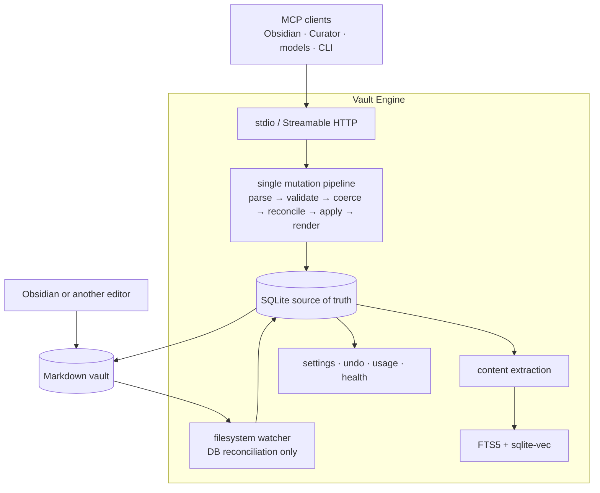

# Vault Engine

Vault Engine is the database-authoritative knowledge-graph service at the center of
the [Vault Engine monorepo](../../README.md). It indexes a Markdown vault, enforces
typed schemas, exposes the graph over MCP, and renders canonical state back to plain
files that remain usable in Obsidian or any editor.

The Engine is deliberately deterministic. Open-ended model loops and narrative
synthesis belong in [Vault Curator](../curator/README.md) or another MCP client.

## What it does

| Capability | What Engine owns |
| --- | --- |
| Vault model | Nodes, types, global fields, per-type claims and overrides, references, versions, and safe paths |
| Mutation pipeline | Parse, validate, coerce, reconcile, apply, atomic render, index update, undo capture, and warnings |
| Search | FTS5 plus local Nomic embeddings in `sqlite-vec`, structured filters, semantic chunking, and reciprocal-rank fusion |
| Extraction | Markdown, Office files, text PDFs, optional image/scanned-PDF vision, and optional audio transcription |
| Durable memory | Bi-temporal memory records, semantic recall, consolidation, expiration, reconciliation candidates, and an editable Markdown projection |
| Shared application state | Boards, conversations, document associations, settings domains, model catalog, prompt defaults, and usage records |
| Operations | OAuth and service tokens, backups, retention, health checks, sync/edit logs, CSV usage reports, normalization, and search rebuilds |

## Before you start

You need:

- The Node.js version pinned in the monorepo's `.nvmrc` (currently Node 24).
- An existing directory to use as the Markdown vault.
- About 1.5 GB of available memory while the local embedding worker is active.
- Provider keys only for the optional integrations you intend to enable.

Run the following commands from the monorepo root.

## Quick start

### 1. Install and build

```bash
npm install
npm run build
```

The ordered root build prepares Engine's shared dependencies before compiling
production TypeScript, verifying the embedded worker, typechecking tests, and building
the query MCP-App UI.

### 2. Configure a vault

```bash
cp packages/engine/.env.example packages/engine/.env
```

Add the vault path to `packages/engine/.env`:

```dotenv
VAULT_PATH=/absolute/path/to/your/vault
```

The default database is `<VAULT_PATH>/.vault-engine/vault.db`. Set `DB_PATH` when
using another filename or location.

### 3. Start a transport

For a local MCP host that launches Engine as a subprocess, use stdio:

```bash
node packages/engine/dist/index.js
```

An MCP host launches this command itself. On stdio, stdout carries only MCP messages and
Engine's logs go to stderr. `npm start -w vault-engine` runs the same server but puts npm's
own banner on stdout, so don't give a host that form.

A stdio connection has no sign-in, so Engine trusts it as fully as the suite's own code.
None of the rules Engine applies to a chat AI cover it: `fetch-url` is not limited to
addresses `web-search` returned, memory changes are not marked `changed_by`, and it may
label a memory `owner` or `curator` and edit `Settings/Memories.md`. Text an AI reads (a
clipping, a saved email, a web page) can tell it what to do, so connect a chat AI over
HTTP, where it signs in and those rules apply, and keep stdio for scripts and hosts you
trust. A host that marks each call its model chooses with
`_meta["vault-engine/chat-model"]` gets the memory rules on those calls, but not the
`fetch-url` one.

For HTTP, first set the OAuth values described below, then choose the port
explicitly. The repository's deployment convention is port `3334`; the bare CLI
default is `3333`.

```bash
node packages/engine/dist/index.js --transport http --port 3334
```

Run both transports in one process when needed:

```bash
node packages/engine/dist/index.js --transport both --port 3334
```

On startup, Engine migrates the database, indexes the vault, renders schemas and
settings notes, repairs links that do not name their file, starts the watcher, and drains
initial embedding work. The `linkRepair` setting in `Settings/Engine/General.md` makes that repair
`report` only (it logs the notes it would re-save) or turns it `off`.

The first start writes into the vault and reaches the network once. It creates the
settings notes and model catalog under `Settings/`, the `.schemas/` export, and the
`.vault-engine/` folder, and it downloads the embedding model
(`nomic-ai/nomic-embed-text-v1.5`) from Hugging Face into the model cache. `linkRepair`
defaults to `on`, so the first start also re-saves notes whose links do not name their
file, and a re-saved note is rendered in full. Try Engine on a copy of a vault first.

## Vault Analyzer

Vault Analyzer is a local, deterministic, read-only pre-install helper. It scans a folder
of Markdown and proposes a Vault Engine field pool and schemas from a *type assignment*
that the caller confirms. A type assignment combines:

- **A frontmatter type field** (`kind`, `type`, `types`, ...). Discovery ranks
  candidates, but Analyzer never selects a key by itself.
- **Folder rules**: `{ directory, type }`. The deepest matching rule types a document
  that has no usable type-field value; a `null` type leaves that subtree untyped. A rule
  covers its directory and every subdirectory, matched by whole path segments.
- **Tag rules**: `{ tag, type }`. A document with no usable type-field value gets the
  type of every rule whose tag it carries, inline (`#meeting`) or in a `tags` (or `tag`)
  frontmatter field; a nested tag (`#meeting/standup`) carries its parents too. A tag rule
  wins over the folder, since the note itself states it. The tag stays in the note.
- **Renames**: `{ from: to }` maps a type-field value to a final type name, or to
  `null` to drop it. Use it to merge values that differ only by case.

Folder-rule types and rename targets are final schema names: trimmed, safe as portable
filenames, and never wrapped as `[[wiki-links]]`, because Engine strips that wrapper
from `types` values.

Where a document has a usable type-field value, that value wins over tag and folder
rules.

Both reports list the tags worth offering as kinds (`tags.candidates`, at most 50, on at
least two notes, each a name a kind could have): discovery over every note, analysis over
the notes the type field leaves untyped. Tags are read as `list-inline-tags` reads them,
and only their names appear in a report, never the text around them.

```bash
npx vault-analyzer discover --root /path/to/folder [--exclude Templates]...
npx vault-analyzer analyze --root /path/to/folder --type-field kind [--type-key kind] [--exclude Templates]...
npx vault-analyzer analyze --root /path/to/folder --spec spec.json
```

A spec file is one JSON object with any of `type_field` (string or `null`), `type_key`,
`folder_rules` (`[{ "directory": "Meetings", "type": "meeting" }]`), `tag_rules`
(`[{ "tag": "meeting", "type": "meeting" }]`), `type_renames`
(`{ "Meeting": "meeting", "misc": null }`), `exclude` (directories), and `field_types`
(`{ "owners": { "field_type": "list", "list_item_type": "reference" } }`). It must provide
a type field, at least one folder or tag rule, or several.

A field whose values have more than one shape needs review: it is listed in
`needs_review.ambiguous_fields`, not proposed. Each one carries `options`: `text` (a
string field) and, unless it is also text, `dominant` (the most common value shape). Each
option's `unconverted` counts the values Engine would refuse to store as that type, after
its parser strips wiki-link brackets and validation resolves a `$mtime`, `$ctime`, or
`$now` date token; `0` means every value converts. A reference field's evidence uses the
targets Engine would store, so with a chosen reference type a plain name counts too. A field named in
`field_types` takes that type instead of an inferred one when every value converts, and
is then proposed and claimed like any other field. Otherwise it stays in review with a
reason naming how many values do not convert.

Discovery reports the inventory, ranked type-field candidates, and every folder with
Markdown in its subtree (direct and subtree counts; the shallowest 1,000 when there are
more). A folder with no eligible Markdown is reported too, with no candidates or folders;
analysis refuses it (`NO_MARKDOWN_FILES`). Analysis reports coverage, per-value and per-rule document counts, the proposal,
and review items. The proposal's `type_assignment.files` lists every eligible Markdown
file in path order with the final types it gets (`[]` when it stays untyped); this is
what Vault Installer applies.

Each command writes exactly one JSON result envelope to stdout. Validate
`data.format_version: 2` before consuming a successful report. Exit status `0` means
the command completed successfully, even when the report contains non-blocking
partial-coverage or review-required issues; `1` means Analyzer refused the requested
analysis; and `2` means the command arguments or spec were invalid. Human diagnostics,
if any, are written to stderr.

Analyzer does not create a database, modify Markdown, rename frontmatter keys, or apply
its proposal. Only Vault Installer presents and applies a user-approved proposal after
the type assignment and a current analysis have been reviewed.

Analyzer follows Engine's built-in vault eligibility rules: it skips hidden paths,
Obsidian sync-conflict files, `.git`, `.vault-engine`, `.schemas`, `.obsidian`, `.trash`,
and `node_modules`. It does not inherit runtime custom exclusions; pass them with
`--exclude` or the spec's `exclude`. Exclusions use Engine's `excludeDirs` matching
(whole segments from the vault root), and excluded files are not inventoried, read, or
fingerprinted. Markdown extensions are accepted case-insensitively.

The type key (`--type-key`, the spec's `type_key`) is the frontmatter key Engine will keep
types in, its [`VAULT_TYPE_KEY`](#the-type-key); `types` when omitted. The proposal maps
the type field onto it (`type_field_mapping`). With the type field as the type key
(`--type-field kind --type-key kind`), nothing is mapped and the notes keep their key; a
`types` key in those notes is then an ordinary field. A key Engine writes in its own notes
is refused (`TYPE_KEY_RESERVED`), and so is a type key, `types` included, that some note
holds a mapping or a nested list in (`TYPE_KEY_VALUE_UNSUPPORTED`), since Engine could not
keep that value as types.

A document typed by another key or a folder rule cannot be mapped when it already
carries a value in the type key; confirm the type key as the type field instead. The key
counts only when it holds something other than null, an empty string, or an empty list,
because adoption re-renders the type key and would replace that value. Engine writes an
empty one (`types:`) on every note it saves, including notes its startup link repair
rewrites. The type key is never proposed as a field.
Type values that are unsafe as portable schema filenames are reported as invalid and
never included in the apply-ready proposal unless a rename maps them to a safe name.
Distinct type names that collide under Analyzer's conservative case and Unicode
normalization key are withheld from the proposal and listed in
`needs_review.type_name_collisions`; merge them with a rename and analyze again. A
document that loses a withheld name still counts as multi-type, so its fields never
become single-type claims for its remaining types.

A type's `default_directory` is the folder rule that typed all of its single-type
documents, or otherwise the one exact parent directory they all share.

On Linux, race-safe containment requires procfs at `/proc/self/fd`; Analyzer validates the
opened file descriptor before reading bytes. On other platforms, Node's filesystem API
provides no equivalent handle-to-final-path check, so Analyzer uses leaf no-follow where
available plus post-read containment and identity checks. Those checks detect ordinary
concurrent changes but are best-effort against an adversarial ancestor-symlink race.

## HTTP authentication

The HTTP transport serves MCP at `/mcp` and uses OAuth with Dynamic Client
Registration. Configure:

```dotenv
OAUTH_OWNER_PASSWORD=<password-for-the-authorization-page>
OAUTH_ISSUER_URL=https://vault.example.com
```

OAuth-capable clients complete the normal authorization flow. Anyone can register a
client under any name, so the authorization page leads with the one thing a client
cannot choose freely: the host its redirect URI sends the authorization code to. Enter
the password only for a connection you started, and only when that host is the client
you expect. Each grant is logged with its destination.

Clients that accept a
static bearer token, such as the Obsidian plugin or Curator, use a long-lived service
token. The issuer script prints the cleartext token once and stores only its SHA-256
hash:

```bash
VAULT_PATH=/absolute/path/to/your/vault \
  npx tsx packages/engine/scripts/issue-service-token.ts --name obsidian-plugin
```

If the deployment uses a non-default database, also pass `DB_PATH` in that command's
environment. To revoke every token of a client, run the same command with `--revoke`
instead (`--name obsidian-plugin --revoke`); it sets `oauth_tokens.revoked = 1` for the
`service-<name>` client ID.

Service-token clients see every tool. OAuth-registered clients (claude.ai, Claude Code)
see the external surface, which omits the suite's own plumbing: board and conversation
persistence, the wiki provenance protocol, `wiki-reconcile`, `record-usage`,
`register-prompt-defaults`, `refresh-memory-note`, and `list-field-guess-candidates`.
This keeps their definitions out of model context; it is not an access control. The list
is `SERVICE_ONLY_TOOL_NAMES` in `src/mcp/tool-surface.ts`.

The HTTP listener binds to loopback. Put TLS termination, such as a reverse proxy or
Cloudflare Tunnel, in front of it for remote access.

## Configuration

Configuration is split into bootstrap/secrets and validated settings notes.

### Bootstrap and secrets: `.env`

| Variable | Required | Purpose |
| --- | --- | --- |
| `VAULT_PATH` | Yes | Absolute path to the Markdown vault |
| `DB_PATH` | No | SQLite path; defaults to `<VAULT_PATH>/.vault-engine/vault.db` |
| `EMBEDDER_MODELS_DIR` | No | Embedder model cache; defaults to `<VAULT_PATH>/.vault-engine/models`. Set it to keep the model files out of a synced vault |
| `VAULT_SETTINGS_DIR` | No | Vault-relative settings folder; defaults to `Settings` |
| `VAULT_ATTACHMENT_DIR` | No | Vault-relative attachment folder |
| `VAULT_TYPE_KEY` | No | Frontmatter key that holds a note's types; defaults to `types`. Chosen at install: Engine records the key its database was built with and refuses to start with another (see [The type key](#the-type-key)) |
| `OAUTH_OWNER_PASSWORD` | HTTP only | Gates the OAuth authorization page |
| `OAUTH_ISSUER_URL` | HTTP only | Public OAuth issuer URL |
| `GEMINI_API_KEY` | Per feature | Gemini image vision and scanned-PDF fallback |
| `ANTHROPIC_API_KEY` | Per feature | Anthropic catalog models for vision (images and scanned PDFs) and memory consolidation; also `visionProvider: claude` |
| `FIREWORKS_API_KEY` | Per feature | Fireworks catalog models for image vision and memory consolidation |
| `OPENROUTER_API_KEY` | Per feature | OpenRouter catalog models for image vision and memory consolidation |
| `OPENAI_API_KEY` | Per feature | OpenAI catalog models for vision (images and scanned PDFs) and memory consolidation. Without any of these four keys, new memories are stored without consolidation |
| `DEEPGRAM_API_KEY` | Per feature | Nova-3 audio transcription. It also needs the `usage:read` and `billing:read` scopes to confirm Deepgram's real charges in the spend ledger. The Member role has only the first; the Admin and Owner roles have both. Without them transcription still works and the daily job logs that it stopped |
| `EXA_API_KEY` | Per feature | `web-search`. `fetch-url` works without it for the suite's own callers; a signed-in chat client can fetch only what `web-search` returned, so without it that client can fetch nothing |

`visionModel` and `memoryConsolidationModel` both default to `[[Qwen 3.7 Plus]]`, a
Fireworks catalog entry. With only another provider's key set, point those settings at an
entry on that provider (for example `[[Claude Sonnet 4.6]]`); until then each
`create-memory` still stores the memory but warns `MEMORY_CONSOLIDATION_FAILED`.

### The type key

A note's types live in one frontmatter key, `types` unless `VAULT_TYPE_KEY` names another
(for a vault that already says `type: meeting` or `kind: meeting`). Engine reads each
note's types from that key and writes them under it, first, on every note it saves,
including its own settings notes, wiki pages, transcripts and the memory note. MCP tools
still call them `types` (`types`, `add_types`, `set_types`, `select: ['types']`), whatever
the key. `get-settings` reports the key as `typeKey`, beside `settingsDir` and
`attachmentDir`, and `Settings/Vault.md` lists it.

The key is set at install and does not change afterwards. Engine records it in the
database on its first start; a database that already has notes and no recorded key was
built with `types`. Started with a different key, Engine refuses to start and says which
key to set back, because it would otherwise read every note as untyped and write each
saved note's types under a second key. Changing the key on an existing vault needs a
migration that rewrites every note, which Engine does not have yet.

Engine keeps every value the key holds that can be a type, since the key is never also a
field and a value left out would be gone at the next save. One reading covers every key,
`types` included (#482): an unquoted `[[link]]` (which YAML reads as a nested list), alone
or as a list item, is its target and a link's `|alias` is dropped, as Vault Analyzer reads
them, a number or boolean is its text, and a type held twice is one type. A mapping or a
deeper list is no type and is not kept; a note's next save writes the key without it, as it
always has.

Before #482 `types` was read more narrowly: those forms were no type, a quoted
`"[[project|Projects]]"` was the type `project|Projects`, and a type held twice failed the
note's index. At the first start of an Engine with #482, every note the startup index did
not just read (its file unchanged) whose stored types differ from the new reading is
indexed again from the same bytes, once per database (meta
`type_key_values_reread_v1`). That index validates nothing, refuses no type (a type without
a schema included) and writes no file; the file changes at the note's next save, which
writes its types as a list. The start log names each such note
(`[types] <path>: <before> -> <after>`, the first 50), and the edits log keeps each one as
`types-reread` with its types before and after (`query-edits-log` with
`event_types: ["types-reread"]`).

The type key, `types` included, is never a field. A tool write that names it among the
fields it sets is refused before anything is read or written, with `VALIDATION_FAILED`
whose message is the refusal and whose `details.issues` carry `TYPE_KEY_FIELD`: in
`create-node` `fields`, in `update-node` `set_fields` in either mode (a `null` and a dry
run included), and in a `batch-mutate` create or update operation, which stops the batch at
that operation. The message names the parameters that change types on that tool: `types`
on `create-node` and a `batch-mutate` create; `set_types`, `add_types` and `remove_types`
on `update-node` and a `batch-mutate` update; `add_types` and `remove_types` in query mode.
`validate-node` reports the issue for a proposed state. The field would otherwise be
written over the note's types, and the next ingest of the file would read its value as
the note's types. The watcher still reads the key as types.

Before #480 a field named `types` was accepted as an unclaimed field. A note may still
carry one in the database (and its value over the types in the file); `vault-doctor`'s
`type_key_field_values` lists them. Such a note stays editable: its next Engine write (any
tool write, schema propagation, undo, an `update-node` with only the node's id) drops the
field, writes the note's types from the database back into the file, and records the
value in the edits log as `value-removed`, which retention keeps. An undo that restores
such a note from its snapshot (a deleted note, say) leaves the field out and records its
value the same way. An edit of the file in
Obsidian before that write makes the field's value the note's types, as it always did.

The key cannot be one Engine writes in its own notes (a setting name, a model,
transcript or memory note key such as `source` or `model`, `aliases`, or a `wiki_`
field), and no global field can be named like it.

See [`.env.example`](.env.example) for the current key list and migration notes.
Missing optional keys disable only their corresponding extractor or provider.
To keep the extraction keys for other features but stop paid audio and vision
extraction, set `extractionEnabled: false` in `Settings/Engine/Models.md` (or seed it with
`EXTRACTION_ENABLED=false` on first boot) and restart Engine.

### Behavior: `Settings/*.md`

Engine keeps behavioral settings canonical in SQLite and projects them into typed,
editable vault notes:

- `Settings/Engine/` — one note per area, like the tabs of a settings screen (#746):
  `General` (excluded folders, the normalizer, link repair), `Models` (attachment
  extraction, vision, the memory-merge model), `Backups and retention`, and `Provenance`.
- `Settings/Wiki.md` — wiki rendering caps and live sections.
- `Settings/Chat.md` — chat models, prompt text, context budget, and step limit.
- `Settings/Curator/` — Curator behavior, read by the sibling service: `General`
  (sweep time, daily limits, journal), `Models` (each job's model, token cap and
  reasoning), `Wikis`, `Memories`, `Conversation capture`, `Organization`, and `Prompts`.
- `Settings/Vault.md` — the vault map: the kinds of notes, fields, status values and
  folders the suite reads in your notes. Leave a kind or field empty (none) to turn off
  what depends on it. The wiki and curator keys that held these names (`projectType`,
  `statusField`, `wikiDir`, `topicDir`, `activeStatuses`, ...) still work through
  `update-settings` and are still reported by `get-settings`, but the wiki and curator
  notes no longer show them (#746): a line with an old name there is not read and is
  reported, unless it shows the vault map's own value. Engine warns in its issues when a
  designated type or field is in no note. Engine reads the names in project evidence
  (meeting dates through `dateField`, read as a link to a note titled with the date or as
  a plain value; task `priorityField` and `scheduledField`), memory note dates, search
  ranking (`wikiType` pages, `meetingType`, `transcriptType` and `dailyNoteType` notes), the embedding
  context (`peopleField` is rendered early) and transcript notes (`transcriptType` in
  `transcriptDir`). With `transcriptType` none, `materialize-transcript` refuses, and
  `archive-source` archives without making a transcript note (asking for one is
  refused); the retained transcript stays searchable. See
  [the vault map](../settings-registry/README.md#the-vault-map-vault-domain).
- `Settings/Models/*.md` — provider, raw model ID, capabilities, enablement, context
  length, and optional pricing for each model. Fireworks discovery enriches visible
  results with public, identity-checked rates; addition refreshes them before writing.
  See [Fireworks model pricing](docs/fireworks-model-pricing.md) for bounds and fallback behavior.

Each note is a snapshot of the settings it shows: deleting a line resets that setting, and
settings shown in other notes are left alone. A setting typed into the wrong note is not
applied; the note's warning names the note that holds it. `update-settings` rewrites the
notes that show the keys it changed. At the first start with the folders, Engine reads the
old single `Settings/Engine.md` and `Settings/Curator.md` one last time, before the
settings take effect, so a change made there while it was stopped still counts, then
removes each one when nothing in it was refused. One holding a refused or unknown value,
or saved while it was being removed, is left in place, no longer read, with a warning in
the log.

Rolling back to an Engine from before the folders has two effects; check these settings
after one. That Engine reads `Settings/Wiki.md` as a snapshot that includes the old vault
names, so their missing lines reset those vault-map values (`taskActiveStatuses` and the
rest) to their defaults. And a Curator or Engine setting changed while rolled back is
undone at the next upgrade: the older Engine does not read or write the folders' notes, so
they still hold the earlier values and win when read again.

The static schema and defaults live in
[`@vault/settings-registry`](../settings-registry/README.md). The `get-settings` and
`update-settings` MCP tools expose the same configuration to agents. Environment
variables marked as migrated in `.env.example` are first-boot seed inputs only;
change the generated note after seeding.

Deleting a domain settings note does not reset its effective settings. When the
live watcher pairs an intact rename or move away from a canonical domain path,
the moved note keeps its identity and authored bytes, and Engine regenerates the
canonical note from the effective settings with a new identity. Regeneration
checks that the canonical path is still absent under the write lock, including
unlink handling and startup reconciliation; a concurrent recreation is left for
normal file ingest. Model notes remain user-owned and are not regenerated.

### Field-name compatibility

Global fields and schema claims support names such as `__proto__`, `prototype`,
`constructor`, and `toString`. Field names are literal data keys: inherited JavaScript
properties never count as authored values, defaults, or raw Markdown. Engine accumulates
and patches field maps using dictionaries without prototypes; MCP input validation preserves
own field keys while validating their values. The same rule applies to orphan fields and explicit nulls
through rendering, queries, propagation, and undo.

This policy requires no database migration or field rename. Existing stored values and
undo snapshots retain their names. The separate restriction on AI guessing for
`__proto__`, `prototype`, and `constructor` remains in effect.

### Explicit-null read projections

Authored YAML nulls remain distinct from absent fields in node reads. `get-node`
returns `{ value: null, type: 'null', source: 'frontmatter' }` for these fields,
including expanded neighbors. `query-nodes` with `include_fields` and the internal
assembler return raw `null` values. A persisted null marker takes precedence over
any shadow value row without modifying storage. See the
[projection contract and audit](docs/explicit-null-projections.md).

### AI-guessable field repair

Global fields may opt into Curator-driven value repair. Both the field flag and its override
permission default to `false`, so migrations enable nothing automatically:

```yaml
fields:
  - name: status
    field_type: enum
    enum_values: [open, in-progress, backlog, done]
    ai_guessable: true
    overrides_allowed:
      ai_guessable: true
```

A schema claim may then set `ai_guessable: true` or `false` only when the global field grants
`overrides_allowed.ai_guessable`; otherwise Engine rejects the override. Multi-type disagreement
cancels to the global value, matching `required`. A non-required field may be marked guessable,
but optional omission is still respected.

Engine's read-only `list-field-guess-candidates` tool offers a field only when its effective flag
is enabled and it is effectively required and missing/empty, or its present value fails ordinary
validation. An absent optional field is never offered. Valid optional null, blank-string, and
empty-list values remain untouched; an explicit optional null is offered only when ordinary null
validation rejects it. Present invalid optional values may be repaired.

An on-demand run that names its fields (#644, the Curator's `fill-fields`) passes
`requested: { fields, query, replace_invalid }` to the same tool. Naming a field is the
consent for that run, so the listing then offers each named field on the notes the query
selects wherever it holds no value (absent, null, blank or an empty list), whether or not
it is required or marked. A value that fails validation is offered, to be replaced, only
with `replace_invalid`; each offered field says which it is (`absent` or `invalid`).
`query` takes `query-nodes`' flat filters, checked by the same schema (no joins, no `where`,
no group predicates), so a malformed predicate is refused before any note is selected. A
named field no type claims is refused. Text typed into a note that the watcher refused
for the field's type (stored nowhere, kept in the file) is read from the file and counted
as such a value, not as an empty field, with `held_text` saying what it is. The write guard takes the same marks
(`field_guess_guard.requested`, `replace_invalid`) and rechecks by the same rule, and a
field holding a valid value is refused in every mode.

Explicit YAML null keys are preserved separately from absence through watcher ingest, unrelated
mutations, render, rename, and undo. Until the one-time presence backfill completes, candidate
discovery returns an empty page with `FIELD_PRESENCE_BACKFILL_PENDING`, so no model spend can race
rollout. Candidate payloads exclude node bodies and current values; invalid-field issues are a
closed value-safe projection that retains constraint meaning without disclosing stored values.
The distinct claimed field universe that could resolve AI guessing to true is bounded by the
same canonical 20,000-character mandatory offered projection Curator uses. This single aggregate
includes every field identity plus exact applicable global and per-type enum values and reference
targets; legal constraints are never truncated. Engine enforces it inside global-field/schema
mutations and undo, with exact-boundary acceptance and full rollback on rejection; candidate
discovery fails closed if legacy or direct database writes bypassed the invariant. Unclaimed and
non-AI fields do not count, and duplicate fields count once. This keeps
the one-call/all-fields contract intact without creating extra model calls or partial ledgers.
Engine never calls the model—the Curator fetches body context only after its ledger and cap checks,
then admits at most one logical call slot per selected node and submits any accepted repair through
a guarded compare-and-swap `update-node` patch. The guard atomically rechecks all offered field
definitions, current AI eligibility, and accepted reference identities and types; an abstained
field neither blocks an unrelated accepted repair nor causes its default to materialize. Curator
disables both application and SDK transport
retries for this phase, so every admitted slot permits at most one provider HTTP attempt; a missing
credential can consume a slot before any request. Response failures disclose no raw model content.

---

## Architecture



The watcher never writes files. It reconciles human edits into SQLite with debounce,
retry, exclusion, and concurrent-write guards. Programmatic writes render atomically
after validation: the type key first, then fields a schema claims in schema order, then
the rest in the order the note already had them, with new ones after. The normalizer is
the explicit drift-repair path.

## MCP surface

Every tool returns the shared envelope
`{ ok: true, data, warnings } | { ok: false, error, warnings }`. Warnings remain
visible on success and failure.

The registered surface spans:

- **Nodes and types:** create, read, query, update, rename, delete, validate, batch
  mutation, type membership, `merge-nodes`, which folds notes into one (see
  [Merging notes](#merging-notes)), and `recover-dates`, which finds a date for notes
  that have none (see [Recovering dates](#recovering-dates)).
- **Schemas and fields:** list, describe, create, update, rename, delete, preview,
  inference, field-value discovery, and read-only candidate discovery through
  `list-field-guess-candidates`.
- **Search and content:** hybrid query, embedded reads, attachment ingest,
  transcripts, materialization, archiving, web search, and URL fetching.
- **Structure discovery:** `survey-nodes` groups notes by similarity, so a model can
  see the kinds hiding in notes that declare none (see [Note survey](#note-survey)), and
  `cleanup-report` lists what is still unorganized (see [Clean-up report](#clean-up-report)),
  `find-duplicate-nodes` lists copies and near copies (see [Duplicate notes](#duplicate-notes)),
  `find-missing-nodes` lists the names that have no note (see [Names with no note](#names-with-no-note)),
  and `list-inline-tags` lists the `#tags` in notes' text (see [Inline tags](#inline-tags)).
- **Wikis:** project evidence, managed-region writes, and deterministic page
  reconciliation used by Curator.
- **Memory:** create, read, update, expire or purge, list with an optional full-text
  or meaning-based (`search_mode: "semantic"`) query, near-pair discovery,
  consolidation replay, and Markdown-projection refresh. `get-node` and
  `project-evidence` take `include_memories: true` to return the memories that bear on
  what is read, each with its source. Two memories about different things of one kind
  (each with a linked subject of that kind, the vault owner's own companies left out,
  none shared) never merge: create leaves such a look-alike out of its comparison and says
  so in `kept_apart`, the replay does the same, and `list-memory-near-pairs` marks the pair
  `subjects_apart` (#718).
- **Application state:** boards, conversations, document links, settings, model
  discovery/addition, and prompt defaults.
- **Operations:** undo, vault statistics, integrity diagnostics, sync/edit logs,
  usage recording, and usage reports.

Some tools register only when their dependency is available: for example,
`web-search` needs `EXA_API_KEY`, while mutation and extraction tools require their
normal server context. Clients should use MCP discovery rather than hard-code a tool
count.

Examples in tool descriptions name the vault's own kinds, fields and statuses from
`Settings/Vault.md` (`src/mcp/example-names.ts`): the `query-nodes` recipes, the
`read-rollups` and `summarize-nodes` examples, and the type names `create-node` and
`create-schema` suggest. A kind or field set to none shows as a placeholder such as
`<task type>` or `<status field>`. Descriptions are built when an MCP session registers
its tools, so a map change shows from the next session (over stdio, after a restart);
connected clients are not notified.

### Related-node summaries

`summarize-nodes` returns a separate `node_summaries` result with versioned definitions,
parent identities, per-relation metrics, optional lookup items, and parent pagination.
It reads current structured reference memberships in one SQLite snapshot. For example:

```json
{
  "filter": { "types": ["project"] },
  "relations": [{
    "as": "outstanding_tasks",
    "direction": "incoming",
    "field": "project",
    "filter": { "types": ["task"], "fields": { "status": { "one_of": ["open", "in-progress"] } } },
    "metrics": [
      { "as": "count", "op": "count" },
      { "as": "next_due", "op": "min", "field": "due", "date_mode": "calendar_date" }
    ],
    "lookup": { "fields": ["status", "due"], "limit": 5 }
  }],
  "sort": { "by": "metric", "relation": "outstanding_tasks", "metric": "count", "order": "desc" }
}
```

Incoming traversal summarizes sources referencing each parent; outgoing traversal
looks up the targets each parent references. Body links are excluded. Counts use
distinct related IDs per parent, including separate memberships for a multi-parent
node. Empty relations count as zero; `min`/`max` return null when no non-null values
exist. Numeric extrema require finite numbers. Date extrema require the explicit
`calendar_date` mode and compare the written date, without converting timezones.
Lookup dates retain their stored strings. Invalid selected values fail the request.

Metrics and sorting cover every matching parent before pagination. Null sort values
come last; IDs provide a stable final tie-breaker. Lookups sort by ID and distinguish
absent fields from explicit nulls. Their `total`, `returned`, and `truncated` fields
make omissions visible. `RESULT_TRUNCATED` applies only to lookup items; metrics
remain exact. `CROSS_NODE_FILTER_UNRESOLVED` is conservative and vault-wide for the
requested field, including when no parents match. It does not assert that a returned
parent is affected. Leaf `exists` filters retain the existing field-row semantics:
an explicit-null marker alone does not count as a field row.

Limits: 4 relations, 8 metrics in total, 10 fields per filter, 200 IDs/10 types per
filter array, 100 `one_of` values, 1,024 characters per string operand, 5 lookup
fields and 10 items per relation/parent. Lookup defaults to 5 identity-only items.
Parent pages default to 50 and cap at 100, with offsets through 10,000. At most
10,000 matching parents and 100,000 raw matching traversal rows are allowed across
all descriptors, before related filtering or deduplication. Requests cap at 65,536
UTF-8 bytes; emitted success envelopes cap at 1,048,576 bytes. Population/response
limits return `INVALID_PARAMS` with `QUERY_LIMIT_EXCEEDED` details and no partial
metrics. Narrow the request after a capacity failure.

This is a synchronous, bounded read with no persisted rollup, new storage, or editable
computed field. Large accepted requests can block other Engine work until complete.
Object argument failures normally use the standard tool envelope. The installed MCP
SDK removes an own top-level `__proto__` property during protocol parsing before the
handler sees it; nested field maps preserve that name as data. Direct service calls
reject unknown top-level keys, including this one.

### Mutation safety

Mutation tools expose no-commit previews where the operation supports them. The main
node mutation tools, batch mutation, and schema update accept `dry_run`; broad or
destructive schema changes also require explicit confirmation. Undo snapshots cover
nodes, schemas, and global fields. A note's snapshot also keeps the lines of any field
its file shows other than as stored, such as "TBD" typed into a date field, which the
Engine refuses and stores nothing for: undoing a write or a delete puts that text back
in the file.

Previews apply the corresponding live operation's optimistic guards without retaining
writes or undo history. A successful preview does not reserve state: execution checks
again. Guard ordering, no-op exceptions, and recovery paths are documented in the
[mutation preview contract](docs/mutation-preview-contract.md).

For `wiki-reconcile`, `reused: true` identifies a previously applied plan and also
requires the current indexed home body to have valid wiki section boundaries.
Preview and live retries reject malformed markers with `VALIDATION_FAILED`; valid
owner edits remain untouched. Reuse does not regenerate content or add undo history,
and callers must still supply the current home version.

Schema propagation distinguishes presentation/AI metadata from changes to field order,
requirements, defaults, and enum constraints. Metadata-only edits remain visible in
previews without rewriting existing nodes; see [schema change effects](docs/schema-change-effects.md).

Data is not silently deleted. Removing a claim or type preserves orphaned field data,
and an unsafe global-field conversion requires an explicit discard decision while
retaining a forensic record.

### Safe reference-list member edits

Structured reference fields whose global field definition has `reference_target`
use the required node type when the database's reference policy is v2. An exact
stored file path wins only when that node has the required type; a wrong-type exact
path stays unresolved. For other matching tiers, one eligible node resolves and
multiple eligible nodes leave the reference ambiguous. Use an exact path such as
`Projects/Example.md` to disambiguate; an extensionless string does not acquire
`.md` automatically. Missing, type-mismatched, and ambiguous references retain
their raw values. Relevant mutation and read responses report bounded warnings
(`REFERENCE_AMBIGUOUS`, `REFERENCE_TARGET_TYPE_MISMATCH`, or
`REFERENCE_RESOLUTION_STALE` where applicable); truncation is explicit.

`get-node` outgoing and incoming relationship entries reflect stored
`resolved_target_id`, including a null target for unresolved references. Graph
joins, rollups, expansion, and traversal use that same stored binding. Inspect
with exact `node_id` or `file_path` when identity matters; top-level node
selectors, ordinary body links, and unconstrained references keep their existing
rules. Existing databases retain v1 until a separately approved offline
activation; newly created empty databases initialize v2. Activation is an offline CLI
step, run with the service stopped and the database backed up:
`node packages/engine/dist/index.js --reference-resolution preview` reports what would
change and a fingerprint, and `--reference-resolution apply --preview-fingerprint
<fingerprint> --offline` applies exactly that preview.

Use `update-node.reference_edit` to add or remove one member of a claimed
`list<reference>` field without replacing a list read earlier. This mode requires
a source `node_id` and cannot be combined with other edits, query mode, edit
sessions, or batch-mutate. It defaults to **preview**, unlike ordinary single-node
updates:

```json
{"node_id":"task-id","reference_edit":{"field":"project","action":"add","target":{"node_id":"project-id"}}}
```

To commit the intent against the latest list, explicitly set `dry_run: false`:

```json
{"node_id":"task-id","reference_edit":{"field":"project","action":"add","target":{"node_id":"project-id"}},"dry_run":false}
```

Independent additions combine. Supply `expected_version` and/or
`expected_content_hash` to require a particular source snapshot instead. Guards
and disk/index equality are checked even for an already-present add or absent
remove. Preview is not a reservation; target identity and schema are checked again
at commit. Repeating an unguarded add after another caller removed the member
reasserts the add; this is not exactly-once delivery.

ID removal removes all unambiguously matching spellings. To remove an exact
stored string, including a dangling reference, supply **both** source guards:

```json
{"node_id":"task-id","reference_edit":{"field":"project","action":"remove","target":{"stored_value":"Deleted project"}},"expected_version":7,"expected_content_hash":"hash-from-get-node","dry_run":false}
```

New additions require a canonical title that resolves uniquely both in Engine
and by filename. Ambiguous titles, unsafe link syntax and sanitized-title/filename
mismatches are rejected. Existing unrelated values and explicit nulls are
preserved; the operation refuses unrelated semantic normalization. Removing the
last member stores `[]`. No-op and preview requests create no history or queues;
real changes create one normal undo operation. Undo restores a guarded node
snapshot and reports conflicts after later edits.

The additive `data.reference_edit` summary reports the outcome, actual `changed`
and proposed `would_change`, entry counts and presence states, observed/result
version and hash, target ID and operation ID. Preview retains `data.preview`;
commit retains the ordinary node-update result fields.

Limits: 256 UTF-8 bytes for the field name, 4 KiB per selector, 1,000 entries and
256 KiB JSON per current/proposed list, and 1 MiB for the complete serialized
result envelope. A transaction-local identity catalog is capped at 50,000 nodes
and 16 MiB encoded metadata. Exceeding a bound rejects before writing. No
truncation, migration, new settings or automatic client adoption is involved.

## Search and extraction

Search combines:

- FTS5 over titles, bodies, fields, and richer lexical context.
- Local 256-dimensional Nomic embeddings stored with `sqlite-vec`.
- Semantic document chunks with heading and node context.
- Structured filters shared with `query-nodes`.
- Reciprocal-rank fusion across lexical and semantic lanes.

Extraction is content-hash cached. Markdown, Office documents, and text PDFs work
without provider keys. Images, scanned PDFs, audio, and web research activate only
when their corresponding provider is configured. Search-version migrations can roll
forward existing embeddings; `--reindex-search` is the manual clear-and-rebuild escape
hatch.

## Maintenance commands

```bash
# Preview canonical-render drift without writes
node packages/engine/dist/index.js --normalize --dry-run

# Apply a one-shot normalization sweep (stop the service first)
node packages/engine/dist/index.js --normalize

# Clear and rebuild semantic search
node packages/engine/dist/index.js --reindex-search
```

`--reindex-search` is not a one-shot: it clears the search index and then starts Engine
normally, watcher and transport included. Stop the service and add the flag to its usual
start command once; run beside a live service, it starts a second Engine on the same vault
and database. Only the `--normalize --dry-run` preview is meant to run while the service
is up.

The long-running service also performs scheduled backups, retention pruning, database
optimization, undo cleanup, settings reconciliation, and CSV usage-report refreshes.
Use `vault-stats` for a cheap status snapshot and `vault-doctor` for deeper read-only
integrity checks.

## Deployment

A typical systemd unit from a monorepo checkout looks like this:

```ini
[Unit]
Description=Vault Engine MCP Server
After=network-online.target
Wants=network-online.target

[Service]
Type=simple
WorkingDirectory=/srv/vault-engine
EnvironmentFile=/srv/vault-engine/packages/engine/.env
ExecStart=/usr/bin/node /srv/vault-engine/packages/engine/dist/index.js --transport http --port 3334
Restart=on-failure
RestartSec=10

[Install]
WantedBy=multi-user.target
```

Example reverse-proxy ingress:

```yaml
ingress:
  - hostname: vault.example.com
    service: http://localhost:3334
```

Any OAuth-capable MCP host connects to `https://<issuer>/mcp`. The host registers itself,
and the authorization page asks for `OAUTH_OWNER_PASSWORD`.

## Advanced read contracts

The following read surfaces build on the same envelope, snapshot, capacity, and warning
semantics described above. They remain separate from editable node fields and do not
create background work simply because the server supports them.

### Saved rollups and inverse relations

Schemas can own version-1 `relationship_views` definitions: named incoming/outgoing
relations over structured reference fields and count/min/max rollups over those relations.
The authoritative namespace is `schemas.metadata.relationship_views_v1`; schema YAML
exports it as `relationship_views`. No new table or migration is needed.

1. Discover definitions and their validity with
   `describe-schema({name:"project", include:["relationship_views"]})`.
2. Use `create-schema` with typed `relationship_views`, or use `update-schema` with
   `relationship_views` and the discovered `expected_relationship_views_hash`.
   Preview with `dry_run:true`; explicit null removes definitions. Stale hashes return
   `CONFLICT` / `STALE_RELATIONSHIP_VIEWS`. Ordinary metadata replacement preserves the
   reserved namespace; raw reserved-key writes are rejected.
3. Read current values with
   `read-rollups({schema:"project", rollups:["open_task_count","next_due_date"],
   relations:[{name:"tasks",fields:["status","due"],limit:5}]})`.
   Definitions must first be configured; these example names are not built-ins.

For example, read two metrics, sort by one, filter parents and include related tasks:

```json
{
  "schema": "project",
  "rollups": ["open_task_count", "next_due_date"],
  "filter": { "fields": { "status": { "ne": "done" } } },
  "sort": { "by": "rollup", "name": "open_task_count", "order": "desc" },
  "relations": [{ "name": "tasks", "fields": ["status", "due"], "limit": 5 }]
}
```

Use your discovered saved names; the example names must already be configured.
Multiple selected rollups work with one selected rollup as the sort key.
`filter` is a structured parent filter, so typed predicates belong under
`filter.fields`; node titles use `title_eq` or `title_contains` instead.
Related items already contain `id`, `title`, `file_path` and `version`.
`relations[].fields` adds up to five scalar typed global fields (string, enum,
number, boolean or date), returned under each item's `fields`; lists and references
are not supported lookup projections. Discover field names/types with
`describe-schema` or `list-global-fields`. A genuine global field named `title`
can still be selected separately from the item's node title.

Parent filters intersect the owning schema type. Rollup sorting occurs before pagination;
lookups can truncate without changing exact metrics. Definitions and source data are
read within one SQLite snapshot. Computed values appear separately under `rollups` and
`relations`, never as editable node fields. Date min/max uses explicit
`date_mode:"calendar_date"`; empty count is zero and empty min/max is null.

Namespaces allow 16 relations, 32 rollups and 64 KiB. A read selects at most eight rollups
and four inverse lookups, compiling to at most four relation descriptors/eight metrics;
identical field/direction/filter descriptors share work. Summary caps remain 10,000 parents,
100,000 raw rows, 100 parents/page and 10 lookup items; the complete rollup envelope is
bounded to 1 MiB. Capacity failures return no partial data. Missing selected dependencies
return `VALIDATION_FAILED` / `INVALID_ROLLUP_DEFINITION`; unrelated invalid definitions
remain discoverable and do not block valid selections.

Definition edits use existing preview, transaction, undo and protected-export paths.
Field renames rewrite typed tokens and capture owner schemas even when they do not claim
the field. Missing/deleted dependencies leave definitions intact. A blocked YAML projection
reports `SCHEMA_FILE_RENDER_BLOCKED` while retaining the committed database state.
Percentages and relative dates are described below. Chained rollups, caching, and
rendered computed fields remain out of scope.

### Bounded relationship traversal

`traverse-nodes` follows one structured reference field from an exact `root_id`.
For dependency review, call with `{root_id, field: "blockedBy", direction: "outgoing"}`;
use `incoming` to find dependents. `max_depth` defaults to 4 and is bounded to 1–8.
Optional `include_fields` projects up to five scalar fields. Responses contain shortest
node depths, original directed edges, observed cyclic components, and explicit unexpanded
boundary nodes. A diamond is not a cycle; boundary-limited reads do not establish global
acyclicity. Counts and completeness apply to resolved structured references, not body links.

One deferred SQLite snapshot spans validation, traversal, projection and serialization.
Caps are 500 nodes (including root), 2,000 logical edges, 10,000 raw relationship rows,
16 KiB arguments and 1 MiB serialized response. Depth limits return success with
`RESULT_TRUNCATED`; capacity overflow returns `INVALID_PARAMS` with
`QUERY_LIMIT_EXCEEDED` and no partial result. Outgoing unresolved diagnostics cover
expanded sources; incoming diagnostics conservatively report vault-wide field existence.
The tool changes no stored values or files.

### Note survey

`survey-nodes` is for a vault whose notes mostly say nothing about what they are. It
groups notes by the similarity of the embeddings search already stores, and describes
each group so a caller can name a kind and its fields. It reads only; typing the notes
stays with `update-node`.

- **Scope.** With no arguments, every note that has no type. `types` looks for
  sub-groups inside those types, `path_prefix` limits it to a folder, and `within`
  surveys one group of an earlier survey again. The suite's own notes are left out:
  the memory note and the Curator Journal always, and untyped notes in the settings
  folder.
- **Groups.** Each has a note count, `cohesion` (0–1), its most typical notes as
  `samples`, its `nearest` other group, and `shared`: folders, title patterns (dates,
  times, ids and numbers become tokens, as in `<date> …`), `Label: value` lines,
  headings and frontmatter fields, each with the share of the group that has it. Text
  and fields are read from at most 500 notes per group, and only the first 4,000
  characters of each. Group 0 is the rest: notes in clusters too small to report.
- **One kind, several groups.** It always forms up to `max_groups` groups (default 12;
  about ten notes a group at least), so a kind is often split, typically by the app it
  was exported from or by how it is written. Groups with the same shared features are
  one kind, and `nearest` is a hint. Stored embeddings include each note's title and
  folder; measured on a mixed three-app export with the real model, the groups followed
  kinds, and folders only decided how a kind was split
  (`tests/survey/mixed-export.model.test.ts`).
- **Acting on a group.** `members_of` pages a group's note ids, most typical first.
  Pass them as `node_ids` to `query-nodes` or to `update-node` query mode
  (`add_types`, `set_fields`).
- **Determinism and state.** The same notes give the same groups and the same
  `survey_id`. The last 8 surveys are held in memory so `within` and `members_of` keep
  working while a caller types groups one by one; a restart drops them, and an unknown
  `survey_id` returns `NOT_FOUND`.
- **Limits.** 50,000 notes (a larger scope is cut to the first by id, with a
  `RESULT_TRUNCATED` warning), 40 groups, 10 samples, 500 members per page. Notes the
  index has not embedded yet are counted in `scope.not_indexed` and left out. It takes
  about half a second for 15,000 notes at 12 groups.

### Clean-up report

`cleanup-report` lists what is still unorganized in a vault, as rows a caller works
through one at a time. It reads only and stores nothing: the vault holds the progress, so
a row that was fixed is smaller the next time, or has moved to `clear`.

| Row | Counts |
| --- | --- |
| `untyped` | Notes with no kind: the notes `survey-nodes` covers with no arguments |
| `task-status-missing`, `project-status-missing` | Tasks and projects with no value in their status field |
| `meeting-people-missing` | Meetings with no value in the people field |
| `task-status-unknown`, `project-status-unknown` | Tasks and projects whose status is in none of the vault map's five lists |
| `no-date` | Meetings and daily notes with neither a readable date field value nor a `YYYY-MM-DD` date in the title, which is how memories date a note. A date field holding something else ("TBD") counts as no date |
| `unclaimed-fields` | Typed notes with a field none of their kinds claims (Obsidian's own `aliases`, `tags` and `cssclasses` are not counted) |
| `missing-notes` | Notes with a link, in the text or in a field, to a note that does not exist. A link left unresolved although a note by that name exists (two notes share the name, or it is of another kind than the field takes) is not counted. `find-missing-nodes` lists the names in full, and adds names written as plain text in the people and company fields, which this row does not count |
| `duplicates` | Notes with the same text as another note: the notes `find-duplicate-nodes` puts in its exact groups with no arguments. Near copies are left to that tool. The row reads every note, past the 50,000 the tool reads in one call |

- **Each row** has `notes` (notes affected) `out_of` (notes the check looked at), `why`,
  `examples` and `next`. An example is a note, or a value with the notes that carry it:
  a field name (with the kind it is mostly on), a status, a missing note's name.
- **`guide`** is the organizing session as steps a model follows, in order: tell the user
  what the report found, take one row at a time, survey the notes with no kind and agree
  the kinds before creating any, preview every change to more than one note and write only
  after a yes, say how to undo it, then read the report again. It comes with every report
  (`src/cleanup/guide.ts`), so any client gets it from a plain request such as "what is
  still unorganized in my vault?", with nothing installed on its side. A report with no
  rows returns a two-line guide instead. The installer's last screen gives that request
  when an install leaves notes without a kind.
- **The `organize-vault` prompt** is the same session started by the user: an MCP prompt
  (`src/mcp/prompts.ts`, the Engine's only one, served to every session) whose one message
  asks for the report and carries the same steps. Claude Code lists it as
  `/mcp__<server name>__organize-vault`; a client with a prompt menu shows "Organize my
  vault". A prompt arrives as the user's own message, which a model follows more readily
  than text in a tool result.
- **Listing a row.** `cleanup-report` with `row: "<id>"` returns exactly the notes that
  row counts, newest first, paged with `limit` and `offset`. Their ids go to `query-nodes`
  or `update-node` as `node_ids`.
- **`next`** holds calls that start on the row, written with the vault's own kinds and
  fields: the row's own listing, and for a row whose notes a filter can express (a missing
  field, an unknown status) the same notes as a `query-nodes` call. A row is never given a
  query that only approximates it: an unreadable date or a link to a truly missing note
  has no filter.
- **Order.** Most notes affected first. On a vault that is already sorted,
  `unclaimed-fields` and `missing-notes` usually lead.
- **The vault map decides the names.** Kinds and fields come from `Settings/Vault.md`.
  A check whose kind or field is set to none is listed under `not_checked` with the
  setting that turns it on.
- **Only the user's notes are counted.** What the suite writes itself is left out: the
  memory note and the Curator Journal, the settings folder, and wiki pages. A gap in one
  of those is not the user's to fix.

It takes about a third of a second on 15,000 notes.

### Duplicate notes

`find-duplicate-nodes` lists the notes that are copies or near copies of each other, in
groups. A vault moved from app to app often holds a note twice: exported twice, or an old
copy beside an edited one. It reads only, stores nothing, and decides nothing: what to do
with a group stays with the caller.

- **Exact groups** hold notes with the same body, whatever their titles and folders.
  Line endings, trailing spaces and blank lines at either end are set aside.
- **Near groups** hold notes whose text is nearly the same. Similarity is the share of
  three-word runs two notes have in common, out of all the runs either has. Words are
  letters and digits only, so the same text in another app's markup (`## Heading` or
  `**Heading**`) scores 1. A near group's `similarity` is the lowest among the pairs that
  tie it together, and a chain of versions (each close to the next) is one group.
- **No model and no embeddings.** A copy is the same words. Embeddings measure the same
  subject, which notes written from one template share without being copies.
- **`min_similarity`** defaults to 0.7 and goes no lower than 0.5. On the mixed-export
  fixture (180 fictional notes from three apps, five kinds, heavy with shared labels and
  stock phrases) no two different notes scored over 0.56, while a copy with one word
  changed scored 0.79 to 0.92 and a copy with a sentence added 0.72 to 0.83.
- **Each note** comes with its title, path, types, word count, `modified_at` (the file's
  time) and `created_at` (when the Engine first indexed it), `inlink_count` and
  `outlink_count`, and `body_hash`: notes of a group with the same value have the same
  body. The most linked-to note is listed first, then the longest.
- **Compared:** the user's own notes, as the clean-up report counts them (not the
  suite's notes, the settings folder or wiki pages), and not transcripts or daily notes
  unless `types` names them, since those are alike by design (`scope.left_out_types`).
  `types` and `path_prefix` narrow it.
- **Too short to compare.** A body under 24 characters is never an exact copy (empty
  notes and stubs are not duplicates), and a note under 20 words is compared for an exact
  copy only.
- **How it stays fast.** Each note is reduced to at most 512 of its three-word runs and a
  96-number signature; notes whose signatures agree on a band are compared in full, so
  the work grows with the notes, not with their pairs. Notes of up to about 500 words are
  compared exactly; longer ones are estimated from the 512 runs, within a few hundredths.
  About 0.2 s for 5,000 notes, 1 s for 20,000 and 2.6 s for 50,000.
- **Limits.** 50,000 notes read (a larger scope is cut to the first by id, with a
  `RESULT_TRUNCATED` warning), 100 groups a page (`limit`, `offset`). At most two million
  pairs are compared in full; reaching that sets `scope.near_incomplete` and warns, and
  exact groups are complete regardless. Every call reads every note in scope again. The
  clean-up report's row has no such limit: it keeps a hash per note and counts the exact
  copies in the whole vault.
- **What to do with a group:** `merge-nodes` folds the other copies into the one to
  keep and repoints every link to them (see [Merging notes](#merging-notes)).
  `delete-node` only removes a copy: links to it are left pointing at a note that no
  longer exists.
- **A note and a longer version that contains it** score by how much text they share of
  all the text either has, so a copy that has since doubled in length scores about 0.5
  and is not listed at the default.

### Names with no note

`find-missing-nodes` lists the names that notes mention but that have no note of their
own, most-named first. In a pile of exported notes, people and companies are mostly
names: this says which of them enough notes name to deserve a note. It reads only and
stores nothing; creating the notes stays with the caller.

- **Where a name is read from.**
  - A link that resolves to nothing, in a note's text or in a field. These are the names
    the clean-up report's `missing-notes` row counts.
  - Plain text in the vault map's people field or company field: `Dana Whitfield` where
    a link would be `[[Dana Whitfield]]`. A list's items are names as written. A people
    field's single text value is split on commas and semicolons, unless the whole value
    is one name already: the note's own link in that field (`[[Whitfield, Dana]]`), or
    text a note answers to as it stands, by its name or by an alias. A link to a heading (`[[Dana Whitfield#Role]]`)
    is read as the link it is, not as plain text. A company's name can hold a comma, so a company
    value is one name, and it is a name whatever it ends in (`Northwind.ai`).
- **Not read:** names in a note's running text (telling a name from other words needs a
  model), and plain text in any other field.
- **Missing means no note of any kind answers to the name.** A link left unresolved
  because two notes share its name, or because the note is of another kind than the
  field takes, is not listed: creating a note for it would add a duplicate.
- **Each name** comes with `notes` (how many notes name it), `body_links` (how many of
  them link to it from their text), `fields` (per field: notes naming it there as a
  link, and as `plain_text`), `other_spellings` (case, separators, `.md`), the three
  newest notes that name it, `likely_type` and `create`.
- **`likely_type`** is the kind the name's note would be, when the fields that name it
  say so: a reference field's target kind, else the vault map's person kind for the
  people field and company kind for the company field. It is null when no field says,
  or when two fields disagree.
- **`create`** is `create-node` arguments: the title, the folder when the name was
  written with one, and `types` when `likely_type` is set. `batch-mutate` creates
  several at once. `create` leaves `types` out, and `create_note` says why and what to do,
  in two cases: the vault has no such kind yet (`create-node` refuses a kind with no
  schema, and a fresh export names people long before it has a person kind), or the kind
  names its files by a template (`Contact - {title}.md`), so a note created as that kind
  would not answer to the name.
- **`existing_note`** is set when a note already answers to the name by an alias or a
  near spelling (`A: B` for the file `A - B`), which no link resolves by. Such a name
  needs no new note, so `create` is left out: its links and values need rewriting to
  that note.
- **A name written with its folder** (`People/Dana Whitfield`) is listed apart from the
  bare name. Creating that note in its folder answers both. A name only ever written as
  plain text is a title as it stands, slash included (`AC/DC`).
- **After a note is created,** links to it resolve. A plain-text value stays plain text:
  it no longer counts as missing, and `scope.plain_text_fields` counts it under
  `with_a_note` until `update-node` rewrites the value as a link.
- **Narrowing:** `fields` keeps the names written in one of those fields (the people
  field, for the people with no note), `min_notes` the names at least that many notes
  name; `limit` (default 50, at most 200) and `offset` page.
- **Finding every note that names one:** `query-nodes` with
  `references: { target: <a spelling> }` for links, or
  `fields: { <field>: { contains: <name> } }` for plain text.
- **Read:** the user's own notes, as the clean-up report counts them.

### Merging notes

`merge-nodes` keeps one note and folds one or more others into it. The others are
removed, and every link to them names the kept note. It is for two notes about the same
person or company, and for the copies `find-duplicate-nodes` lists.

It previews by default. `dry_run: false` merges, and the result's `operation_id` undoes
the whole merge with `undo-operations`.

- **Arguments:** `keep` (the id of the note to keep) and `merge` (the ids of up to 10
  notes to fold into it), then optionally `set_fields`, `body`,
  `keep_titles_as_aliases` and `dry_run`.
- **Fields.** The kept note keeps its own values.
  - A field only a merged note holds is carried over (`fields.carried`).
  - A list field both hold is combined: the merged note's items the kept note lacks are
    added (`fields.combined`).
  - Where both hold different values, the kept note's stays, and `fields.conflicts`
    shows both. `set_fields` chooses another value, and can set or remove (`null`) any
    other field.
  - Text the kept note's file holds that the Engine did not take (a value that fails
    its field's rules) counts as the kept note's value, whether the database holds
    nothing for the field or its value from before: the field is left alone, and a
    merged note's different value shows as a conflict. Only `set_fields` writes it.
- **Text.** Each merged note's text is added to the kept note, as written, under a
  `## Merged from <title>` heading. Text the note already holds is not added twice, and
  an empty kept note takes the first text as its own. `body` supplies the merged text
  in place of this.
- **Kinds.** The merged note has every kind its notes had (`types_added`).
- **Names.** Each merged note's title is added to the kept note's `aliases`, so
  Obsidian's link autocomplete and search still find it by the old name, and a link
  later typed with the old name is repaired to point at it.
  `keep_titles_as_aliases: false` leaves the titles out.
- **Links.** Every link bound to a merged note is rewritten, in a note's text or in a
  field, whether or not the field is defined.
  - **What is kept:** the link's display text, and its heading or block anchor.
  - **How the kept note is named:** by its title, or by its vault path where another
    remaining note shares the title (`links.written_as`). A heading link takes the path
    too where its whole text would name another note (a note called `Alpha#Goals`). An
    embed of a note whose name has a dot keeps `.md` (`![[Report.v2.md]]`), or it would
    be read as an attachment.
  - **In fields:** a value is rewritten only where that note holds it as a link. The
    same words as plain text are left alone, in another note or beside the link. A value
    with no brackets is a link only in a field defined as a reference. A link inside longer text
    in an undefined field (`Ask [[Dana W]]`) is rewritten where it stands, and two names
    for one note in the same list become one.
  - **No rewrite needed:** a link whose text already names the kept note (a same-titled
    copy was merged) is bound to it as it stands.
  - **Left alone:** a field of a linking note whose file holds text there that the Engine
    did not take. Rewriting it would replace what was typed, so it is listed in
    `links.fields_left_alone` with a warning, and its stored link is not repointed.
- **Also moved to the kept note** (`moved`): memories scoped to or drawn from a merged
  note, and boards, conversations and transcripts linked to one. Deleting a note expires
  its memories; a merged note's text lives on, so its memories do too.
- **One undo** restores the removed notes and their files, the kept note and every
  rewritten link. It does not move memories, boards, conversations or transcripts back.
- **Refused:**
  - a wiki page, a settings note, the memory note or the journal, as either side;
  - a merge while one of its notes, or a note that links to them, has an edit the Engine
    has not read yet, or has lost its file (`CONTENT_HASH_MISMATCH`): the merge works
    from the database, so that text would be lost. Try again in a few seconds;
  - a merge that would leave a note invalid (`VALIDATION_FAILED`, naming the note and
    the field). Nothing is changed; `set_fields` can supply the value;
  - a merged note whose file holds text the Engine did not take: a value that fails its
    field's rules stays in the file as typed and is stored nowhere, so removing the note
    would lose it. Correct or clear the value first;
  - a `set_fields` value that is not text or a list, for an undefined field that holds a
    link in the kept note. Pass `null` to remove the field, then set it with
    `update-node`.
- **How it is written.** One transaction: the merged notes leave the database, the kept
  note is written once and every linking note once. Their files are removed only after
  the commit, so a refused merge leaves every file as it was. A merged note's file that
  was saved while the merge ran is not removed: it holds text the merge did not see, so
  it is kept and named in `files_kept`, with a warning. A preview runs the same
  writes against the database alone and rolls them back, so it reports what the real
  merge would refuse.
- **One trace an undo leaves.** When same-titled copies are merged, a link whose text
  already reads as the kept note's name is not rewritten, only bound to the kept note.
  An undo brings the copy back but does not bind that link back to it: the link stays on
  the kept note until its own note is next read or written. Both notes carry the name
  the link gives.

### Recovering dates

`recover-dates` finds a date for notes that have none the system can read, from what
each note itself holds, and writes it to the vault map's date field. A note's date is
read from that field, or else from a `YYYY-MM-DD` day in its title, and never from the
file time. An exported note often has neither, though the date is there in another form.

It previews by default. `dry_run: false` writes, and one run is one undo.

- **Where a proposal comes from,** in this order:
  1. the date field's own text, written another way (`March 4, 2021`);
  2. another frontmatter field named for the note's date (`meeting date`, `when`,
     `start`), then one named for when it was made (`created`, `createdAt`);
  3. the title, in a form other than `YYYY-MM-DD` (`2021_03_04`, `4 Mar 2021`);
  4. the first ten lines of the text: a labelled line (`Date: …`), or a line that is only
     a date;
  5. a field named for the last edit (`updated`, `modified`);
  6. the file's time, only with `use_file_time`, and only for a note that holds no
     written date at all.
- **Not read as the note's date:** a field whose name has any word beyond the note's own
  date (`due date`, `release date`, `date of birth`, `end date`), the vault map's due and
  scheduled fields, and a date inside a sentence of the text.
- **Sure and unsure.** A date is sure when it is written in a clear form in the
  frontmatter or the title. It is unsure, with `doubts` saying why, when:
  - day and month could be either way round (`03/04/2021`), or the year has two digits;
  - it is the first day of a span (`March 4-6, 2021`);
  - it comes from a line of the text, a last-edit field or the file time;
  - writing it would replace what the date field holds (`replaces`): text that is not
    this date, words beside the date (`March 4, 2021 (tentative)`), a list, or a link
    (`[[March 4, 2021]]`), which a plain date would drop;
  - the note states another day too (`sources_disagree`): an export's `created` and
    title often hold the day it was exported, while a `Date:` line in the text says when
    the meeting was. `also` lists the other days, and the user says which is right. A
    `created` that differs from a field named for the note's date (`meeting date`) does
    not count, since a note is often written on another day; nor does a last edit. When
    the stated days disagree, no source is sure, that `created` included.
- **Text only the file holds** (`file_only_text`): the date field holds text it refused,
  such as "TBD", which is in the note's file alone. A date over it is unsure like any
  other replacement, and undo puts the text back.
- **Not writable** (`writable: false`): an either-way date with no reading.
- **An either-way date** is read by the order the other dates of the same field (or of
  the titles, or of the same label) show, across the whole vault: `25/03/2021` in
  another note says day first. With nothing to go by, `date` is null, `readings` gives
  both, and it is never written. A run that writes remembers the orders it learned,
  since writing `2021-03-25` over `25/03/2021` removes the evidence; they are used for
  a source the vault no longer shows any evidence for.
- **What a run writes.** The sure dates. The unsure ones are listed for the user, and
  written with `include_unsure: true`, usually with `node_ids` naming the ones they
  confirmed.
- **Each proposal** has `date`, `from`, `field` (the field or the line's label), `where`
  (the text it was read from), `sure` and `doubts`. The first sure candidate wins, else
  the first unsure one.
- **`scope`** counts the notes read, those with no date (`undated`), and of those the
  `sure`, `unsure` and `unreadable` (no reading) proposals and the notes that hold no
  date at all (`none`).
- **Narrowing:** `types`, `path_prefix`, `node_ids`; `only` lists the sure or the unsure;
  `limit` (default 50, at most 200) and `offset` page.
- **Limits.** 500 notes written per call; `remaining` says how many the run did not get
  to, and calling again goes on from there, since a written note is no longer undated. A
  note that cannot be written (an edit the Engine has not read, a note that fails
  validation for a reason of its own) is skipped with the reason and does not count
  toward the 500, so the notes behind it are still reached. One call tries at most
  5,000 notes.
- **Forms read:** numbers (`2021-03-04`, `2021.03.04`, `20210304`, `25/03/2021`) and
  English month names (`March 4, 2021`, `4 Mar 2021`). Only whole dates: `March 2021`
  and `next Friday` name no day.
- **Read:** the user's own notes, as the clean-up report counts them. The report's
  `no-date` row points here.

### Inline tags

`list-inline-tags` lists the `#tags` written in notes' text, most notes first, with the
notes that carry each. Some apps mark what a note is with a tag in its text (`#meeting`,
`#recipe`). Nothing else in the Engine reads those, so no query can find "the notes
tagged `#meeting`". It reads only and stores nothing.

- **Each tag** comes with `notes` (how many carry it), `inline` (in their text),
  `in_field` (in the `tags` or `tag` frontmatter field, which is counted as the same
  tag), `untyped` (with no kind), the three kinds those notes most have, and the three
  newest notes.
- **`tag`** lists exactly the notes of one tag, newest first, each with its kinds and
  where it holds the tag.
- **Turning a tag into a kind or a field value** uses the tools that already write in
  bulk: the ids go to `update-node` as `query: { node_ids }`, with `add_types` or
  `set_fields`. It previews until `dry_run` is false and takes 500 ids a call.
- **The tag's text stays in the note.** Nothing here changes a note.
- **What a tag is,** as Obsidian reads it:
  - `#` at the start of a line or after a space, then letters, digits, `_`, `-` and `/`,
    with at least one character that is not a digit (`#project/alpha`, `#2021-plans`;
    not `#123`);
  - not a heading (`# Title`), a link to a heading (`[[Note#Part]]`), a URL's fragment,
    or anything in code: a fenced or indented block, or inline code on one line or
    several; nor anything in an HTML block or comment;
  - the same tag in any letter case;
  - a nested tag counts for the tags it is nested under: a note with `#project/alpha`
    is one of the notes of `project` (`nested_only` says how many carry a tag only that
    way).
- **Narrowing:** `prefix` (`project/`), `min_notes`, `path_prefix`, `untyped_only`;
  `limit` and `offset` page the tags (default 50, at most 200) or one tag's notes
  (default 200, at most 500).
- **Read:** the user's own notes, as the clean-up report counts them. The report's row
  for notes with no kind points here with `untyped_only`.

### Project home and subpage provenance

Engine stores captured inputs and output revisions in dedicated SQLite provenance
records, separate from the derived relationship index. Project capture records each
Curator home or subpage call separately: replaced narrative sections and its new Log entry.
It does not archive every vault edit or certify individual claims. Input dependency
is not verified claim support; a changed source does not prove an output false;
retained inputs do not guarantee deterministic LLM replay.

| MCP tool | Purpose |
| --- | --- |
| `provenance-prepare` | Validate current source observations and retain the effective provider request before dispatch; `dry_run` validates without recording or reserving. |
| `provenance-stage-result` | Retain validated sections and their final contribution against the prepared bundle. |
| `provenance-transition` | Mark dispatch, renew, fail or abandon; cannot publish or resurrect a capture. |
| `inspect-provenance` | Select `status`, `attempt`, `node`, `output`, `input_text`, `text`, `refresh_target` or `purge_receipts`. Metadata omits payload text; text is separately paginated. |
| `find-affected-outputs` | Compare recorded direct dependencies with current Engine observations. Returns candidates and comparison reasons, not truth judgments. |
| `purge-provenance` | Preview a source-ID or derivation-ID scope, then commit that reviewed scope token with `dry_run:false, confirm:true`. |

`get-node`, `project-evidence` and `list-memories` accept opt-in
`include_provenance:true`. Their observations accompany the represented data from
one read snapshot. The existing `evidence_hash` retains its refresh semantics;
observation fingerprints and retained span digests are separate. `wiki-reconcile`
accepts optional `home.provenance` and content-writing page bindings; all output
receipts commit atomically with the wiki mutation.
Exact retries recover the historical receipt even after later edits, with current
contribution state reported separately. Existing version guards still govern new writes.

Provenance migration **3** preserves existing captures and permits one output per
node in a reconciliation batch. New captured project batches advertise
`project-subpage-v1` and `multi-output-reconcile-v1`; `provenance_receipts` is ordered
home first, then content-writing page operations. The singular `provenance_receipt`
continues to mean the home. No-flow prepare/attempt calls still default to
`project-home-v1`, and legacy single-home replay remains compatible.

New-mode or page-bound publication rechecks captured observations before writes;
external drift rejects the complete batch. Legacy home-only publication keeps its
existing source-drift semantics. Engine records its own final observations for
sources deliberately changed by publication, including merged source pages.
`expected_self_transition` means an expected change during publication and is
excluded from direct-impact candidates. A later external change is still reported.
Replay retains the complete original receipt set and mappings once under the home
anchor, capped at 64 KiB. Partial capture purge/expiry invalidates batch replay;
it cannot reapply writes or reconstruct erased payloads.

Node observations use `node-token-v2`, covering identity, version, content hash,
title and path, including offline renames that preserve version/hash. Previously
retained v1 observations remain inspectable; impact comparisons with them report
`comparison_unknown` rather than assuming rename coverage. New captures must regather
v2 observations. Ambiguous or malformed wiki section markers make current contribution
state `unknown`, including on historical receipt replay.

`project-evidence` also accepts `provenance_node_ids` (up to 512) with
`include_provenance:true` to select observation metadata for represented sources.
The response always contains a fresh, coherent evidence snapshot; callers must use
that snapshot together with its observations. Curator requests the IDs selected by
its home formatter when the default metadata cap omits a rendered source, with at
most three rereads if the rendered source set changes. Unrepresented IDs are omitted;
missing required observations fail capture before model dispatch.

Engine settings (next use; no environment variables):

| Setting | Default |
| --- | ---: |
| `provenanceRequestBytes` | 1,048,576 |
| `provenanceComponentBytes` | 262,144 |
| `provenanceItemCount` | 512 |
| `provenanceOutputBytes` | 262,144 |
| `provenanceTotalBytes` | 2,097,152 |
| `provenanceCapacityBytes` | 1,073,741,824 |
| `provenanceLeaseHours` | 24 |
| `provenanceFailedRetentionDays` | 7 |

The first five are hard ceilings that settings may lower. Cross-limit combinations
must remain valid. Engine validates the merged effective settings, including explicit
and settings-file resets, before persisting. Invalid combinations retain the previous
coupled byte limits and report setting issues; unrelated valid edits still apply.
Logical capacity includes all retained payload copies and active
reservations, excluding SQLite metadata/index/WAL and backup overhead. Each prepare
reserves the total derivation limit; commit releases unused space. Capture rejects
excess rather than truncating an already-used request. Capacity exhaustion blocks new
tracked synthesis; increase capacity deliberately or preview and purge selected history.
Committed history is never silently evicted.

Ordinary source/output deletion leaves committed capture history intact. The existing
maintenance sweep abandons expired leases and expires failed/abandoned payloads seven
days after their terminal time. Full scheduled Curator runs may start new attempts;
old reservations expire by lease. Durable requested-page recovery consults its saved
checkpoint and never automatically reissues an uncertain paid call. Transport retries
reuse the exact attempt.
A staged result is not publication; only the Engine output receipt establishes commit.

Retained requests contain sensitive copies, including generated context and corrections.
A source purge removes every retained composite bundle selected in the preview, including
other inputs co-captured in those bundles, copied labels/digests and stored outputs.
It leaves current vault notes unchanged and keeps opaque audit tombstones. One purge
covers at most 100 derivations; `truncated:true` requires another preview/confirmation
for the remainder. A changed scope is rejected. A lost reply retries the same token
without purging newly created captures.

Purge is logical erasure in this database, not physical secure erasure of SQLite pages,
WAL, disk, external logs or backups. `purge_restore_verification` is always `unverified`:
a restored old backup can reintroduce retained content. Export opaque purge receipts
and re-preview their derivation IDs after restoration; manage backup destruction and
filesystem copies separately. There is no global erasure attestation.

Metadata reads default to 20 records (100 maximum); impact accepts 50 sources and
performs at most 1,000 comparisons per page; text pages are at most 64 KiB UTF-8.
Follow cursors even on an empty filtered impact page. Dependency coverage is direct
and may include opaque aggregates; it does not recursively trace prior generated pages.
Unknown legacy outputs have no fabricated provenance. Later uncaptured contribution
changes are `not_recorded`; ambiguous comparisons remain `unknown`.

### Selective project-home refresh

Curator can request a captured home-only publication via the additive
`wiki-reconcile.home_refresh` guard. Engine requires an existing canonical project
home, current retained output ID, matching managed text/version/topology, staged
provenance and no page operations, rechecked inside the write transaction.
It preserves full-curation stamps and adds replacement lineage to the new receipt.
Provenance schema version 2 migrates old receipts with null replacement lineage.
`inspect-provenance` advertises `selective_home_refresh_v1` and provides the
metadata-only `refresh_target` selector. Sub-pages have the same path:
`wiki-reconcile.page_refresh`, advertised as `selective_page_refresh_v1`.

### Read-only provenance inspection

`inspect-provenance` now advertises `output_input_comparisons_v1` and `input_text_v1`
in the optional `inspection_features` status field. Capture `capability_version`
remains 1. Existing callers can continue using their current selectors.

- `select: "output"` accepts `include_comparisons: true`. Each returned input has
  a comparison against its recorded observation, with a response `compared_at`.
  Comparisons cover that page's read snapshot; source changes do not prove the
  generated narrative is false. Omitting the option preserves legacy responses.
- A note that only gained or lost links around its words since it was observed compares
  `unchanged` here and in `find-affected-outputs` (#332): provenance migration **4** stores
  each observation's note text hash (`text_hash`, with links read as the words they show),
  and gives observations of notes still as observed theirs at the upgrade. An observation
  without one, or a note renamed or moved since, compares as before.
- Each input from `select: "output"` carries `position`: its first span's field and the
  smallest UTF-8 start offset in that field, or null once a purge drops its spans. Inputs
  are stored under random ids, so this is how a reader lists them in the order the model
  read them; the Obsidian inspector lists a build's memories that way (#551).
- `select: "input_text"` requires `output_revision_id` and `input_id`. It returns
  retained span fragments with UTF-8 byte coordinates, full `input_digest`,
  availability, and an optional continuation cursor. `max_bytes` is 4–65,536
  (default 16,384), with at most 64 fragments per page. Different spans remain
  separate; text is the input representation, not a whole historical source file.
- Text reads validate input ownership and retained attribution integrity. Initial
  reads of erased captures return empty segments and their availability;
  continuation after erasure fails with `PROVENANCE_REVOKED`. Ordinary source
  deletion does not erase retained captures.

These additions perform no mutations, model calls, or schema migrations. Disabling
future capture does not disable inspection of retained historical records.

### Percentage and relative-date rollups

`summarize-nodes` and schema-owned `read-rollups` definitions support a `percentage`
metric. The relation/rollup filter selects eligible members; `matching_filter.fields`
selects a subset of those members. Results use distinct nodes, return 0–100, and
return `null` for an empty denominator. `metric_details` (summaries) or
`rollup_details` (saved rollups) reports numerator and denominator counts. Sorting
uses the full calculated population before pagination; lookup caps do not limit it.

For example, configure a saved rollup with `update-schema` using the current
`expected_relationship_views_hash`, preview, and then apply:

```json
{
  "name": "completion",
  "relation": "tasks",
  "filter": {"fields": {"status": {"one_of": ["done", "open", "in-progress"]}}},
  "metric": {"op": "percentage", "matching_filter": {"fields": {"status": {"eq": "done"}}}}
}
```

These status names are configuration, not operator policy. Other schemas, reference
fields, status-field names and vocabularies work the same way. Allowed enum values
are separate schema configuration. A shared status-classification system is not
introduced here, and the existing Obsidian project-health profile remains fixed.
Use new saved names instead of changing that card's required definitions.

A date-typed field can use `date_window` with inclusive `from_days` and exclusive
`to_days`. At least one bound is required, each an integer within ±36,600; two bounds
must be ordered. `{"to_days":0}` is overdue; `{"from_days":0,"to_days":7}` is today
and the following six dates. Missing/null dates do not match. Timestamp values and
malformed calendar dates in the otherwise eligible population fail explicitly.
Date min/max retains its existing calendar-date projection behavior.

Discover saved names via `describe-schema` with `include:["relationship_views"]`.
Temporal definitions advertise `requires_evaluation_context:true`; percentages
advertise `unit:"percent"`. Read configured definitions with, for example:

```json
{
  "schema": "project",
  "rollups": ["completion", "active_overdue_count"],
  "evaluation_context": {
    "time_zone": "America/New_York",
    "as_of": "2026-09-19T16:00:00Z"
  }
}
```

Every relative-date read requires an explicit named timezone. `as_of` is optional;
when omitted Engine samples the clock once. The response reports effective
`time_zone`, normalized `as_of` and `calendar_date`. For this example overdue means
before 2026-09-19, and the [0,7) window ends before 2026-09-26. Day arithmetic follows
the calendar across DST. Timezone aliases are accepted by Intl and echoed as supplied.
Reuse the returned instant/timezone across pages to pin the date boundary, but this
neither freezes database changes between reads nor reconstructs historical data.

The standard request/relationship/response limits still apply. Temporal parent
filters conservatively cap ordinary candidates before date filtering, so narrowing
other parent filters may be necessary. Unresolved-reference warnings retain their
existing scope. New metadata is omitted from legacy reads that do not need it.

Upgrade Engine before installing definitions using these operators. An older Engine
rejects a namespace containing unknown metric/predicate shapes; reverting code alone
can make that namespace undiscoverable. Definition edits, exports, field renames,
preview, hash-conflict checks and undo retain the existing governed path. No database
migration, environment variable, model call or automatic definition installation is
required by this feature.

### Bounded AND/OR read filters

`query-nodes` accepts an optional `where` expression. `all` intersects branches;
`any` unions distinct node identities. Existing flat arguments remain outer AND
constraints. This works for schema-defined entities and fields generally, without
installing saved definitions. For example, task status open OR estimate greater
than one:

```json
{
  "types": ["task"],
  "where": {
    "any": [
      { "fields": { "status": { "eq": "open" } } },
      { "fields": { "estimate": { "gt": 1 } } }
    ]
  },
  "limit": 25
}
```

Each node is a nonempty ordinary filter leaf or exactly one `all`/`any` group.
Groups contain 2–8 children, with at most four group levels. A request containing
expressions has shared limits of 64 expression nodes, 128 predicates, 512 scalar
operands and 16 KiB of `where` JSON. Flat siblings and selected saved definitions
contribute to the effective predicate/operand budget; target expressions share the
same budget. Existing whole-request and summary population limits also apply.

Query leaves support the existing structured query vocabulary, including literal
`full_text`, whole-word `full_text_words` (#687: the text's words in order, any case,
read from the full-text index, so "Ark" is not found in "market"), references and
one-hop joins. `join_filters[].target.where` supports the existing target vocabulary,
excluding further joins, `full_text` and `full_text_words`. Ranking,
pagination and projection controls belong outside expressions. `update-node.query`
rejects `where`, including in targets, in preview and apply. General NOT, nested
relationship hops and query relative-date operators are outside this feature.

Summaries accept expressions in parent and related-member `filter`; percentage
`matching_filter` expressions have fields-only leaves. The numerator is evaluated
inside the final eligible denominator. This example counts the completed fraction
of open/done tasks for selected projects:

```json
{
  "filter": { "types": ["project"], "where": { "any": [
    { "title_eq": "Project A" }, { "title_eq": "Project B" }
  ] } },
  "relations": [{
    "as": "work", "direction": "incoming", "field": "project",
    "filter": { "types": ["task"], "where": { "any": [
      { "fields": { "status": { "eq": "open" } } },
      { "fields": { "status": { "eq": "done" } } }
    ] } },
    "metrics": [{ "as": "completion", "op": "percentage",
      "matching_filter": { "where": { "fields": { "status": { "eq": "done" } } } }
    }]
  }]
}
```

Summary date windows use one explicit context, for example
`"evaluation_context":{"time_zone":"America/New_York","as_of":"2026-09-20T02:13:18Z"}`.
Context is required if any selected branch contains `date_window`, even when an
alternative branch matches. Static candidate selection replaces date atoms with
true while preserving the groups. A date atom validates candidates passing its
ordinary leaf constraints and projected siblings at every AND ancestor; OR adds
no sibling constraint. All gated dates are validated before returning results.
For `open AND (high-estimate OR due-window)`, all otherwise eligible open nodes'
dates are checked. For `done OR (open AND due-window)`, only the open branch's
dates are checked. Missing/null dates do not match; malformed non-null values in
that population fail with identity/field details, without exposing the raw value.

Saved rollup eligibility and percentage matching support fields-only expressions
in `relationship_views_v1`. Given an existing `tasks` relation, an additive rollup
entry can be:

```json
{
  "name": "active_work", "relation": "tasks",
  "filter": { "where": { "any": [
    { "fields": { "status": { "eq": "open" } } },
    { "fields": { "status": { "eq": "in-progress" } } }
  ] } },
  "metric": { "op": "count" }
}
```

Saved relation filters remain type-only. `read-rollups.filter.where` supports
ordinary summary leaves and always intersects the owning schema. Discovery,
preview/hash guards, export, field rename and undo preserve expression trees.
Array order affects hashes; legacy definitions without expressions keep their
hashes. Several individually valid definitions can exceed a combined read budget;
that read fails without partial results.

Upgrade Engine before installing expression-bearing definitions. Older Engine
versions can reject the containing namespace after a downgrade. Clients must not
retry by dropping expressions. Existing views retain `where` as one inspectable,
removable caller filter through type changes, sorting, refresh and save/reopen;
ordinary chip edits add outer AND constraints. Unresolved-link warnings retain
their existing vault-wide scope and do not establish a specific project's evidence
completeness. No existing definitions or production settings are changed by enabling
this code.

### Enum group classification (foundation)

Scalar enum fields can carry `enum_groups: { version: 1, groups: [...] }`. Group names
and membership are user-defined, and groups may overlap. This metadata does not
change stored node values or activate wiki, Curator, health-card or checkbox behavior.
Those consumers adopt explicit schema/field/group bindings in a later slice.

```json
{"version":1,"groups":[{"name":"active","values":["ready","waiting"]},{"name":"waiting","values":["waiting"]}]}
```

Use `describe-global-field` to read `enum_groups_hash` before editing. Supply that
hash as `expected_enum_groups_hash` to `update-global-field`. Classification-only
`dry_run:true` supports `enum_groups`, `enum_values`, and
`overrides_allowed.enum_groups`; it rejects mixed unrelated edits. Apply the same
proposal without `dry_run` after reviewing exact changed node/context counts.
A changed definition rejects the stale proposal without writes. Previews reject
more than 100,000 node/context pairs; examples are independently limited to 50 and
32 KiB and explicitly report truncation.

`overrides_allowed.enum_groups` is independent of vocabulary override permission.
On a schema claim, omitted `enum_groups_override` in a patch retains the current
setting, null inherits, and `{ "version": 1, "groups": [] }` replaces inheritance
with an empty namespace. Inherited groups intersect the type's vocabulary; explicit
overrides must fit it. `describe-schema` with `include:["classification"]` exposes
effective groups, origin, excluded and unassigned values, and hashes. Override edits
carry both `expected_enum_groups_hash` and `expected_global_enum_groups_hash` on the
claim. Initial schema claims referencing configured groups guard the global hash.
The audit is absent on older engines: clients must treat that as unsupported rather
than substitute literal status meanings.

`classify-nodes` takes `{schema, field, node_ids}` with 1–200 distinct IDs. It preserves
order and reports classified memberships, unclassified reasons (`missing`, `null`,
`invalid`, `unmapped`), `not_applicable`, or `missing_node`. It does not return bodies.
The envelope fails above 256 KiB rather than clipping original values. Malformed
legacy JSON is unclassified/invalid and preserves its raw storage as
`original.value: { value_json: "..." }`; stored JSON null remains unclassified/null.

Read filters support these additive field operators in queries, join targets,
summaries, saved rollups and percentage matching:

```json
{"fields":{"status":{"in_group":{"schema":"task","group":"active"}}}}
```

```json
{"fields":{"status":{"is_unclassified":{"schema":"task"}}}}
```

Both require the requested node type. Missing definitions or groups are configuration
errors, not zero counts. Literal filters retain their previous behavior. Bulk
`update-node` rejects group predicates until guarded consumer actions are introduced.
Group-aware reads return `classification_dependencies` separately from saved-rollup
hashes. Membership changes alter the execution hash; label-only edits do not. A caller
combining separately fetched counts and drilldowns must compare these hashes.

Definitions support existing projection, rename and undo paths. Projection I/O
failures roll back the definition, undo record, and files still owned by that attempt;
external-edit hash protection remains in force. `.schemas/` YAML is
an export, not an import channel. Removing a group used by a saved rollup is rejected;
change the saved reference first. Migration adds nullable metadata and a disabled
override permission only; it does not infer memberships or activate consumers.

### Usage report cost classification

`record-usage` optionally accepts `provider_cost_usd`, a finite nonnegative actual
account charge from a provider response. It takes precedence over rate-table
estimation; callers must not supply estimated dollars in this field. Existing
callers that send only raw units retain their prior behavior.

`usage-report` adds `sweep`, `run`, `source`, `stage`, `target`, `outcome`,
`reported_model`, and `cost_basis` grouping dimensions, `sweep_ref`/`run_ref`/
`source_ref` filters, and group `offset`. Actual and estimated dollars are returned
separately with their event counts, unpriced counts and Curator usage-completeness
counts. `cost_usd` remains the backward-compatible known subtotal. It must not be
presented as a complete bill when pricing or capture is incomplete. Group limits
do not limit totals. Null attribution means unavailable, not a guessed value.

The automatic `usage-curator-sweeps.csv` export uses the same cost classifications.
The existing raw and summary exports remain compatible. Curator's separate
`curator-cost-report` adds its local wiki-publication outcome join. All reporting
is read-only apart from the existing CSV projections. There is no database
migration, new provider lookup, billing backfill, or narrative model call.

## Package layout

| Path | Responsibility |
| --- | --- |
| `src/mcp/` | MCP server, the query UI resource, and tool registration |
| `src/pipeline/` | Safe-path handling and the single mutation pipeline |
| `src/db/` | SQLite connection, schema, migrations, maintenance, and retention |
| `src/search/` | Embedding worker, chunking, indexing, ranking, and retrieval |
| `src/survey/` | Grouping notes by similarity for `survey-nodes` |
| `src/cleanup/` | The checks behind `cleanup-report` |
| `src/duplicates/` | Comparing notes' text for `find-duplicate-nodes` |
| `src/missing-notes/` | The names with no note, for `find-missing-nodes` and the clean-up report's `missing-notes` row |
| `src/merge/` | Folding notes into one, for `merge-nodes` |
| `src/dates/` | Reading a date out of exported text, and proposing one per undated note, for `recover-dates` |
| `src/tags/` | Reading the `#tags` in notes' text, for `list-inline-tags` |
| `src/extraction/` | Content extractors, cache, attachment resolution, and transcripts |
| `src/settings/` | Settings persistence, note ingest/render, and model catalog |
| `src/memories/` | Durable memory service and Markdown projection |
| `src/sync/` | Watcher, reconciler, normalizer, locks, and logs |
| `src/undo/` | Operation capture, snapshots, restore, and cleanup |
| `src/usage/` | Paid-call recorder, pricing snapshots, reports, and CSV export |
| `tests/` | Unit, integration, model, performance, and transport coverage |

## Development

Read [AGENTS.md](AGENTS.md) before changing Engine. Production code is organized by
domain under `src/`; tests mirror those domains under `tests/`.

```bash
npm run dev -w vault-engine
npm run typecheck -w vault-engine
npm run build -w vault-engine
npm test -w vault-engine
```

Focused suites:

```bash
npm run test:perf -w vault-engine
npm run test:model -w vault-engine
npm run build:ui -w vault-engine
```

The model and performance suites have extra runtime or credential requirements and
are intentionally outside the default test command. For cross-package contract or
release-facing changes, also run the root `npm test` and `npm run build`.

## License

MIT
