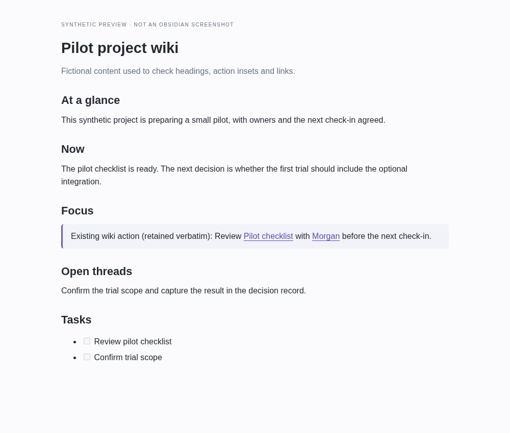

# Vault Engine for Obsidian

Vault Engine for Obsidian (`vault-obsidian`, often shortened to VEfO) is the desktop
client for [Vault Engine](../engine/README.md). It adds Engine-backed search, live
query cards, boards, persistent conversations, and an MCP-powered chat surface to
Obsidian without creating a second copy of vault state.

The plugin is a thin client: nodes, boards, conversations, settings, memory, and usage
records remain in Engine. The plugin stores only connection details, local provider
keys, and one search preference in Obsidian's `data.json`.

## What it does

| Surface | Capabilities |
| --- | --- |
| Vault Engine view | Run and edit live table, kanban, list, and calendar cards against the graph |
| Vault Chat | Stream model responses, call discovered Engine/Curator tools, inspect tool traces, choose models per conversation, and manage context chips |
| Boards | Boards hold several views (table, kanban, list, calendar, note, overview, usage), shown as tabs in an Obsidian Bases-style layout; switch between a note's boards, link boards to the active note and optionally follow it |
| Conversations | Persist messages and UI state in Engine; link, follow, archive, unarchive, attach, and delete conversations |
| Search | Open a fast Engine-backed search modal with lexical, semantic, or hybrid ranking |
| Models | Discover provider catalogs, add model notes, enable or disable catalog entries, and choose a model in chat |
| Note integration | Preview node links, bind a chat or board to the active note, and carry explicit note/board/node context into a turn |
| Provenance | Inspect retained inputs and current-source comparisons for generated project-home and subpage contributions without copying captures into plugin state |

## Before you start

You need:

- Obsidian 1.5 or newer on desktop. The plugin is desktop-only.
- A running Engine HTTP endpoint, normally `http://localhost:3334/mcp`.
- An Engine service token.
- At least one enabled model in Engine's `Settings/Models/` catalog and the
  matching provider API key if you want chat.
- An optional running [Vault Curator](../curator/README.md) endpoint and scoped token
  if you want Curator tools in chat.

## Build and install

When the [installer](../installer/README.md) sets up Engine on an Obsidian vault, it can do
the steps below for you: it builds the plugin, copies it into the vault, and writes its
connection with tokens of its own. You then only turn the plugin on in Obsidian.

By hand, run from the monorepo root:

```bash
npm install
npm run build -w vault-obsidian
```

The build first compiles every shared dependency, typechecks the plugin, then writes
the production bundle in this directory:

- `main.js`
- `styles.css`
- `manifest.json`

Copy those three files into your vault's plugin folder:

```bash
mkdir -p "/absolute/path/to/vault/.obsidian/plugins/vault-engine"
cp packages/obsidian-plugin/main.js \
   packages/obsidian-plugin/styles.css \
   packages/obsidian-plugin/manifest.json \
   "/absolute/path/to/vault/.obsidian/plugins/vault-engine/"
```

In Obsidian, enable community plugins, reload installed plugins if necessary, and
enable **Vault Engine**.

## Configure the connection

Open **Settings → Vault Engine** and set:

| Setting | Purpose |
| --- | --- |
| Engine URL | Full MCP endpoint, including `/mcp`; defaults to `http://localhost:3334/mcp` |
| Bearer token | Long-lived Engine service token |
| Curator URL | Full Curator MCP endpoint, including `/mcp` |
| Curator token | Optional scoped token; blank disables Curator tools |
| Fireworks API key | Enables Fireworks-backed catalog models |
| Anthropic API key | Enables Anthropic-backed catalog models |
| OpenRouter API key | Enables OpenRouter-backed catalog models |
| OpenAI API key | Enables OpenAI-backed catalog models. Calls use the Responses API with `store: false`, so OpenAI does not store them as response state; its standard abuse-monitoring retention still applies unless your OpenAI organization has other data controls |
| Default search mode | `hybrid`, `semantic`, or `fts` ranking for the search modal |

Mint the Engine token from the monorepo checkout that points at your Engine database:

```bash
VAULT_PATH=/absolute/path/to/your/vault \
  npx tsx packages/engine/scripts/issue-service-token.ts --name obsidian-plugin
```

Use **Test connection** in the settings tab, or run the **Ping engine
(vault-stats)** command, to confirm the endpoint and token.

Provider keys are stored in the plugin's local `data.json`. On a chat turn, the plugin
passes the selected provider request through Engine's allowlisted `/llm/stream` relay
so the Electron renderer receives a live stream; Engine does not choose the model or
persist the key. Close and reopen an existing chat leaf after changing keys.

## Commands and views

The plugin registers four ribbon actions and these command-palette entries:

| Command | Result |
| --- | --- |
| Open Vault Engine view | Opens the live query-card surface |
| Open Vault Chat view | Opens persistent MCP chat |
| Open Vault Boards view | Opens saved boards and board composition |
| Search vault | Opens the Engine-backed search modal |
| Ping engine (vault-stats) | Tests the MCP connection and reports node count |
| Chat ping (one Fireworks turn) | Runs a small end-to-end model-stream check using the resolved default model |
| Discover models | Searches a catalog provider (Fireworks, Anthropic, OpenRouter, or OpenAI) and adds a model to `Settings/Models/` |
| Manage models | Lists catalog entries and changes their enabled state |
| Open wiki panel | Opens the wiki panel on the current note: the wiki it belongs to, whether the page is up to date, how it was built, and rebuilding |
| Show pages built from current note | Opens the wiki panel on the current note with **Pages built from this note** open |
| Create project wiki | On a project note with no wiki, checks for free, then registers the wiki and runs its first build once you confirm. Also in the note's context menu |
| Create topic wiki from this note | On any note, checks for free, makes one small paid call to suggest the topic the note is about, then creates a paused topic wiki (or adds the note to a matching one) once you accept or edit it. Also in the note's context menu |
| Build dossier for this note | On a person or company note, previews for free what a dossier would read and cost, then builds (or rebuilds) it once you confirm and offers to open the page. Also in the note's context menu as **Build dossier** |

## Chat and model resolution

The model catalog and behavioral chat settings come from Engine:

- `Settings/Chat.md` supplies `defaultModel`, `titleModel`, `vizModel`, `maxSteps`,
  context budgets, and prompt text.
- `Settings/Models/*.md` supplies each model's provider, raw ID, enabled state,
  capabilities, context length, and optional pricing. **Manage models** enables or
  disables a model in its note under the settings folder Engine reports (`settingsDir`
  from `get-settings`; `Settings` for an Engine that reports none).
- The composer model picker stores a per-conversation `modelRef` in Engine's opaque
  `client_state`.

Each send resolves the selected catalog entry against provider keys available on this
plugin installation. A deleted, disabled, or unavailable selection falls back through
the stored default, registry default, and enabled local-provider candidates instead of
blocking the conversation. Model choice and prompt settings are not duplicated in
`data.json`.

The chat loop lives in [`@vault/chat-core`](../chat-core/README.md), while reusable
React presentation lives in [`@vault/chat-ui`](../chat-ui/README.md). The plugin owns
only Obsidian integration, Engine/Curator connections, persistence orchestration, and
the streaming relay adapter.

## Data ownership and transport

- MCP calls use Obsidian's CORS-free, buffered `requestUrl` and a manually managed
  Streamable HTTP session.
- Model bytes stream through Engine's allowlisted HTTP relay because `requestUrl`
  itself cannot expose a streaming response to the renderer.
- Engine stores conversations, messages, document links, opaque client state, boards,
  and cards.
- The plugin never writes Engine SQLite or vault Markdown directly.
- Read-only composer context is explicit: active-document identity, a selected board,
  and pinned nodes. The model fetches full document content through tools when needed.
- Curator tools are merged only when a Curator token is configured; Engine tools win
  on any name collision.
- The names the views, presets and prompts use come from Engine's vault map
  (`Settings/Vault.md`), read with one `get-settings` call in the background and reused
  for ten minutes; until it is read, and against an Engine older than the map, they are
  today's names. The Boards **Kanban** and **List** presets query the map's task kind
  and write its status, priority and due fields into the view; with no task kind neither
  is offered, and with no task status field Kanban isn't. The List checkbox is ticked for
  the map's done statuses and writes its tick and untick values; where those cannot work
  (no done tick value, or a value the field's enum does not take) each task shows its
  status instead. Chat's `present-viz` and
  the board composer build their examples from the map. A saved view keeps the field
  names it stored.

## The wiki panel

Run **Vault Engine: Open wiki panel** from the command palette. The right sidebar (#545; it was
called the provenance inspector, and its view type and command ids are unchanged, so saved
layouts and hotkeys keep working) follows the note you're editing, as Backlinks and Outline do.
The pin in its header keeps it on one note; unpinning moves it to the note that is active then.
Notes you open from the panel (a source's title, the wiki home) don't move it. It is built from
Obsidian's own parts and theme variables, so it takes on your theme's colours, fonts and radii.

From the top:

- **The note.** Its title (click to open it) and what it is to its wiki: a page, the wiki's home,
  the project or topic note the wiki is about, or not part of a wiki.
- **The status board.** One row for this page and one for its wiki, each with its state and its
  own **Rebuild…**. The page is *Up to date*, has *N sources changed*, was *Edited after this
  build*, or is an older build you're viewing. The wiki is *Up to date*, *Behind* (its notes
  changed since its last build), *Paused*, *Building now*, *Queued*, *Not built yet* or *Last build
  failed*. The row that needs you gets the accent button; the coins icon marks a paid action.
- **Wiki.** A **Scheduled builds** toggle (pausing is free and takes effect at once: scheduled
  builds skip a paused wiki, and it changes only when it is rebuilt on request), the last full
  build with its estimated cost, today's Curator budget, and **Open wiki home**.
- **Changed since this build**, **Sources** and **History**: see below.
- **Pages built from this note**: the reverse question, below. It reads nothing until opened; it
  is open from the start on a note that isn't a wiki page.

A note that isn't part of a wiki gets **Create project wiki…** and **Create topic wiki…** where the
command palette would offer them.

**Dossiers** (#554) get the same panel. A dossier page reads *Dossier for Jordan Ellis · Person*, and
its one **This dossier** row is *Up to date*, *Behind*, *Building now*, *Queued* or *Last build
failed*, with **Rebuild…**. *Behind* counts the memories recorded about the person since the build
that it didn't read, and the sources it read that have changed; both are listed under **Changed since
this build**. The person's or company's own note shows the kind (*Person*, *Company*, or the vault
map's name for it), *Has a dossier* with a **Dossier** row, or *No dossier yet* with **Build a
dossier** in place of the wiki card. While a first build is queued or running, or after one failed,
*No dossier yet* has a **Dossier** row in place of that card, read under the title the build gives
the page (*Jordan Ellis Dossier*); *Queued* names the build ahead of it. A build in flight is read
again every 5 seconds, and when it ends the panel reads the note again, so a new page shows without
reopening it. Closing **Build dossier for this note** makes an open panel read its status again. The
**Dossier** section has **Rebuild nightly when behind**, the
last build with its estimated cost, today's budget, and a link to the page or the note. **Sources**
names what a dossier read: the note itself, the meetings and notes read in full, the lists, its
memories and rules on what to say, and its **Past facts**.

| Element | MCP call | Notes |
|---|---|---|
| Is it a dossier? | `get-node` and `curator-status` with `project` = the note's title | A page whose `wiki_for` names one note and which has no `wiki_parent`, when Curator has no wiki registered for that note and the note is one of the vault map's entity kinds but its project kind; the note's dossier is found the same way as a wiki's home |
| Its state | `curator-status` with `project` = the page title (on a note with no page yet, *&lt;Name&gt; Dossier*), and the page's `wiki_status` | Curator writes `behind` or `current` as it checks dossiers every 30 minutes; a build in flight is read again every 5 seconds until it ends |
| New memories | `list-memories` with `subject_of` = the note, 200 a page, up to 1,000 | Those recorded after the build that it didn't read. The list comes by the day each memory became true, not when it was recorded, so it is read in full; past 1,000 the panel says *at least* and makes no claim that nothing is new |
| Rebuild nightly | `update-node` on the note's `dossier` field, dry run first | `on-change`, or removed. The note changes, so the dossier shows that note as changed until its next build, and the panel reads it all again to say so; the rebuild dialog sets it as part of the build instead |
| Rebuild… / Build dossier… | `build-dossier`, then `curator-status` | The same dialog as **Build dossier for this note**, below |

The wiki needs a Curator endpoint and token. It is found from the note's `wiki_for` (the root
note, read with `get-node`), or from the note itself, by asking Curator's `curator-status` whether
that root's title is a registered wiki with the same root. The home's `wiki_status` is read with
`get-node`, from the home itself or from the page that names the same root in `wiki_for` and has
no `wiki_parent`, as Engine finds it, so a renamed home is still found. A build the home says is
running counts even when Curator reports none, as a scheduled sweep's build is not one it reports.
The toggle calls `set-wiki-paused`, then reads both again.

On a page Curator built, the panel answers three questions about the page:

- **Is it up to date?** The page row says whether any source it was built from has changed or
  been deleted since the build, and whether Curator's part of the page was edited by hand.
  **Changed since this build** lists those sources first.
- **What changed since the previous build?** Notes newly used or dropped, and how many memories
  came and went, at the top of **Sources**.
- **What was it built from?** One row per source, grouped as notes Curator **read**, notes only
  **listed** (timeline, task list, most-active ranking), **memories** (shown as their text), your
  **corrections**, **wiki context** (this wiki's own pages) and **instructions & format**. Each row
  says how the source was used. **Show captured text** shows the retained text — for a listed note,
  just the lines that mention it.

**History** shows earlier builds; choosing one shows that build, and its row offers **Latest** to
go back. **Check again** in the header reloads the panel. **Rebuild…** on the page row appears only
when Engine reports the build eligible for an on-demand refresh.
Current source links resolve the stable Engine ID and open only
an existing local Markdown file. Historical source paths are informational.
Sources reported missing have no navigation action; their retained text remains
available. Checking again shows whether they have returned. Expected publication
changes can include merged source notes. They are not reported as external drift;
later edits still are. Subpages never receive the home-only refresh action. Legacy
pages keep an explicit unknown/uncaptured history until actually captured.

If a read discovers a network or session failure, the panel clears its data
and offers **Try again**. After reconnecting, it shows the note it was showing again.
Ordinary tool errors can be retried without replacing the connection.

Install Engine support before loading this plugin version. Older Engines show an
unsupported-version message; both `output_input_comparisons_v1` and `input_text_v1`
are required. No new setting, schema setup or model provider is needed. Retained
historical captures can be inspected even when future capture is disabled.

Inputs establish what was supplied, not which claims it supports or whether the
narrative is true. The output comparison covers the recorded managed contribution,
not the entire note. Purged/expired captures and unknown comparisons are labeled.
Already displayed text is cleared when a read discovers erasure; the sidebar does
not subscribe to live purge notifications. It stores no capture text or target
selection in settings/workspace state, and after reopening it starts on the active note.

## Create or rebuild a wiki, and find pages behind on a note

When the inspected build is the latest build of a project wiki's home or sub-page and Engine
reports it eligible, the page row offers **Rebuild…**. It opens a dialog that runs a free check and
shows what it rewrites, what it leaves alone and the configured model. **Rebuild page** authorizes
generating that one page, even on a paused wiki. Nothing else changes, so after a
sub-page rebuild the home may lag until it's next rebuilt. A sub-page rebuild works from the page's
current text, the notes its last build read and notes related to it now. The
panel's **Check again** remains a read-only inspection reload.

**Rebuild…** on the wiki row (or, when Curator can't name the wiki, on the latest build of any wiki
page) runs a full curation of that wiki, even if it is paused or nothing has changed. Its dialog
first shows a free check with the models it uses, the last build's estimated cost and today's
budget, and it starts only when you confirm. Closing the dialog doesn't stop it; the wiki row then
shows it building.

A topic wiki's pages keep no build records. On one of them the panel names the topic wiki, and
the page row says topic wikis rebuild as a whole. The rebuild dialog's check also says when the
rebuild searches the web, and a paused wiki stays paused afterwards.

A project wiki's empty home has no build records either until its first build runs, and a pause
left from before the wiki was created stops that build. The wiki row says it hasn't been built
yet, and the page row says the page has no build record.

**Create project wiki** is offered on a project note, from the command palette or the note's
context menu, when Curator keeps no wiki for that project yet. `projectType` in Engine's vault
map (`Settings/Vault.md`) names the project type, read with `get-settings`; when it is none the
command is never offered. The project wikis come from
`curator-status`. Both are read in the background and reused for five minutes (the type for ten),
so the command can show or hide at once; a wiki created elsewhere may take that long to hide it, and
the panel's check still says so. The panel runs a free `create-project-wiki` dry run and shows
what will happen: the wiki is registered (free), then its first build runs, which is paid and counts
against today's Curator budget. It names the planning, page and home models and today's budget,
and says when the budget is spent or the wiki is paused. Creating starts only when you confirm.
When an earlier pause stops the first build, the panel says so and offers **Build it now…**, which
opens the whole-wiki rebuild panel (`curate-project-wiki` with `force`): a free check, then a paid
build on confirm, and the wiki stays paused.
The Curator is given the note's path, so a note of the same name in another folder isn't taken for
it. A renamed project whose wiki is still registered under its old name is offered a free move to
the new name instead.
The first build runs behind the reply, so the panel follows it with `curator-status` for the
project: queued, building, then built (with its estimated cost) or why it wasn't. The Curator's
refusals, such as a project title a topic wiki already uses, read as plain sentences. Closing the
panel doesn't stop the build.

**Create topic wiki from this note** is offered on any Markdown note, from the command palette or
the note's context menu, when a Curator token is set. It makes a wiki about the subject a note
implies, which may not be its headline: a clipping titled "Why the Owls fired their coach" implies
"The 2026 Metro Owls". The panel finds the note's id on Engine with `get-node` by its path, then:

| Step | MCP call | Notes |
|---|---|---|
| Free check | `propose-topic-wiki` with `dry_run`, and `curator-status` | Refuses a wiki page, a topic wiki's own note and a note with too little text. Names the model and today's budget |
| Suggest | `propose-topic-wiki` | Only on **Suggest a topic (paid)**: one small paid call, which creates nothing |
| Accept or edit | none | The topic, brief, confidence and alternatives are shown. The topic and brief can be edited, and picking an alternative fills them in. The name can't be the note's own title, since the wiki gets a topic note of its own, nor a matched wiki's name |
| Create, or add | `create-or-update-wiki` | Create sends the proposal's ready arguments with the edited topic and brief: a `vault+web` wiki with the note as its source, `paused: true`. When the topic matches a topic wiki, **Add this note to …** sends `add_source_node_ids` instead, beside **Create a new wiki anyway** |
| Follow | `curator-status` with `project`, every 3 seconds | Queued, then building, then built with its estimated cost, or why not |

The note becomes a source of the topic wiki only; it isn't linked to any project wiki. The wiki
builds once and then stays paused, so it changes only when a note is added to it or it's rebuilt on
request (**Rebuild…** on the wiki row of one of its pages, or Vault Chat). Resumed, the nightly sweep
refreshes it only while scheduled wiki sweeps are on (`curator-status` shows
`wiki_reconciliation_mode` `live`).
Nothing retries a failed first build by itself. Curator queues the build and replies at once, so a
build with web research, which can take minutes, never outlasts a request. Refusals such as a
taken name, a spent budget or a failed suggestion read as plain sentences; a taken name goes back
to the form. A paid call is never repeated automatically: a create with no clear reply is settled by
reading status. Closing the panel doesn't stop the build.

**Build dossier for this note** (#715) is offered on a note of one of the vault map's entity kinds
(`entityTypes`, else its person and company kinds) that is neither a project nor a wiki page, from the
command palette or the note's context menu (**Build dossier**), when a Curator token is set. The
panel finds the note's id on Engine with `get-node` by its path, then:

| Step | MCP call | Notes |
|---|---|---|
| Free preview | `build-dossier` with `dry_run`, and `curator-status` with the page title | What it reads (memories about the note, linking notes and meetings, how many in full), the page it writes or rebuilds, the model, one or two paid calls (two when the note has rules on what may be said), the estimate and the most it could cost, today's budget, and whether the note asks for nightly rebuilds (`dossier: on-change`). Refusals are the Curator's own words |
| Build | `build-dossier` | Only on **Build dossier**, or **Rebuild dossier** when the page exists, and only when the most it could cost fits today's budget. **Rebuild it nightly when it falls behind** sends `rebuild` when it differs from the note's mode, so the Curator sets the note's field before the build reads it |
| Follow | `curator-status` with the page title, every 3 seconds | Queued, then building, then written with its estimated cost, or why not; **Open the dossier** once written |

The wiki panel opens the same dialog from a dossier or its person's or company's note, with the note's
id, so it doesn't look the note up by path. A paid build is never repeated automatically: a build with
no clear reply is settled by reading status. Closing the dialog doesn't stop the build; the panel then
reads the note and its dossier again.

These panels use tools an AI caller has too: `preview-wiki-refresh`, `refresh-wiki-page` and
`wiki-refresh-status` for one page, `curate-project-wiki` and `curator-status` with `project` for
the whole wiki, `set-wiki-paused` to pause or resume it, `create-project-wiki` for a new one,
`get-node`, `propose-topic-wiki` and `create-or-update-wiki` for a topic wiki, and `build-dossier`,
`list-memories` and `update-node` for a dossier. `scripts/wiki-rebuild-parity.test.ts` drives the rebuilds
over MCP and checks the caller holds the create tools.

Configure a Curator endpoint and token with `curate:read` and `curate:trigger`.
Both services must support rebuilding a single page. Submission saves only a request
ID, Curator endpoint and Engine vault identity in view state; closing the panel does
not cancel the server job. After a reload, or once its dialog is closed, the panel offers **Show
status**, which reads the existing request without resubmitting. Restore the original endpoints before resuming after a
connection change. Ambiguous submissions retry the same request ID.
Definitively rejected submissions clear their saved resume ID and require a fresh
preview. Dismissing or replacing the panel also replaces its cached Curator client.
If the panel closes before its request ID finishes saving, no request is sent and
that unsent ID is cleared. Cleanup cannot erase a newer panel's saved request.
The same cleanup applies when a local connection/vault check prevents the first
submission. If an earlier attempt may have reached Curator, its ID is retained even
when a later retry is blocked before sending.

Success links to the new and previous captured versions. Token usage is shown only
when known. An uncertain model outcome requires a new explicit preview/confirmation;
it never automatically triggers a second paid call.

After editing a note, open **Pages built from this note** in the wiki panel (or run **Vault
Engine: Show pages built from current note**). It answers one question about the note, by its
stable Engine node ID: is any current wiki page still built from an earlier version of it? Engine reports only
recorded uses whose source has since changed, been deleted, or can't be checked, so
an empty result reads **No wiki page is behind on this note** (with the number of
recorded uses checked), or **No recorded build has used this note** when there are
none. Each page row says when it was built and whether the curator read or only
listed the note; the exact receipt, comparison, role and coverage stay in
**Technical details**.

Choose **See what it was built from** to open that exact build in the wiki panel, with the note's
inputs highlighted, including a build outside the first history page; **Back to** returns to the
note. **Older builds that used it** separately loads builds that are no longer what's on the page
(replaced, edited or deleted), grouped by page.

Only curator builds with saved records are covered; being built from an earlier
version does not mean a page is wrong. The workflow is read-only: **Check again** repeats
bounded Engine reads but does not call a model, regenerate content, install capture
definitions, mutate notes, or trigger automatic refresh. It stores no target,
cursor, candidate, or retained text in plugin/workspace state.

## Wiki reading presentation

Reading view and rendered wiki previews (including embeds) show headings for known
Engine section markers and inset paragraphs beginning **Existing wiki action
(retained verbatim):**. This presentation uses existing `types: [wiki]` frontmatter
(the wiki kind, `wikiType`, in Engine's vault map; when it is none nothing is presented)
and renderer source context. It preserves prose, links, action text, order and stored
Markdown; it makes no Engine or model calls and does not change freshness results.
Source editing keeps the existing marker text. Headings are skipped for unknown,
malformed or empty sections, and when renderer context cannot locate them safely.



This synthetic browser preview uses the plugin processor and CSS. Actual Obsidian
callback/source-range behavior and theme compatibility still need a host check.

## Package layout

| Path | Responsibility |
| --- | --- |
| `src/main.ts` | Plugin lifecycle, views, commands, pings, and model-management entrypoints |
| `src/engine/` | MCP transport, typed clients, settings/catalog access, and active-document scope |
| `src/chat/` | Chat view, in-process AI SDK transport, context assembly, persistence, and tool wiring |
| `src/boards/` | Board view, composition, interpretation, persistence, note-following, and operations |
| `src/provenance/` | Current-note resolution and Obsidian sidebar integration for retained provenance |
| `src/wiki/` | Render-only presentation of existing wiki section markers and retained actions, and the Create project wiki, Create topic wiki from this note and Build dossier commands |
| `src/search/` | Search modes, Engine adapter, and Obsidian modal |
| `src/models/` | Model discovery, catalog management, and modals |
| `src/llm/` | Catalog-to-provider resolution and Engine streaming-relay fetch |
| `src/view/` | General Vault Engine query-card view |
| `test/` | Vitest and React Testing Library coverage mirroring the source domains |

## Development

Start the esbuild watcher:

```bash
npm run dev -w vault-obsidian
```

Build and test:

```bash
npm run build -w vault-obsidian
npm test -w vault-obsidian
```

The plugin imports shared packages but never Engine or Curator source. Changes to chat
messages, board/card specs, conversation state, or MCP envelopes may affect several
packages; run the root dependency check and relevant shared-package tests for those
changes.

Generated `main.js` is ignored by Git. Do not commit local `data.json`, vault contents,
or provider keys.

## License

MIT
